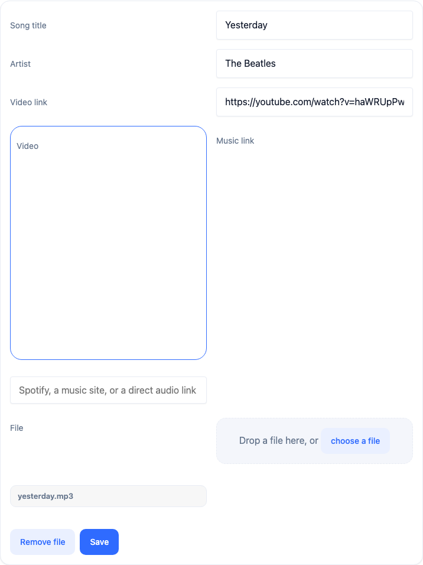
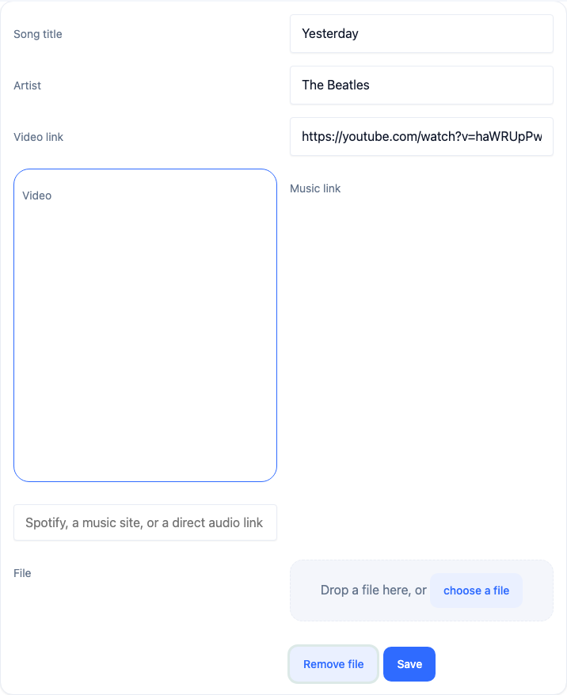
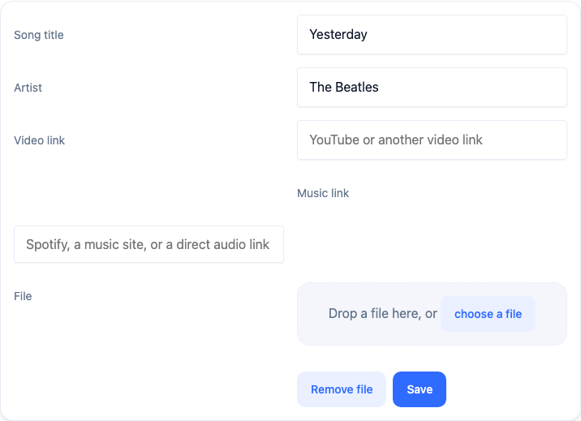

# План устранения ошибки при удалении аудиофайла песни (Bug ID: `8257c7eb194e4447722ca3f06fb4183f`)

> [!WARNING]
> **ПРЕДУПРЕЖДЕНИЕ О НЕПРИКОСНОВЕННОСТИ СТОРОННЕГО ФУНКЦИОНАЛА:**
> Запрещается модифицировать, перемещать или нарушать функционал, не относящийся к управлению файлами песни и сохранению метаданных песни в редакторе `#songUser`. Запрещено изменять другие серверные маршруты, караоке-плеер, систему уроков, экзамены, словарь, авторизацию и базу данных. Все изменения строго и изолированно ограничены обработкой удаления аудиофайла в [`client/main/main-hooks.js`](file:///Users/tsovakpalakian/PycharmProjects/english-quiz/client/main/main-hooks.js), методом открепления медиа в [`client/main/main-bridge.js`](file:///Users/tsovakpalakian/PycharmProjects/english-quiz/client/main/main-bridge.js), серверным сервисом [`src/learning-song-media.mjs`](file:///Users/tsovakpalakian/PycharmProjects/english-quiz/src/learning-song-media.mjs), маршрутизацией в [`src/learning-stage-worker.mjs`](file:///Users/tsovakpalakian/PycharmProjects/english-quiz/src/learning-stage-worker.mjs) и тестами в [`test/test-lyricadd-validation.mjs`](file:///Users/tsovakpalakian/PycharmProjects/english-quiz/test/test-lyricadd-validation.mjs).

---

### Скриншот 1: Редактор метаданных песни с кнопкой Remove file


### Скриншот 2: Состояние редактора после нажатия Remove file перед сохранением


---

## 1. Точная формулировка проблемы и анализ первопричины

- **Идентификатор инцидента**: Bug ID `8257c7eb194e4447722ca3f06fb4183f`
- **Маршрут / Экран**: `CLIENT /unsupported`, экран `song`
- **Пользователь**: `teacher_yester` (роль `ADMIN`)
- **Текст ошибки**:
  ```
  Error: Operation: Song file changes is not supported and was not saved. Cards, lessons, texts, songs, progress, personal statistics and media have dedicated save routes.
      at Object.unsupported (https://lumiscia.org/main-bridge.js?v=9f2e704af3f7a444:641:316)
      at stageSaveSongMeta (https://lumiscia.org/preview.js?v=554e712dd710d59e:34039:43)
      at saveSongMeta (https://lumiscia.org/preview.js?v=554e712dd710d59e:9959:14)
      at HTMLDivElement.<anonymous> (https://lumiscia.org/preview.js?v=554e712dd710d59e:10688:9)
  ```
- **Хронология действий пользователя**:
  1. Пользователь находился на экране песни `#song`.
  2. Нажал кнопку `lyricMeta` (`[data-lyric-meta]`), открыв панель редактирования метаданных (`#songUser [data-lyric-meta-editor]`).
  3. Нажал кнопку `Remove file` (`[data-lyric-file-clear]`), в результате чего в [`client/03f-songs.js#L1433`](file:///Users/tsovakpalakian/PycharmProjects/english-quiz/client/03f-songs.js#L1433) флаг `editFileRemoved` установился в `true`.
  4. Нажал кнопку `Save` (`[data-lyric-meta-save]`), вызвавшую функцию `saveSongMeta()`, перенаправленную через патч превью в [`client/main/main-hooks.js#L855`](file:///Users/tsovakpalakian/PycharmProjects/english-quiz/client/main/main-hooks.js#L855) (`stageSaveSongMeta`).
  5. В функции `stageSaveSongMeta` в строке [`client/main/main-hooks.js#L859`](file:///Users/tsovakpalakian/PycharmProjects/english-quiz/client/main/main-hooks.js#L859) сработала временная заглушка:
     ```javascript
     if(editFileRemoved){window.LearningMain.unsupported('Изменение файла песни');return;}
     ```
     Она выбросила исключение, показала баннер об неподдерживаемой операции и зарегистрировала клиентский сбой через метод `reportClientBug`.

---

## 2. Границы области изменений и инварианты (Scope Boundaries & Invariants)

1. **Клиентская часть**:
   - В [`client/main/main-hooks.js#L859`](file:///Users/tsovakpalakian/PycharmProjects/english-quiz/client/main/main-hooks.js#L859) заменить выброс ошибки `unsupported` на штатное удаление / открепление аудиофайла:
     - Если песня сохранена на сервере (`saved.stageId`) и содержит прикрепленный аудиофайл (`saved.fileName` или `saved.media_key`), вызывается `await window.LearningMain.detachSongAudio(saved)`.
     - Очищаются локальные поля `fileName` и `fileType` объекта песни, сбрасывается флаг `editFileRemoved = false`.
     - Если у песни изначально не было прикрепленного файла, либо был отменен только что выбранный локальный файл, сброс `editFileRemoved = false` выполняется без ошибок и без лишних сетевых запросов.
   - В [`client/main/main-bridge.js`](file:///Users/tsovakpalakian/PycharmProjects/english-quiz/client/main/main-bridge.js) добавить метод `detachSongAudio(item)`, отправляющий HTTP-запрос `DELETE /api/library/:id/media` с заголовком и телом `{ expectedRevision: item.stageRevision }`.
2. **Серверная часть**:
   - В [`src/learning-song-media.mjs`](file:///Users/tsovakpalakian/PycharmProjects/english-quiz/src/learning-song-media.mjs) добавить метод `detach(actor, id, body)` в класс `SongMediaService`:
     - Проверка прав владения песней в профиле пользователя.
     - Проверка ожидаемой ревизии (`expectedRevision`).
     - Сброс `media_key = NULL`, удаление полей `fileName` и `fileType` из `content_json`, инкремент ревизии.
   - В [`src/learning-stage-worker.mjs#L159`](file:///Users/tsovakpalakian/PycharmProjects/english-quiz/src/learning-stage-worker.mjs#L159) включить `(songUpload && method === 'DELETE')` в перечень разрешенных операций записи.
   - В [`src/learning-stage-worker.mjs#L326`](file:///Users/tsovakpalakian/PycharmProjects/english-quiz/src/learning-stage-worker.mjs#L326) добавить вызов `SongMediaService.detach`.
3. **Сохранение обратной совместимости**:
   - Сохраняются все существующие контракты API библиотеки и загрузки аудио.
   - Базовый функционал добавления и редактирования песен остается неизменным.

---

## 3. Контрольный список реализации (Checklist)

- 🟩 **Этап 1: Документирование и локализация первопричины инцидента**
  - Создание документа плана в `docs/` с анализом трассировки стека, ссылками на строки кода и скриншотами интерфейса.
- 🟩 **Этап 2: Серверный метод открепления аудиофайла песни**
  - Добавление метода `detach(actor, id, body)` в `SongMediaService` в [`src/learning-song-media.mjs`](file:///Users/tsovakpalakian/PycharmProjects/english-quiz/src/learning-song-media.mjs).
  - Подключение маршрутизатора `DELETE /api/library/:id/media` в [`src/learning-stage-worker.mjs`](file:///Users/tsovakpalakian/PycharmProjects/english-quiz/src/learning-stage-worker.mjs) и [`ops/run-learning-main.mjs`](file:///Users/tsovakpalakian/PycharmProjects/english-quiz/ops/run-learning-main.mjs).
- 🟩 **Этап 3: Клиентский интерфейс удаления файла в мосте и хуках**
  - Добавление метода `detachSongAudio(item)` в [`client/main/main-bridge.js`](file:///Users/tsovakpalakian/PycharmProjects/english-quiz/client/main/main-bridge.js).
  - Замена заглушки `unsupported` в `stageSaveSongMeta` в [`client/main/main-hooks.js`](file:///Users/tsovakpalakian/PycharmProjects/english-quiz/client/main/main-hooks.js) на вызов `detachSongAudio` и очистку `editFileRemoved`.
- 🟩 **Этап 4: Автоматические тесты (модульные, интеграционные и визуальные)**
  - Тестирование `DELETE /api/library/:id/media` на сервере в [`test/test-learning-song-media.mjs`](file:///Users/tsovakpalakian/PycharmProjects/english-quiz/test/test-learning-song-media.mjs).
  - Тестирование `stageSaveSongMeta()` при `editFileRemoved: true` для песни с файлом и без файла в [`test/test-lyricadd-validation.mjs`](file:///Users/tsovakpalakian/PycharmProjects/english-quiz/test/test-lyricadd-validation.mjs).
  - Визуальное сквозное тестирование сценария открепления аудиофайла в браузере с генерацией скриншота верификации.
- 🟩 **Этап 5: Сборка клиентских и продакшен-ассетов**
  - Запуск `npm run build:preview`.
  - Запуск `node ops/build-learning-production-assets.mjs`.
  - Валидация 25 целевых тестов без ошибок.

---

## 4. Верификация интерфейса (Visual Verification)

### Скриншот 3: Подтверждение успешного удаления файла и готовности сохранения без ошибок

