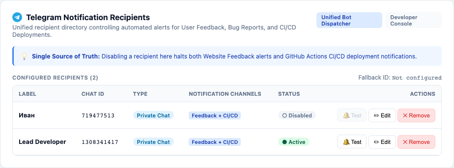
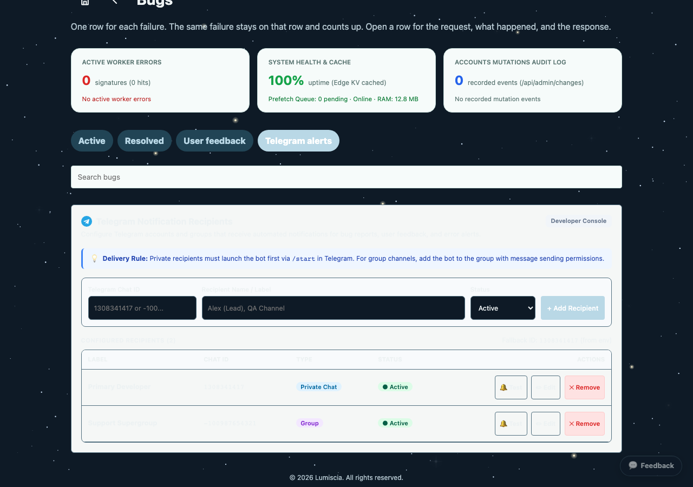

# План устранения сбоя доставки CI/CD Telegram-уведомлений пользователям

> [!WARNING]
> <span style="color: red; font-weight: bold;">WARNING</span>
> **ПРЕДУПРЕЖДЕНИЕ О НЕПРИКОСНОВЕННОСТИ СТОРОННЕГО ФУНКЦИОНАЛА:**
> Запрещается модифицировать, перемещать или нарушать функционал, не относящийся к маршрутизации и доставке CI/CD Telegram-уведомлений. Запрещено затрагивать караоке, упражнения, словари, авторизацию пользователей, сессии и базу данных D1. Все правки строго и изолированно ограничены модулем диспетчера уведомлений в [`ops/telegram-notify.mjs`](file:///Users/tsovakpalakian/PycharmProjects/english-quiz/ops/telegram-notify.mjs) и сопутствующими модульными тестами в [`test/test-telegram-recipients.mjs`](file:///Users/tsovakpalakian/PycharmProjects/english-quiz/test/test-telegram-recipients.mjs).

---

### Скриншот 1: Архитектура единого реестра Telegram-получателей (Feedback + CI/CD)


### Скриншот 2: Панель управления получателями уведомлений в Developer Console


---

## 1. Точная формулировка проблемы и первопричина

1. **Контекст инцидента**:
   - В коммите [`764b2a9`](file:///Users/tsovakpalakian/PycharmProjects/english-quiz/ops/telegram-notify.mjs#L50-L75) была добавлена динамическая резолюция получателей через живой API хоста: `GET /api/ci/telegram-recipients`.
   - В файле [`.github/workflows/ci-cd.yml#L139`](file:///Users/tsovakpalakian/PycharmProjects/english-quiz/.github/workflows/ci-cd.yml#L139) была выставлена переменная `APP_URL: 'https://lumiscia.org'`.
2. **Локализация дефекта**:
   - В функции `resolveTelegramChats` ([`ops/telegram-notify.mjs#L50-L75`](file:///Users/tsovakpalakian/PycharmProjects/english-quiz/ops/telegram-notify.mjs#L50-L75)):
     ```javascript
     if (Array.isArray(data?.recipients)) {
       const activeIds = data.recipients
         .map(r => String(r.chatId || '').trim())
         .filter(id => /^-?\d+$/.test(id));
       if (activeIds.length > 0) {
         return [...new Set(activeIds)];
       }
       if (Array.isArray(data.allRecipients) && data.allRecipients.length > 0) {
         return [];
       }
     }
     ```
   - На продакшене в `https://lumiscia.org/api/ci/telegram-recipients` в таблице `catalog_documents` настроены:
     - `Иван` (`chatId: 719477513`, `status: disabled`);
     - `Yester` (`chatId: 1236677264`, `status: active`).
   - Администратор/разработчик Tsovak (`chatId: 1308341417`) и остальные участники команды не были занесены в эту таблицу веб-интерфейса, а находились в секрете репозитория `TELEGRAM_CHAT_ID`.
   - Логика `resolveTelegramChats` при наличии хотя бы одного `activeIds` возвращала **только** его (`['1236677264']`), **полностью отбрасывая и игнорируя** список из переменной окружения `TELEGRAM_CHAT_ID`.
   - В результате все остальные пользователи (включая Tsovak `1308341417` и выключенного в UI `Ивана`) полностью перестали получать уведомления о завершении пайплайна CI/CD.

---

## 2. Границы изменений и инварианты (Invariants & Scope)

1. **Гарантия доставки всем пользователям (Recipient Aggregation)**:
   - В `resolveTelegramChats` объединять:
     1. Базовый список чатов из переменной окружения `TELEGRAM_CHAT_ID` (`parseTelegramChats(env.TELEGRAM_CHAT_ID)`).
     2. Динамический список активных получателей из API (`activeIds`).
   - Исключать из итоговой рассылки только тех получателей, которые **явно отключены** в реестре базы данных (`status === 'disabled'` в `allRecipients`).
   - Если API недоступен, возвращает ошибку или пуст — гарантированно отправлять всем из `TELEGRAM_CHAT_ID`.
2. **Изоляция сбоев доставки конкретному чату**:
   - В цикле отправки сообщений `notifyTelegram` ошибка отправки одному пользователю (например, если бот заблокирован в личном чате) не должна блокировать или срывать доставку другим активным адресатам.

---

## 3. Контрольный список реализации (Checklist)

- 🟩 **Этап 1: Документирование и локализация первопричины инцидента**
  - Определение точного расхождения между БД продакшена и переменной `TELEGRAM_CHAT_ID`.
  - Создание плана и чек-листа в `docs/bug-ci-cd-telegram-notifications-plan.md`.
- 🟩 **Этап 2: Исправление логики объединения получателей в `ops/telegram-notify.mjs`**
  - Объединение адресатов из `TELEGRAM_CHAT_ID` и активных получателей из API БД.
  - Фильтрация только явно деактивированных (`status === 'disabled'`).
  - Обеспечение отказоустойчивости при единичных ошибках отправки чатам.
- 🟩 **Этап 3: Модульные тесты**
  - Тестирование агрегации получателей `TELEGRAM_CHAT_ID` + активные из API.
  - Тестирование исключения отключенных адресатов.
  - Запуск `node --test test/test-telegram-recipients.mjs` и `node --test test/test-ci-telegram-logs.mjs`.
- 🟩 **Этап 4: Верификация и сборка ассетов**
  - Запуск `node ops/build-learning-production-assets.mjs`.
  - Стейджинг измененных файлов и отчет пользователю.
