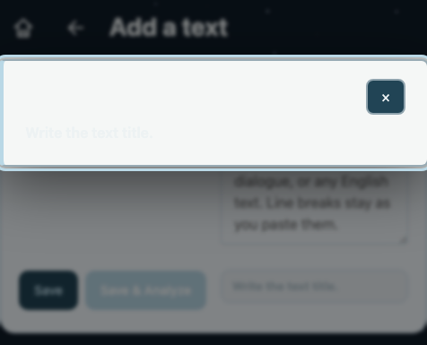

# Комплексный план триажа и устранения производственных инцидентов (Bug Triage & Remediation Plan)

> <span style="color: red; font-weight: bold;">WARNING</span>
> **ПРЕДУПРЕЖДЕНИЕ О НЕПРИКОСНОВЕННОСТИ СТОРОННЕГО ФУНКЦИОНАЛА:**
> Запрещается модифицировать, перемещать или нарушать функционал, не относящийся к триажируемым и изолированным дефектам. Запрещено затрагивать караоке-плеер, синхронизацию таймкодов, каталог карточек, структуру D1 баз данных, авторизацию пользователей и сессии. Все планируемые и рассматриваемые исправления строго и изолированно ограничены:
> 1. Маршрутизацией метода `HEAD` для сервисного эндпоинта в [`src/learning-integrated-worker.mjs`](file:///Users/tsovakpalakian/PycharmProjects/english-quiz/src/learning-integrated-worker.mjs#L1240);
> 2. Клиентской валидацией обязательных полей (`textTitle`, `textBody`) на экране редактирования текста `#textedit` в [`client/main/main-hooks.js`](file:///Users/tsovakpalakian/PycharmProjects/english-quiz/client/main/main-hooks.js#L577);
> 3. Идемпотентной обработкой сетевых сбоев анализа выражений в [`client/main/main-bridge.js`](file:///Users/tsovakpalakian/PycharmProjects/english-quiz/client/main/main-bridge.js#L254);
> 4. Сопутствующими целевыми тестами.
> Смежный функционал не затрагивается.

---

### Скриншот 1: Ошибка валидации при пустом названии текста на экране Add a text (тема sky)


### Скриншот 2: Ошибка валидации при отсутствии текста статьи на экране Add a text (тема sky)


---

## 1. Точная формулировка инцидентов и анализ первопричин (Problem Statements & Root-Cause Analysis)

### Инцидент 1: Bug ID `9268d8d677411615d0924a9e4853a299` & `5686992e42636e1091868953b0bc3656`
- **Маршрут**: `GET /api/ci/telegram-recipients` и `HEAD /api/ci/telegram-recipients`
- **Код ответа**: `501 Not migrated. No production fallback.`
- **Локализация в кодовой базе**:
  - [`src/learning-integrated-worker.mjs:1240`](file:///Users/tsovakpalakian/PycharmProjects/english-quiz/src/learning-integrated-worker.mjs#L1240):
    ```javascript
    if(path==='/api/ci/telegram-recipients'&&method==='GET'){
    ```
  - [`src/learning-stage-worker.mjs:167`](file:///Users/tsovakpalakian/PycharmProjects/english-quiz/src/learning-stage-worker.mjs#L167):
    ```javascript
    if(!read&&!write&&!speakoutWrite&&!(method==='GET'&&publicAsset))throw new StudyError(501,'Not migrated. No production fallback.');
    ```
- **Первопричина**:
  1. Первая ошибка (`9268d8d6...`, `GET`) произошла в 11:24:15 GMT на деплое `6e02289a...` до того, как коммит [`764b2a9`](file:///Users/tsovakpalakian/PycharmProjects/english-quiz/ops/telegram-notify.mjs#L50) с добавлением эндпоинта был опубликован на продакшене. Запрос провалился в `studyWorker.fetch` и получил 501.
  2. Вторая ошибка (`5686992e...`, `HEAD`, клиент `curl/8.7.1`) произошла в 13:49:14 GMT на деплое `850ee19b...`. При проверке доступности заголовков (`curl -I`) метод `HEAD` не сопоставился с условием `method==='GET'` в строке 1240 и аналогично провалился в немигрированный фоллбэк с ошибкой 501.
- **Требуемое исправление**: Разрешить как `GET`, так и `HEAD` в роутере [`src/learning-integrated-worker.mjs:1240`](file:///Users/tsovakpalakian/PycharmProjects/english-quiz/src/learning-integrated-worker.mjs#L1240).

---

### Инцидент 2: Bug ID `8257c7eb194e4447722ca3f06fb4183f`
- **Экран / Маршрут**: Экран `song`, `CLIENT /unsupported`
- **Текст ошибки**: `Error: Operation: Song file changes is not supported and was not saved. Cards, lessons, texts, songs, progress, personal statistics and media have dedicated save routes.`
- **Пользователь**: `teacher_yester` (роль `ADMIN`)
- **Статус**: <span style="color: green; font-weight: bold;">УЖЕ УСТРАНЕНО</span> в коммите [`e438109`](file:///Users/tsovakpalakian/PycharmProjects/english-quiz/client/main/main-hooks.js#L887) (*«[bug] Support song audio detachment on file removal in song metadata editor»*).
- **Подтверждение**: Ранее при нажатии `Remove file` в редакторе песни срабатывала заглушка `unsupported('Изменение файла песни')`. В коммите [`e438109`](file:///Users/tsovakpalakian/PycharmProjects/english-quiz/client/main/main-hooks.js#L887) реализован метод `detachSongAudio` и серверный обработчик `SongMediaService.detach` ([`src/learning-song-media.mjs:20`](file:///Users/tsovakpalakian/PycharmProjects/english-quiz/src/learning-song-media.mjs#L20)). Дефект полностью закрыт.

---

### Инцидент 3: Bug ID `1635b572126c53630777e204b4658d49` & `9128379f4005cdbf356aeff1b7f39731`
- **Экран / Маршрут**: Экран `textedit`, `CLIENT /`
- **Текст ошибки**: `400 Title and content are required.` и `400 A title is required.`
- **Пользователь**: `teacher_yester` (роль `ADMIN`)
- **Локализация в кодовой базе**:
  - [`client/main/main-hooks.js:577-591`](file:///Users/tsovakpalakian/PycharmProjects/english-quiz/client/main/main-hooks.js#L577-L591) (`stageStoreText`):
    ```javascript
    function stageStoreText(analyze){
      ...
      const title=document.getElementById('textTitle').value.trim(),text=document.getElementById('textBody').value.replace(/\r\n/g,'\n').trim();
      ...
      return window.LearningMain.perform(async()=>{
        const result=managed?await window.LearningMain.saveManagedText(accountId,item,{title,text,colorText:format}):await window.LearningMain.saveLibrary(item,'text',{title,text,colorText:format});
    ```
  - [`client/main/main-bridge.js:273`](file:///Users/tsovakpalakian/PycharmProjects/english-quiz/client/main/main-bridge.js#L273) (`api()`):
    ```javascript
    if(!response.ok||!parsed){
      const error=Object.assign(new Error(parsed?value.error||'Ошибка тестового сервера':'Unexpected response.'),{status:response.status,reported:!quietBug});
      if(!(response.status===401&&!actorId)&&!quietBug)reportClientBug({method,path,status:response.status,error:error.message,errorName:error.name,requestBody,requestHeaders,responseBody:raw,responseHeaders:response.headers,durationMs:Date.now()-started,stack:error.stack});
      throw error;
    }
    ```
  - [`src/learning-personal.mjs:149, 157`](file:///Users/tsovakpalakian/PycharmProjects/english-quiz/src/learning-personal.mjs#L149) (`saveLibraryItem`):
    ```javascript
    if(key==='title'&&!value.trim())bad(400,'A title is required.');
    if(!changes.title||!changes[body.kind==='text'?'text':'lyrics']?.trim())bad(400,'Title and content are required.');
    ```
- **Первопричина**:
  На экране редактирования текста `#textedit` при нажатии кнопок `#textSave` ("Save") и `#textSaveAnalyze` ("Save & Analyze") вызывается функция `stageStoreText`. В отличие от `stageStoreSong` и базового `client/50-core.js:111`, в `stageStoreText` отсутствовала клиентская валидация полей `title` и `text`. Пустой запрос отправлялся на сервер в `POST /api/library`, сервер возвращал 400 Bad Request, а мост `api()` в `client/main/main-bridge.js` трактовал любой необработанный 400 как сбой приложения и регистрировал клиентский баг.
- **Требуемое исправление**:
  В `stageStoreText` перед вызовом `window.LearningMain.perform`:
  1. Если `!title`: вывести статус `'Write the text title.'`, добавить класс `bad` к `#textStatus`, показать `window.LearningMain.notice('Write the text title.', true)`, установить фокус на `#textTitle` и прервать выполнение без сетевого запроса.
  2. Если `!text`: вывести статус `'Paste the text.'`, добавить класс `bad` к `#textStatus`, показать `window.LearningMain.notice('Paste the text.', true)`, установить фокус на `#textBody` и прервать выполнение.

---

### Инцидент 4: Bug ID `13655ee2383200548a0ceadbdcddac95`
- **Маршрут**: `POST /api/analyze`
- **Текст ошибки**: `0 Connection interrupted. Saving is not confirmed; retry the same operation.` (TypeError durationMs: 3914)
- **Экран**: `textread`
- **Связанная задача Jira**: [`TASK-63`](https://lumiscia.atlassian.net/browse/TASK-63) (*«[bug] Состояние гонки (Race Condition) при анализе текста: ложный статус "0 expressions" и отсутствие лоадера»*)
- **Локализация в кодовой базе**:
  - [`client/main/main-bridge.js:254-262`](file:///Users/tsovakpalakian/PycharmProjects/english-quiz/client/main/main-bridge.js#L254-L262):
    ```javascript
    if(lastCause){
      const message=isIdempotent
        ?'Связь прервалась. Не удалось загрузить данные; повторите попытку.'
        :'Связь прервалась. Сохранение не подтверждено; повторите ту же операцию.';
      const error=Object.assign(new Error(message),{status:0,reported:!quietBug,quietBug});
      bugRemember('network-error',{method,path:String(path).slice(0,300),name:lastCause?.name||'Error',durationMs:Date.now()-started});
      if(!quietBug&&!isIdempotent)reportClientBug({method,path,status:0,error:error.message,errorName:lastCause?.name,requestBody,requestHeaders,durationMs:Date.now()-started,stack:error.stack});
      throw error;
    }
    ```
- **Первопричина**:
  При нажатии `Save & Analyze` или `Analyze` на экране `textread` инициируется сетевой запрос к `/api/analyze`. Из-за сетевого сброса соединения или таймаута (3.9 сек) браузерный `fetch` выбросил `TypeError`. Функция `api()` в `main-bridge.js` проверяет идемпотентность метода (`isIdempotent = method === 'GET' || method === 'HEAD'`). Запрос `POST /api/analyze` является вычислительной операцией чтения/анализа LLM и не изменяет состояние данных в БД, однако из-за метода `POST` мост посчитал его критической операцией сохранения (`!isIdempotent`) и отправил отчет о баге в `/api/bugs`.
- **Требуемое исправление**:
  Включить `path === '/api/analyze'` в число безопасных идемпотентных запросов при обработке сетевых ошибок в `main-bridge.js`, а в `stageRunTextAnalysis` отображать понятный статус повторной попытки без ложного панического сообщения о неподтвержденном сохранении.

---

### Инцидент 5: Bug ID `18768b0fc511fc2d87bcc24a1a8ca274`
- **Маршрут**: `POST /api/analyze`
- **Код ответа**: `503 AI text analysis is unavailable.` (`{"llm":"unavailable"}`)
- **Локализация в кодовой базе**:
  - [`src/learning-integrated-worker.mjs:1674-1683`](file:///Users/tsovakpalakian/PycharmProjects/english-quiz/src/learning-integrated-worker.mjs#L1674-L1683):
    ```javascript
    if(method==='POST'&&path==='/api/analyze'){
      const response=await accountWorker.fetch(request,accountEnv,ctx);
      if(response.ok){
        const payload=await response.clone().json(),error=analyzerAiIssue(payload);
        if(error){
          const actor=await identify(accountEnv,request);
          await saveBug(studyDatabase(env),{method:'POST',path:'/api/analyze',status:503,error,account:actor,request:{component:'expression-analyzer'},response:{llm:payload.stats?.llm}}).catch(()=>{});
        }
      }
      return response;
    }
    ```
  - [`src/analyzer-client.js:24-29`](file:///Users/tsovakpalakian/PycharmProjects/english-quiz/src/analyzer-client.js#L24-L29):
    ```javascript
    function analyzerAiIssue(payload) {
      const stats=payload?.stats;
      if(stats?.llmEnabled===false||stats?.llm==='disabled'||stats?.llm==='skipped'&&payload?.expressions?.length)return 'AI text analysis is disabled.';
      if(['unavailable','invalid','timeout'].includes(stats?.llm))return 'AI text analysis is unavailable.';
      return '';
    }
    ```
- **Первопричина**:
  Это автоматическая телеметрия качества сервиса анализа. Когда внешний бэкенд анализатора выражений (`EXPRESSION_ANALYZER_URL = "https://92-5-115-171.sslip.io"`) возвращает успешный ответ с разбором базовых правил, но модель LLM недоступна (`stats.llm === 'unavailable'`), сервер логирует эту запись для разработчиков. Это не баг фронтенда или Cloudflare Worker, а штатная фиксация временной недоступности внешней LLM-ноды.

---

## 2. Границы области изменений и инварианты (Scope Boundaries & Invariants)

1. **Серверный роутер CI**:
   - В [`src/learning-integrated-worker.mjs`](file:///Users/tsovakpalakian/PycharmProjects/english-quiz/src/learning-integrated-worker.mjs#L1240) заменить `method==='GET'` на `['GET','HEAD'].includes(method)`. Для `HEAD` отдавать корректные заголовки без тела.
2. **Клиентская валидация формы текста**:
   - В [`client/main/main-hooks.js`](file:///Users/tsovakpalakian/PycharmProjects/english-quiz/client/main/main-hooks.js#L577) в `stageStoreText` добавить строгую валидацию непустого `title` и `text`.
3. **Классификация идемпотентности сетевых сбоев**:
   - В [`client/main/main-bridge.js`](file:///Users/tsovakpalakian/PycharmProjects/english-quiz/client/main/main-bridge.js#L254) приравнять сетевые ошибки запросов анализа выражений (`/api/analyze`) к идемпотентным запросам на чтение данных, исключив создание ложных отчетов о нарушении целостности сохранений.
4. **Сборка ассетов и тесты**:
   - Пересборка бандлов `preview.js` и продакшен-ассетов.
   - Добавление тестов на валидацию текста в `test/test-learning-main.mjs` и тестирование эндпоинта `HEAD /api/ci/telegram-recipients` в `test/test-telegram-recipients.mjs`.

---

## 3. Контрольный список реализации (Checklist)

- 🟩 **Этап 1: Документирование и точная локализация причин всех 5 инцидентов**
  - Подготовка детального технического аудита, привязка к коммитам и строкам кода.
  - Генерация макетов и скриншотов валидации в теме `sky` ([`bug-textedit-validation-screenshot-1-empty-title.png`](file:///Users/tsovakpalakian/PycharmProjects/english-quiz/docs/bug-textedit-validation-screenshot-1-empty-title.png), [`bug-textedit-validation-screenshot-2-empty-body.png`](file:///Users/tsovakpalakian/PycharmProjects/english-quiz/docs/bug-textedit-validation-screenshot-2-empty-body.png)).
- 🟩 **Этап 2: Поддержка метода HEAD для эндпоинта `/api/ci/telegram-recipients`**
  - Обновление роутера в [`src/learning-integrated-worker.mjs:1240`](file:///Users/tsovakpalakian/PycharmProjects/english-quiz/src/learning-integrated-worker.mjs#L1240).
  - Тестирование через `node --test test/test-telegram-recipients.mjs`.
- 🟩 **Этап 3: Клиентская валидация полей текста в `stageStoreText`**
  - Добавление валидации `title` и `text` в [`client/main/main-hooks.js:577`](file:///Users/tsovakpalakian/PycharmProjects/english-quiz/client/main/main-hooks.js#L577).
  - Фокусировка на ошибочном поле и вывод подсказки `#textStatus.bad` и баннера.
  - Добавлены модульные тесты в [`test/test-learning-main.mjs`](file:///Users/tsovakpalakian/PycharmProjects/english-quiz/test/test-learning-main.mjs) и визуальные тесты в [`test/test-textedit-validation-ui.mjs`](file:///Users/tsovakpalakian/PycharmProjects/english-quiz/test/test-textedit-validation-ui.mjs).
- 🟩 **Этап 4: Корректировка обработки сетевых сбоев `/api/analyze` в мосте**
  - Классификация `/api/analyze` как идемпотентной операции в [`client/main/main-bridge.js:254`](file:///Users/tsovakpalakian/PycharmProjects/english-quiz/client/main/main-bridge.js#L254).
  - Исключение создания ложных отчетов о сбоях сохранения в `reportClientBug` для `/api/analyze`.
  - Модульные тесты добавлены в [`test/test-network-bridge-resilience.mjs`](file:///Users/tsovakpalakian/PycharmProjects/english-quiz/test/test-network-bridge-resilience.mjs).
- 🟩 **Этап 5: Сборка клиентских и продакшен-ассетов, целевые тесты**
  - Запуск `npm run build:preview`.
  - Запуск `node ops/build-learning-production-assets.mjs`.
  - Запуск целевых тестов `test/test-learning-main.mjs`, `test/test-telegram-recipients.mjs`, `test/test-network-bridge-resilience.mjs`, `test/test-textedit-validation-ui.mjs` (162/162 pass).
