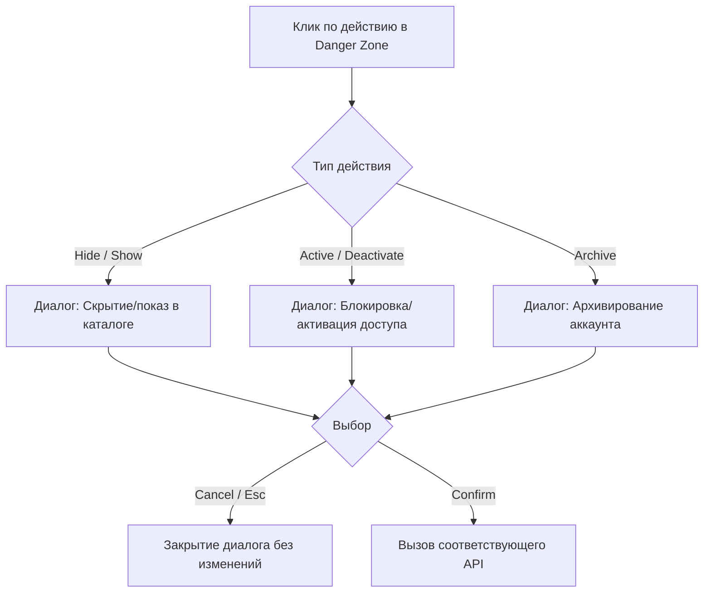

# Спецификация: Модальные окна подтверждения для Danger Zone (Account Status & Lifecycle)

## 1. Обзор функционала
Для предотвращения случайных кликов по критическим действиям управления статусом аккаунта студента (`Hide account`, `Deactivate access`, `Archive account`) внедряются интерактивные модальные диалоги подтверждения на базе стандарта HTML5 `<dialog>`.

---

## 2. Спецификация модального диалога (`danger-confirm-dialog`)

- **Разметка**: `<dialog class="danger-confirm-dialog" aria-labelledby="dangerConfirmTitle">`
- **Структура**:
  - `danger-confirm-icon`: круглая пиктограмма с цветовой дифференциацией (янтарная для предупреждений, красная для деструктивных действий);
  - `danger-confirm-text`:
    - `h3#dangerConfirmTitle`: четкий вопрос-заголовок;
    - `p#dangerConfirmDesc`: пояснение последствий для аккаунта студента;
  - `danger-confirm-footer`:
    - Кнопка отмены `Cancel` (`[data-danger-cancel]`);
    - Кнопка подтверждения с контекстным текстом действия (`[data-danger-confirm]`).
- **Стилизация**:
  - `border-radius: 16px`;
  - Мягкая тень `box-shadow: 0 20px 25px -5px rgba(0,0,0,0.2)`;
  - Полупрозрачный `::backdrop` с размытием `backdrop-filter: blur(4px)`.

---

## 3. Обработка действий

1. **`hide-user`**:
   - Заголовок: `Hide account from public directory?` / `Show account in public directory?`
   - Описание: последствия скрытия или восстановления видимости.
   - Подтверждение: вызов `/api/admin/users/:id/hidden`.
2. **`active-user`**:
   - Заголовок: `Deactivate student access?` / `Activate student access?`
   - Описание: мгновенное ограничение авторизации студента без потери данных.
   - Подтверждение: вызов `/api/admin/users/:id/active`.
3. **`archive-user`**:
   - Заголовок: `Archive student account?`
   - Описание: перемещение аккаунта в архив и отзыв доступа к урокам.
   - Подтверждение: вызов `/api/archive`.
   - Совместимость: сохранение резервного вызова `confirm()` в среде unit-тестирования `test-deleted-account-ui.mjs`.

---

## 4. Чеклист реализации

- 🟩 1. Разработка Markdown-спецификации (`docs/danger-zone-confirm-modal-spec.md`)
- 🟩 2. Реализация функции `showDangerConfirm` и обработчиков в `client/40-account.js`
- 🟩 3. Добавление стилей диалога `.danger-confirm-dialog` в `site/preview.css`
- 🟩 4. Пересборка продакшен-бандлов (`npm run build:preview && node ops/build-learning-production-assets.mjs`)
- 🟩 5. Прогон целевых тестов (`test-deleted-account-ui.mjs`, `test-role-navigation-ui.mjs`, `test-chat-ui.mjs`)
- 🟩 6. Полный прогон `npm run check` (171 скрипт)
