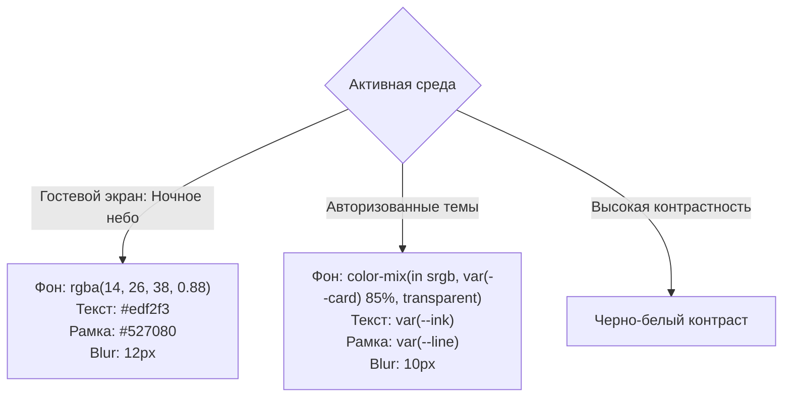

# Спецификация: Адаптация кнопки и модального окна фидбека под темы и фон

## 1. Проблема и цели
- **Проблема**: На гостевом экране ночного неба (`body:is(.guest-home,.guest-auth)`) плавающая кнопка фидбека `#feedbackFloatingTrigger` отображалась со светлым фоном `var(--card)` (`#f5f7f6`) и светлым текстом `var(--ink)` (`#edf2f3`), что приводило к коэффициенту контрастности 1.04:1 (надпись «Feedback» была невидима) и выбивалась из темно-синей звездной палитры.
- **Цели**:
  1. Обеспечить корреляцию цвета кнопки с фоном и текущей темой.
  2. Для экрана ночного неба оформить кнопку и диалог фидбека в полупрозрачном космическом стиле (`rgba(14, 26, 38, 0.88)`, светлый текст `#edf2f3`, рамка `#527080`, `backdrop-filter: blur(12px)`).
  3. Для всех авторизованных тем (Light, Dark, Mint, Almond, Ocean и др.) гарантировать корректное наследование `var(--card)`, `var(--ink)`, `var(--line)` и `var(--acc)`.

---

## 2. Архитектура стилей

---

## 3. Чеклист реализации

- 🟩 1. Разработка Markdown-спецификации (`docs/feedback-theme-correlation-spec.md`)
- 🟩 2. Обновление стилей `.feedback-floating-btn` и `.feedback-dialog` в `site/preview.css`
- 🟩 3. Пересборка продакшен-бандлов (`npm run build:preview && node ops/build-learning-production-assets.mjs`)
- 🟩 4. Проверка и захват скриншотов на темном ночном небе и в светлой теме
- 🟩 5. Прогон целевого теста `test-feedback-ui.mjs`
- 🟩 6. Полный прогон `npm run check` (171 скрипт)
