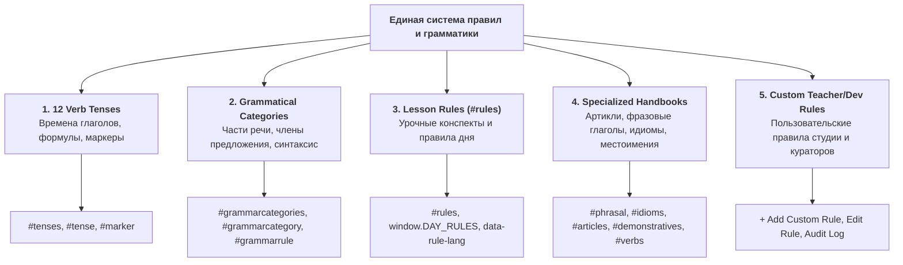

# Спецификация системы грамматических правил (5 категорий) и универсального журнала аудита правок (Audit History & Visual Diff)

> [!IMPORTANT]
> Данный документ является официальным архитектурным стандартом для подсистемы грамматики и контроля версий контента SaaS-платформы.
> В соответствии с фундаментальными требованиями проекта:
> 1. Вся грамматическая база делится на **5 исчерпывающих категорий** (а не только 12 глагольных времен).
> 2. Преподаватели (`TEACHER`) и разработчики (`DEVELOPER`) обладают возможностью создания и редактирования правил.
> 3. Реализуется **универсальная история правок (Universal Audit Log)** с визуальным диффом («кто, когда, с чего на что изменил») для **всех сущностей системы, кроме приватного чата**.

---

## 1. Исчерпывающая классификация грамматических правил (5 категорий)



---

### Категория 1: 12 времен глагола (Verb Tenses Matrix)
* **Назначение**: Полная матрица видо-временных форм английского языка ($4 \times 3$).
* **Экраны**: `#tenses` (интерактивная сетка $4 \times 3$), `#tense` (детальный разбор выбранного времени), `#marker` (каталог маркеров времени).
* **Сетка времен**:
  1. *Present Simple*, *Present Continuous*, *Present Perfect*, *Present Perfect Continuous*.
  2. *Past Simple*, *Past Continuous*, *Past Perfect*, *Past Perfect Continuous*.
  3. *Future Simple*, *Future Continuous*, *Future Perfect*, *Future Perfect Continuous*.
* **Состав карточки времени**:
  - Название и краткое резюме сути времени (EN / RU).
  - Формулы образования: Утвердительная (`+`), Отрицательная (`-`), Вопросительная (`?`) с вспомогательными глаголами (`do/does`, `did`, `have/has`, `had`, `will`, `be`).
  - Временная шкала (Timeline Graphic): наглядная визуализация момента действия (точка, отрезок, предшествование, процесс).
  - Временные маркеры (Time Markers): интерактивные бейджи (`already`, `yet`, `since`, `for`, `yesterday`, `by 5 PM`, `while`, `usually`).
  - Примеры использования: предложения с подсветкой сказуемого и кнопкой озвучки произношения.

---

### Категория 2: Грамматические категории и части речи (Grammatical Categories)
* **Назначение**: Фундаментальный грамматический справочник, охватывающий структуру английского предложения от морфемы до сложного предложения.
* **Экраны**: `#grammarcategories` (каталог 4 разделов), `#grammarcategory` (список правил категории), `#grammarrule` (интерактивный ридер правила с разбором).
* **4 фундаментальных раздела**:
  1. **Parts of Speech (Части речи)**:
     - Nouns (исчисляемые/неисчисляемые, собирательные, притяжательный падеж).
     - Pronouns (Personal, Possessive, Reflexive, Relative, Indefinite).
     - Verbs (Stative vs Dynamic, Regular/Irregular, Modals).
     - Adjectives (Degrees of comparison: positive, comparative, superlative; порядок прилагательных).
     - Adverbs (Adverbs of frequency, manner, degree, place, time).
     - Prepositions (Prepositions of time, place, direction, movement).
     - Conjunctions (Coordinating: FANBOYS, Subordinating, Correlative).
     - Interjections.
  2. **Sentence Constituents (Члены предложения и синтаксис)**:
     - Subject (Простое, сложное, формальное `It/There`).
     - Predicate (Простое глагольное, составное именное, составное глагольное).
     - Direct & Indirect Objects.
     - Subject & Object Complements.
     - Adverbials (Обстоятельства времени, места, образа действия).
     - Word Order (Прямой порядок слов: SVOMPT, инверсия).
  3. **Morphology (Словообразование и морфология)**:
     - Suffixes (Noun suffixes: -ment, -tion, -ness; Adjective: -ful, -less, -able; Adverb: -ly).
     - Prefixes (Negative: un-, in-, dis-, mis-; Directional: pre-, post-, re-, over-).
     - Plural noun formation & irregular plurals.
     - Compound words (open, hyphenated, closed).
  4. **Higher Units (Сложные синтаксические конструкции)**:
     - Phrases (Noun phrase, Verb phrase, Prepositional phrase, Gerund phrase, Participial phrase).
     - Clauses (Independent clause, Dependent clause, Relative clauses: defining vs non-defining, Adverbial clauses).
     - Conditional sentences (Zero, First, Second, Third, Mixed Conditionals).
     - Passive Voice (Все времена, Causative have/get something done).
     - Reported Speech (Сдвиг времен, изменение местоимений и указателей времени).

---

### Категория 3: Урочные правила конспектов (Lesson & Daily Rules)
* **Назначение**: Контекстные правила, привязанные к конкретным дням обучения (`days`) и темам занятий.
* **Экраны**: `#rules` (реестр правил дня), инспекторы конспекта `#material` и `#lesson`.
* **Особенности реализации**:
  - Данные хранятся в `window.DAY_RULES` и загружаются динамически по `dayId` / `lessonId`.
  - **Двуязычный переключатель (Bilingual Switcher)**: `[data-rule-lang="en"]` / `[data-rule-lang="ru"]` — мгновенное переключение языка пояснений без перезагрузки экрана.
  - Прямая связка с лексикой: каждое правило содержит ссылки на практические карточки `#flip` и задания в `#daywork`.

---

### Категория 4: Специализированные справочники (Specialized Handbooks)
* **Назначение**: Узкоспециализированные экспресс-справочники с быстрым интерактивным поиском и фильтрацией:
  1. `#articles` (Артикли): Определенный (`the`), Неопределенный (`a` / `an`), Нулевой артикль. Правила для географических названий, уникальных объектов, абстрактных понятий, устойчивых выражений.
  2. `#phrasal` (Фразовые глаголы): 300+ фразовых глаголов с разделением на Separable / Inseparable, глаголы с 2 частицами (`look forward to`, `put up with`).
  3. `#idioms` (Идиомы и устойчивые выражения): Образный смысл, эквивалент на русском языке, происхождение, пример диалога.
  4. `#demonstratives` (Указательные местоимения): Матрица `this` / `that` / `these` / `those` в пространственном и временном контексте.
  5. `#verbs` (Неправильные глаголы): Таблица трех форм (Base form, Past Simple, Past Participle) с поиском по окончанию, шаблону чередования гласных и встроенным аудио.

---

### Категория 5: Пользовательские правила преподавателей и разработчиков (Custom Rules Studio)
* **Назначение**: Возможность создания авторских правил преподавателями для своих групп и глобальных правил разработчиками.
* **Права доступа**:
  - `TEACHER`: Создание правил для своих прикрепленных групп (`classGroupId`) и уроков (`dayId`). Редактирование созданных правил.
  - `DEVELOPER`: Полный доступ ко всем категориям (1–5), возможность переопределения системных правил и публикация глобальных правил для всех студентов.
  - `STUDENT`: Режим чтения (`read-only`), добавление правил в «Избранное/Закладки».
* **Интерфейс создания и редактирования (`Rule Editor Modal / Drawer`)**:
  - Кнопка `+ Add Custom Rule` (в шапке разделов `#rules`, `#grammarcategories`).
  - Кнопка `Edit Rule` (карандаш на карточке правила для автора или Dev).
  - Поля формы:
    - Заголовок на английском (`title_en`) и русском (`title_ru`).
    - Категория (селектор из 5 категорий).
    - Привязка (Группа, Урок, либо Глобально).
    - Формула правила (`formula_markup` с поддержкой тегов `<mark>`, `<b>`, токенов).
    - Тело объяснения (`content_en`, `content_ru`) с Markdown-форматированием.
    - Динамический блок примеров: пары `Sentence EN` + `Translation RU` + `Audio Pronunciation Key`.
    - Список частых ошибок студентов (`Common Pitfalls / Watch Out`).
    - Обязательное поле: Причина правки / Комментарий ревизии (`Change Summary`).

---

## 2. Универсальная система аудита и визуального диффа (Universal Audit History)

> [!CAUTION]
> **Требование целостности**: История правок должна вестись для **абсолютно всех сущностей платформы** (правила, карточки слов, конспекты уроков, блоки экзаменов, группы, профили CRM), за исключением **приватных сообщений чата** (`#messages`), где действует политика конфиденциальности личной переписки.

### 2.1. Схема данных аудита в базе данных (D1: `STUDY_DB`)

```sql
CREATE TABLE IF NOT EXISTS entity_audit_log (
    id TEXT PRIMARY KEY,                       -- Уникальный ID записи: rev_20261028_XXXXX
    entity_type TEXT NOT NULL,                 -- 'rule' | 'card' | 'lesson' | 'exam' | 'group' | 'account'
    entity_id TEXT NOT NULL,                   -- ID изменяемой сущности
    version INTEGER NOT NULL,                  -- Инкрементный номер ревизии: 1, 2, 3...
    timestamp_utc TEXT NOT NULL,               -- ISO 8601 UTC таймкод: '2026-10-28T09:14:22Z'
    actor_id TEXT NOT NULL,                    -- ID пользователя, внесшего изменение
    actor_login TEXT NOT NULL,                 -- Логин (напр. 'teacher_anna')
    actor_name TEXT NOT NULL,                  -- Отображаемое имя
    actor_role TEXT NOT NULL,                  -- 'TEACHER' | 'DEVELOPER' | 'ADMIN'
    action_type TEXT NOT NULL,                 -- 'CREATE' | 'UPDATE' | 'DELETE' | 'RESTORE'
    change_summary TEXT,                       -- Комментарий автора: 'Added past participle examples'
    diff_json TEXT NOT NULL,                   -- JSON-массив детальных изменений полей
    snapshot_before TEXT,                      -- Полный сериализованный JSON сущности ДО правки
    snapshot_after TEXT NOT NULL               -- Полный сериализованный JSON сущности ПОСЛЕ правки
);

CREATE INDEX IF NOT EXISTS idx_audit_entity ON entity_audit_log(entity_type, entity_id, version DESC);
CREATE INDEX IF NOT EXISTS idx_audit_actor ON entity_audit_log(actor_id, timestamp_utc DESC);
CREATE INDEX IF NOT EXISTS idx_audit_timeline ON entity_audit_log(timestamp_utc DESC);
```

---

### 2.2. Контракт JSON-диффа (`diff_json`)

Каждое изменение сохраняет точные различия по каждому затронутому полю:

```json
[
  {
    "field": "title_ru",
    "label": "Заголовок правила (RU)",
    "before": "Настоящее совершенное длительное время",
    "after": "Настоящее длительное совершенное (Present Perfect Continuous)"
  },
  {
    "field": "formula",
    "label": "Формула образования",
    "before": "Subject + have/has + been + V-ing",
    "after": "Subject + have/has + been + V-ing (+ for / since + duration)"
  },
  {
    "field": "examples",
    "label": "Список примеров",
    "type": "array_diff",
    "added": [
      {
        "en": "How long have you been waiting for the bus?",
        "ru": "Как долго ты уже ждешь автобус?"
      }
    ],
    "removed": []
  }
]
```

---

### 2.3. Пользовательский интерфейс отображения истории и диффа (Visual Diff UI)

1. **Индикатор ревизии в заголовке сущности**:
   - Рядом с заголовком правила, карточки или урока отображается бейдж:
     `v3 · Edited 3h ago by teacher_elena`
   - Клик по бейджу открывает **Боковой дровер истории изменений (`#entityAuditDrawer`)**.
2. **Боковой дровер истории изменений (`#entityAuditDrawer`)**:
   - Хронологический таймлайн ревизий от последней к первой:
     - Карточка ревизии: `Версия 3 (Текущая)` $\to$ `Версия 2` $\to$ `Версия 1 (Создание)`.
     - Метаданные: Аватар автора, Имя, Роль, Время изменения (`28 Oct 2026, 09:14 UTC`), Комментарий автора (`change_summary`).
     - Переключатель отображения: `Visual Diff` (только изменения) или `Full Snapshot` (весь документ в этой версии).
3. **Визуальная подсветка различий (Visual Diff Viewer)**:
   - Текст, который был удален или заменен: подсвечивается мягким красным фоном с зачеркиванием (`.diff-deleted`, `background: var(--diff-red-bg); color: var(--diff-red-text); text-decoration: line-through;`).
   - Новый добавленный текст: подсвечивается мягким зеленым фоном (`.diff-inserted`, `background: var(--diff-green-bg); color: var(--diff-green-text); font-weight: 600;`).
   - Неизмененный текст остается контекстом.
4. **Кнопка отката к версии (`Revert / Rollback`)**:
   - Для ролей `TEACHER` и `DEVELOPER`: кнопка `Restore this version`.
   - При откате создается **новая ревизия** (например, `v4 (Restored from v2)`), что гарантирует абсолютную безопасность и невозможность потери данных истории.

---

## 3. Матрица применимости универсального аудита по сущностям

| Сущность системы | Идентификатор `entity_type` | Где отображается история | Кто может редактировать | Кто может просматривать историю |
| :--- | :--- | :--- | :--- | :--- |
| **Грамматические правила (5 категорий)** | `rule` | `#grammarrule`, `#rules`, `#tense` | Teacher, Developer | Student, Teacher, Developer |
| **Карточки слов и лексика** | `card` | `#word`, `#itemEditPop`, `#flip` | Teacher, Developer | Teacher, Developer |
| **Конспекты и планы уроков** | `lesson` | `#days`, `#lesson`, `#material` | Teacher, Developer | Teacher, Developer |
| **Экзаменационные блоки и тесты** | `exam` | `#exams`, `#examblocks` | Teacher, Developer | Teacher, Developer |
| **Учебные группы и составы** | `group` | `#groups`, `#groupdetail`, `#admingroup`| Teacher, Admin, Developer | Teacher, Admin, Developer |
| **Профили пользователей в CRM** | `account` | `#admin`, `#adminuser` | Admin, Developer | Admin, Developer |
| **Приватный мессенджер (`#messages`)** | — | **Исключено из аудита** (защита тайны переписки) | Автор сообщения (inline edit) | Только участники диалога |

---

## 4. API Эндпоинты управления правилами и аудитом

```http
### 1. Получение истории изменений любой сущности
GET /api/audit/history?entityType=rule&entityId=rule_present_perfect
Authorization: Bearer <token>
Response: { "entityId": "...", "currentVersion": 3, "history": [ { "version": 3, "actor": {...}, "diff": [...] } ] }

### 2. Создание нового пользовательского правила
POST /api/rules/custom
Authorization: Bearer <teacher_or_dev_token>
Body: { "category": "grammar_category", "subCategory": "prepositions", "title_en": "Prepositions of Place: At vs In vs On", ... }

### 3. Редактирование существующего правила с записью диффа
PUT /api/rules/custom/:ruleId
Authorization: Bearer <teacher_or_dev_token>
Body: { "title_en": "...", "content_en": "...", "change_summary": "Clarified exception for 'at the corner'" }

### 4. Откат правила к выбранной версии
POST /api/rules/custom/:ruleId/rollback
Authorization: Bearer <teacher_or_dev_token>
Body: { "targetVersion": 1, "reason": "Restoring original baseline examples" }
```
