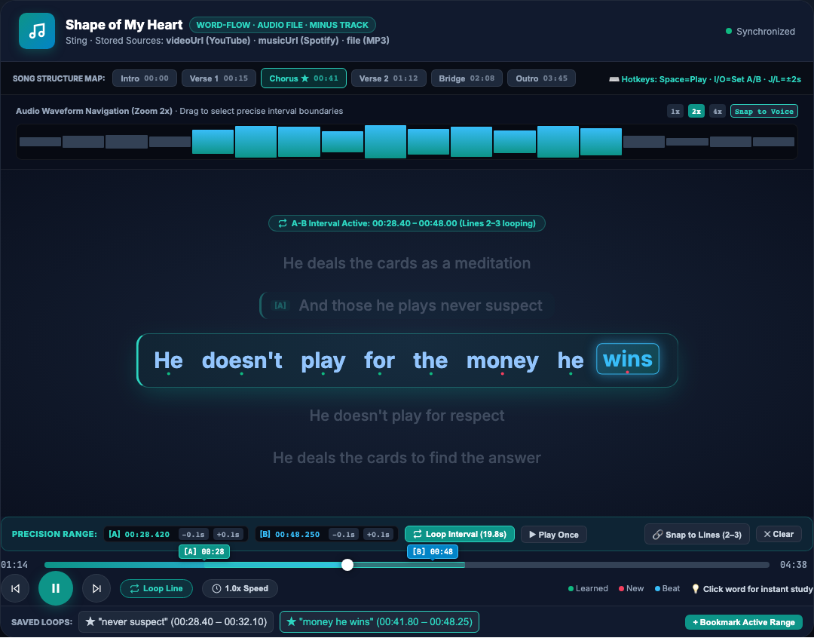
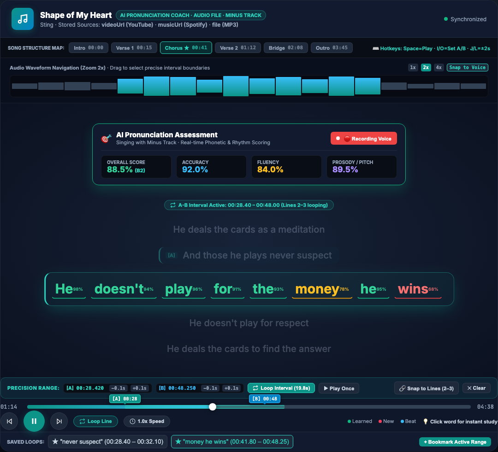
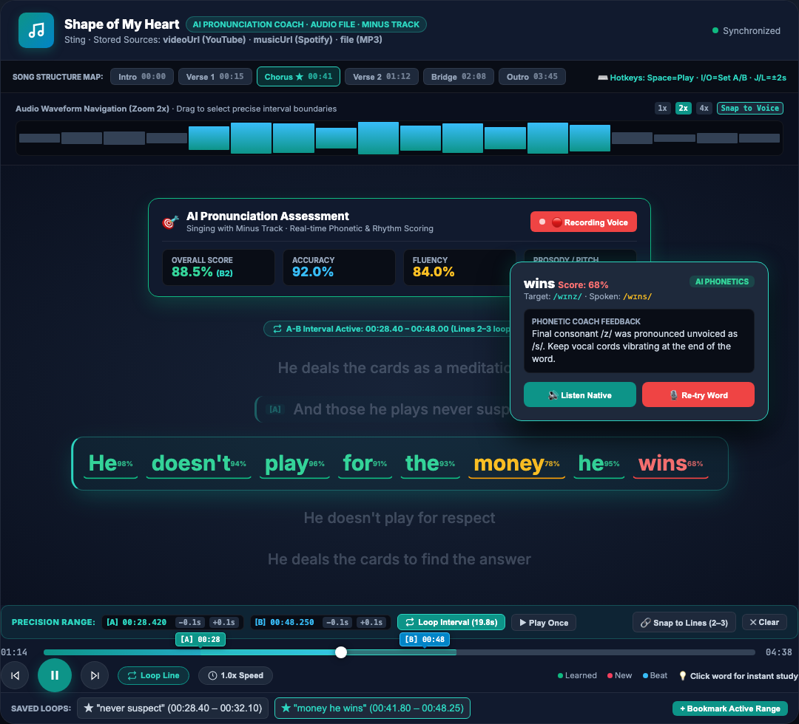
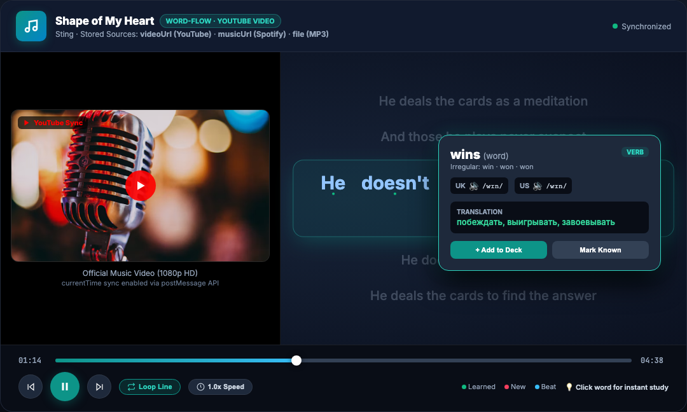
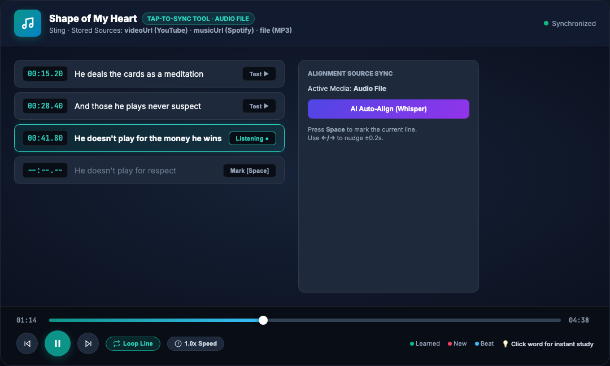
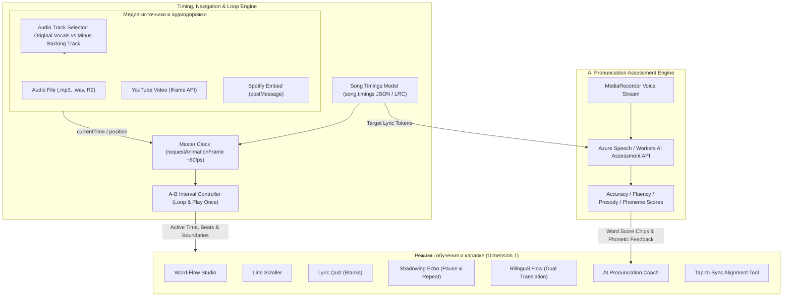

# [TASK-61] Концепция и архитектурный план: Синхронизированное караоке из текстов песен и интерактивное изучение слов

> **Jira Task**: [TASK-61](https://lumiscia.atlassian.net/browse/TASK-61) - [feature] Синхронизированная караоке-студия с A-B интервальным зацикливателем, минусовкой и ИИ-тренером произношения

> [!WARNING]
> **ПРЕДУПРЕЖДЕНИЕ О НЕПРИКОСНОВЕННОСТИ СТОРОННЕГО ФУНКЦИОНАЛА:**
> Запрещается модифицировать, повреждать или нарушать логику модулей платформы, не относящихся к модулю караоке песен. Запрещено затрагивать работу модулей грамматики ([`grammar.js`](file:///Users/tsovakpalakian/PycharmProjects/english-quiz/grammar.js)), тестов и экзаменов ([`src/exam-scoring.mjs`](file:///Users/tsovakpalakian/PycharmProjects/english-quiz/src/exam-scoring.mjs)), чата ([`src/chat-worker.mjs`](file:///Users/tsovakpalakian/PycharmProjects/english-quiz/src/chat-worker.mjs)), календаря посещаемости и групп ([`client/40-account.js`](file:///Users/tsovakpalakian/PycharmProjects/english-quiz/client/40-account.js)). Любые доработки изолируются строго в подсистеме караоке и плеера песен ([`client/03f-songs.js`](file:///Users/tsovakpalakian/PycharmProjects/english-quiz/client/03f-songs.js), [`client/03d-songs.js`](file:///Users/tsovakpalakian/PycharmProjects/english-quiz/client/03d-songs.js), [`site/preview.html`](file:///Users/tsovakpalakian/PycharmProjects/english-quiz/site/preview.html)).

---

## 1. Анализ кодовой базы и текущей инфраструктуры песен

В существующей кодовой базе проекта заложены следующие компоненты:
1. **Хранение данных песни**:
   - [`client/03d-songs.js#L1-L56`](file:///Users/tsovakpalakian/PycharmProjects/english-quiz/client/03d-songs.js#L1-L56) — функции `loadSongs()`, `writeSongs()`, `storeLyricSong()`. В объекте `song` хранятся поля: `id`, `title`, `artist`, `lyrics` (чистый текст), `marks` (словарь состояний слов), `videoUrl`, `musicUrl`, `fileName`, `fileType`, `colorText`.
2. **Анализ лексики песни**:
   - [`client/03d-songs.js#L57-L135`](file:///Users/tsovakpalakian/PycharmProjects/english-quiz/client/03d-songs.js#L57-L135) и [`client/03f-songs.js#L535-L664`](file:///Users/tsovakpalakian/PycharmProjects/english-quiz/client/03f-songs.js#L535-L664) — функции `cardIndex()`, `cardForLyric()`, `lyricPieces()`, `lyricKeys()`, `lyricHtml()`, `lyricMark()`. Слова сопоставляются с известными карточками, фразовыми глаголами, идиомами и формами неправильных глаголов.
3. **Воспроизведение и медиа-источники**:
   - [`client/03f-songs.js#L21-L100`](file:///Users/tsovakpalakian/PycharmProjects/english-quiz/client/03f-songs.js#L21-L100) — функции `youtubeId()`, `vimeoId()`, `spotifyEmbed()`, `isDirectAudio()`, `videoHtml()`, `musicHtml()`.
   - [`client/03f-songs.js#L320-L353`](file:///Users/tsovakpalakian/PycharmProjects/english-quiz/client/03f-songs.js#L320-L353) — функция `onEmbedMessage(event)` перехватывает события YouTube (`infoDelivery`, `onStateChange`) и Spotify (`playback_update`).
   - [`client/03f-songs.js#L435-L499`](file:///Users/tsovakpalakian/PycharmProjects/english-quiz/client/03f-songs.js#L435-L499) — функция `bindSongPlayerBar(song, container)` связывает элемент воспроизведения с панелью `#songPlayerBar` ([`site/preview.html#L1220-L1250`](file:///Users/tsovakpalakian/PycharmProjects/english-quiz/site/preview.html#L1220-L1250)).

---

## 2. Архитектура декартова произведения: Режимы обучения × Источники медиа

Интерфейс строится по принципу полного декартова произведения двух независимых измерений:

$$\text{Комбинации} = \text{Режимы обучения (6)} \times \text{Источники медиа (3)} = 18\text{ состояний}$$

Пользователь переключает режим обучения и источник звука независимо друг от друга в верхней панели селекторов.

### Измерение 1: Режимы обучения и караоке (Study & Karaoke Modes)
1. **«Word-Flow Studio» (Пословное караоке в такт вокалу)**:
   - Каждое слово плавно подсвечивается в такт пению артиста с анимацией 60 кадров в секунду на базе `requestAnimationFrame`.
   - Индикация словарного статуса: зеленая точка (изучено), красная точка (новое слово), рамка (фразовый глагол или идиома).
2. **«LRC Dynamic Scroller» (Построчный автоскроллер)**:
   - Текст песни отображается крупными блоками строк. Активная строка центрируется в видимой области, предыдущие строки плавно уходят вверх с полупрозрачностью.
3. **«Lyric Quiz & Sing-Along» (Интерактивный тренажер аудирования)**:
   - Целевые или неизученные слова заменяются интерактивными пропусками `? [____]`. Слушатель выбирает верный вариант из предложенных чипов в момент приближения такта.
4. **«Shadowing & Echo Studio» (Теневое повторение с паузой)**:
   - После пропевания строки плеер автоматически делает паузу заданной длительности (в интервале 2–4 секунды) для проговаривания фразы вслух учеником («Listen → Pause & Repeat»).
5. **«Bilingual Flow» (Параллельный подстрочный перевод в такт)**:
   - Под каждой строкой песни отображается синхронизированный перевод на русский язык. При подсветке английской фразы синхронно подсвечивается соответствующая часть перевода.
6. **«Tap-to-Sync Alignment Tool» (Студия разметки таймингов)**:
   - Инструмент для расстановки временных меток в такт песни нажатием клавиши Space, ручной корректировки стрелками и импорта стандартных файлов LRC.

### Измерение 2: Источники воспроизведения (Playback Media Sources, хранящиеся в сущности песни)
Все ссылки на воспроизведение уже хранятся непосредственно в программе внутри объекта песни (`song.videoUrl`, `song.musicUrl`, `song.fileName` в [`client/03f-songs.js#L360-L369`](file:///Users/tsovakpalakian/PycharmProjects/english-quiz/client/03f-songs.js#L360-L369)):
1. **«Audio File» (Локальный файл / R2 / Cloudflare)**:
   - Ссылка или бинарный блоб загруженного трека берется из поля `song.fileName` и разрешается через `blobUrlFor(song.id)` / `/api/song-file?id=...`. Прямой элемент `<audio>` обеспечивает точность синхронизации миллисекундного диапазона.
2. **«YouTube Video» (Split-Screen лейаут)**:
   - Ссылка на видеоклип берется из поля `song.videoUrl`. Интерфейс переключается в двухколоночный режим: в левой колонке транслируется встроенный плеер YouTube API, в правой колонке в такт видео отображается выбранный режим караоке.
3. **«Spotify Embed» (Стриминг-виджет Spotify)**:
   - Ссылка на трек берется из поля `song.musicUrl`. Виджет Spotify встраивается в верхнюю часть экрана, передавая обновления позиции через API `playback_update`, а текст синхронно следует за аудиопотоком.

Панель селектора источников автоматически анализирует наличие заполненных полей в карточке песни: доступные источники помечаются статусом `In Program`, позволяя пользователю переключаться между ними в один клик. Если поле еще не заполнено, отображается кнопка быстрого добавления ссылки.

---

## 3. Функционал воспроизведения выбранного интервала (A-B Interval Looper)

Для отработки сложных фрагментов, скороговорок и трудных куплетов в плеер добавляется механизм воспроизведения произвольного интервала:

### 3.1. Способы задания интервала:
1. **Через шкалу воспроизведения (Scrubber A-B Markers)**:
   - Нажатие кнопки `📍 Set [A]` фиксирует начальную точку интервала по текущему времени трека.
   - Нажатие кнопки `🏁 Set [B]` фиксирует конечную точку интервала.
   - На шкале отображается контрастная световая полоса с ползунками `[A]` и `[B]`, которые можно двигать мышью для изменения границ.
2. **Через строки текста песни (Snap to Lines)**:
   - Пользователь нажимает на строку или выделяет диапазон строк (строки 2–3). Метка `[A]` автоматически привязывается к началу первой выбранной строки, а метка `[B]` — к завершению последней выбранной строки.
   - В тексте песни выбранный интервал помечается левой бирюзовой рамкой `.in-interval` и бейджем активного диапазона.

### 3.2. Логика работы проигрывателя:
- **Режим «Loop Interval» (`🔁`)**: при достижении метки `[B]` плеер мгновенно перематывает дорожку на метку `[A]` и продолжает проигрывание в цикле.
- **Режим «Play Once» (`▶`)**: плеер проигрывает отрезок от точки `[A]` до точки `[B]` и автоматически встает на паузу.
- **Подстройка интервала**: кнопки тонкой коррекции со смещением на ±0.1 секунды позволяют подогнать границы под дыхание вокалиста.

---

## 4. Навигация и высокоточная настройка интервалов (Navigation Systems & Precision Controls)

Для детального управления воспроизведением и точной фиксации временных отрезков интерфейс оснащается пятью уровнями навигации:

### 4.1. Структурный навигатор по секциям песни (Song Structure Map)
- Оглавление трека расположено в верхней части караоке-сцены: `[Intro]`, `[Verse 1]`, `[Chorus ★]`, `[Verse 2]`, `[Bridge]`, `[Outro]`.
- Нажатие на кнопку секции мгновенно перемещает аудиоплеер к началу куплета или припева.

### 4.2. Интерактивная аудиоволна с масштабированием (Waveform Zoom & Scrubbing)
- Отображение аудиоволны трека с переключателем масштаба (`1x`, `2x`, `4x`).
- Возможность выделения диапазона протяжкой мыши прямо по графику волны.
- Кнопка «Snap to Voice» автоматически притягивает границы меток к границам вокальной фразы, устраняя срезание гласных звуков.

### 4.3. Миллисекундные степеры и прямой числовой ввод
- Точные поля ввода меток: `[A]: 00:28.420` и `[B]: 00:48.250`.
- Кнопки микросдвига с шагом `±0.1s` и `±1.0s` для подстройки границ интервала под дыхание вокалиста.

### 4.4. Клавиатурная навигация без мыши (Keyboard-First Navigator)
- `Space` — Воспроизведение / Пауза.
- `[I]` — Фиксация точки [A] (Interval Start).
- `[O]` — Фиксация точки [B] (Interval End).
- `[J]` / `[L]` — Перемотка на 2 секунды назад / вперед.
- `[↑]` / `[↓]` — Переход к предыдущей / следующей строке текста.
- `[R]` — Перезапуск воспроизведения активного интервала с начала.

### 4.5. Банк закладок интервалов (Saved Loops & Phrase Bookmarks)
- Панель закладок под плеером позволяет сохранять сложные фразы (образец: `★ "never suspect" 00:28-00:32`) для моментального возврата к ним на повторных уроках.

---

## 5. Переключение на инструментальный минус и проверка произношения с помощью ИИ

Для перехода от пассивного караоке к профессиональной отработке вокала и речи добавляется инструментальная дорожка и голосовой тренажер:

### 5.1. Переключение на инструментальный минус (Minus / Backing Track)
- В сущность песни добавляются поля:
  - `song.minusUrl` — внешняя ссылка на инструментал (минусовку без вокала).
  - `song.minusFileName` / `song.minusKey` — локальный аудиофайл инструментала, сохраненный в изолированном хранилище R2 платформы ([`src/learning-song-media.mjs#L26-L45`](file:///Users/tsovakpalakian/PycharmProjects/english-quiz/src/learning-song-media.mjs#L26-L45)).
- В плеере монтируется переключатель аудиодорожки:
  - `[🎙️ Original Vocals]` ⇄ `[🎹 Minus Track (Instrumental Backing)]`.
- Переключение происходит мгновенно: плеер подменяет источник звука с сохранением точной текущей миллисекунды воспроизведения (`currentTime`), поэтому аккомпанемент продолжается без сбоя ритма.

### 5.2. Интеграция с существующим модулем оценки речи ИИ
- В платформе задействуются встроенные компоненты оценки устной речи [`src/speech-assessment.mjs`](file:///Users/tsovakpalakian/PycharmProjects/english-quiz/src/speech-assessment.mjs) и провайдеры распознавания речи ([`src/azure-speech-provider.mjs`](file:///Users/tsovakpalakian/PycharmProjects/english-quiz/src/azure-speech-provider.mjs)):
  - **Запись голоса**: в режиме `AI Pronunciation Coach` браузер активирует микрофон через `MediaRecorder`.
  - **Пословный и фонемный скоринг**: ИИ сравнивает аудиопоток с эталонным текстом строки ([`lyricTokens`](file:///Users/tsovakpalakian/PycharmProjects/english-quiz/client/03f-songs.js#L845)) и выдает три оценки:
    - `Accuracy` (точность произношения гласных и согласных звуков);
    - `Fluency` (плавность и связность пения под минус в темпе композиции);
    - `Prosody / Pitch` (интонация и ритмическое соответствие).
  - **Цветовая дифференциация слов**:
    - Зеленый (балл $\ge 90\%$): чистое эталонное произношение;
    - Желтый (балл $70–89\%$): понятное произношение с легким акцентом;
    - Красный (балл $< 70\%$): фонетическое искажение или пропуск слова.
  - **Карточка фонетического разбора (Phonetic Coach Feedback)**: нажатие на проблемное слово открывает сравнение целевой транскрипции с фактически распознанной (образец: конечный звонкий согласный `/z/` был ошибочно оглушен до `/s/`), с кнопкой прослушивания эталона носителя языка и повторной записи.

### 5.3. Синергия с интервальным плеером (A-B Looper)
- Ученик выбирает сложный куплет (строки 2–3), включает инструментальный минус и запускает цикличное зацикливание интервала. Ученик поет фразу несколько раз подряд, наблюдая в реальном времени за ростом общего балла произношения.

---

## 6. Интерактивный файл макета

Интерактивный эталонный прототип всей матрицы комбинаций, минусовки, интервального плеера и AI-тренажера произношения сохранен в файле:
[`docs/karaoke-word-flow-mockup.html`](file:///Users/tsovakpalakian/PycharmProjects/english-quiz/docs/karaoke-word-flow-mockup.html)

---

## 7. Прилагаемые визуальные макеты

### Скриншот 1

*Скриншот 1: Переключение дорожки на режим Minus Track (Instrumental Backing) с активной панелью интервала A–B и сохранением позиции в ритме песни.*

---

### Скриншот 2

*Скриншот 2: Режим AI Pronunciation Coach под минусовку — дашборд реального времени с оценками Overall (88.5%), Accuracy (92%), Fluency (84%), Prosody (89.5%) и пословной индикацией.*

---

### Скриншот 3

*Скриншот 3: Карточка Phonetic Coach Feedback при нажатии на проблемное слово — сопоставление целевой транскрипции (/wɪnz/) и произнесенной (/wɪns/), совет тренера и кнопки повторной отработки.*

---

### Скриншот 4

*Скриншот 4: Интерактивная карточка Word Inspector Popover при нажатии на слово в строке караоке — отображение транскрипции, перевода и кнопок добавления в словарь без сброса проигрывателя.*

---

### Скриншот 5

*Скриншот 5: Режим Tap-to-Sync Alignment Studio с таблицей таймкодов, горячими клавишами разметки и выбором активного источника медиа.*

---

## 8. Архитектурная диаграмма матрицы компонентов

---

## 9. Чеклист реализации

- 🟩 Этап 1: Модель данных `song.timings` (секции песни, строки, слова, таймкоды, минус-треки `song.minusUrl` и `song.minusFileName`) и парсер формата LRC в [`client/03d-songs.js`](file:///Users/tsovakpalakian/PycharmProjects/english-quiz/client/03d-songs.js).
- 🟩 Этап 2: Универсальный адаптер синхронизации времени для источников `audio`, `video` (YouTube Split Layout) и `spotify` в [`client/03f-songs.js`](file:///Users/tsovakpalakian/PycharmProjects/english-quiz/client/03f-songs.js).
- 🟩 Этап 3: Переключатель инструментальной дорожки (`Original Vocals` ⇄ `Minus Track`) с бесшовной подменой источника звука без потери позиции в [`client/03f-songs.js`](file:///Users/tsovakpalakian/PycharmProjects/english-quiz/client/03f-songs.js).
- 🟩 Этап 4: Режим `AI Pronunciation Coach` с записью голоса через `MediaRecorder` и подключением к API речевой оценки [`src/speech-assessment.mjs`](file:///Users/tsovakpalakian/PycharmProjects/english-quiz/src/speech-assessment.mjs).
- 🟩 Этап 5: Карточка `Phonetic Coach Feedback` для пословного отображения фонем и советов тренера.
- 🟩 Этап 6: Механизм интервального проигрывателя (A-B Looper, установка меток [A] и [B], привязка диапазона к строкам «Snap to Lines» и зацикливание фрагмента под минус) в [`client/03f-songs.js`](file:///Users/tsovakpalakian/PycharmProjects/english-quiz/client/03f-songs.js).
- 🟩 Этап 7: Навигационные контроллеры (панель секций песни, масштабируемая аудиоволна, миллисекундные степеры, горячие клавиши и банк закладок) в [`client/03f-songs.js`](file:///Users/tsovakpalakian/PycharmProjects/english-quiz/client/03f-songs.js).
- 🟩 Этап 8: Написание модульных и визуальных тестов для всех комбинаций матрицы, минусовки и речевой оценки в директории `test/`.
- 🟩 Этап 9: Проверка через сборщик продакшен-ассетов `npm run build:preview`.
