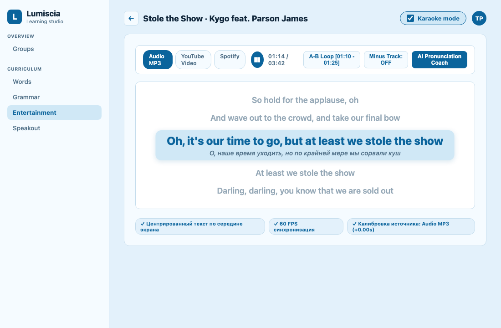
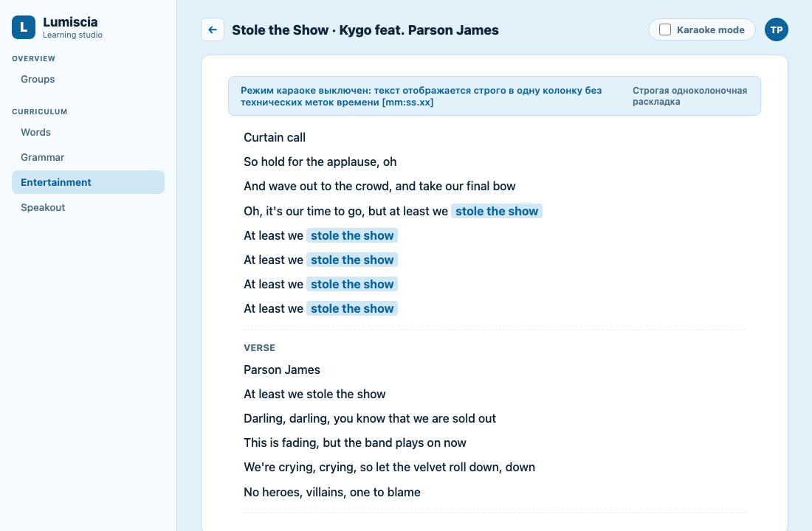
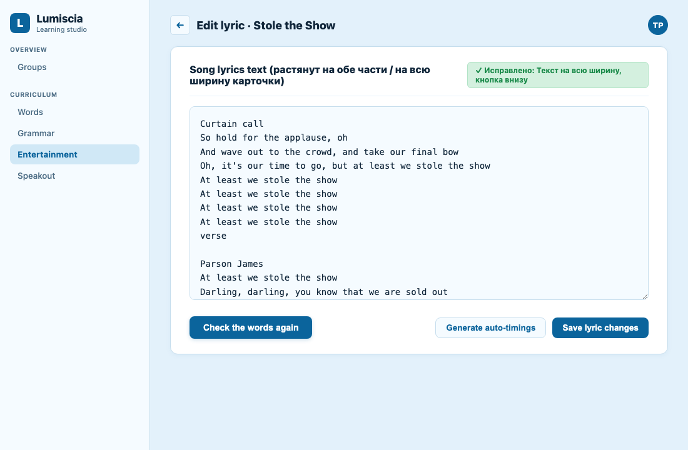
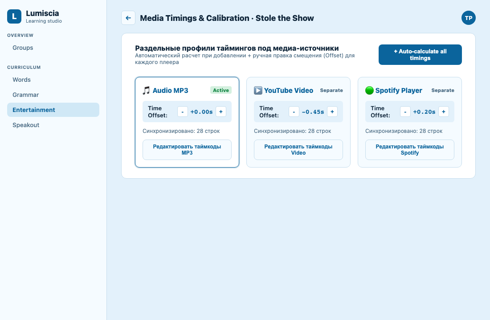

# [TASK-61] Доработка универсального доступа: Кнопка Karaoke Studio и автотайминги для всех песен

> **Jira Task**: [TASK-61](https://lumiscia.atlassian.net/browse/TASK-61) - [feature] Синхронизированная караоке-студия с A-B интервальным зацикливателем, минусовкой и ИИ-тренером произношения

> [!WARNING]
> **ПРЕДУПРЕЖДЕНИЕ О НЕПРИКОСНОВЕННОСТИ СТОРОННЕГО ФУНКЦИОНАЛА:**
> Запрещается модифицировать, повреждать или нарушать логику модулей платформы, не относящихся к плееру и караоке песен. Запрещено затрагивать работу модулей грамматики ([`grammar.js`](file:///Users/tsovakpalakian/PycharmProjects/english-quiz/grammar.js)), тестов и экзаменов ([`src/exam-scoring.mjs`](file:///Users/tsovakpalakian/PycharmProjects/english-quiz/src/exam-scoring.mjs)), чата ([`src/chat-worker.mjs`](file:///Users/tsovakpalakian/PycharmProjects/english-quiz/src/chat-worker.mjs)), календаря посещаемости и групп ([`client/40-account.js`](file:///Users/tsovakpalakian/PycharmProjects/english-quiz/client/40-account.js)). Любые доработки изолируются строго в подсистеме караоке и плеера песен ([`client/03f-songs.js`](file:///Users/tsovakpalakian/PycharmProjects/english-quiz/client/03f-songs.js), [`client/03d-songs.js`](file:///Users/tsovakpalakian/PycharmProjects/english-quiz/client/03d-songs.js), [`site/preview.html`](file:///Users/tsovakpalakian/PycharmProjects/english-quiz/site/preview.html), [`site/preview.css`](file:///Users/tsovakpalakian/PycharmProjects/english-quiz/site/preview.css)).

---

## 1. Проблема и цель доработки

1. **Проблема**:
   - В режиме `Edit lyric` блок формы имеет класс `.saas-form-grid` (2 колонки): поле `textarea` сжато в левую колонку, а кнопка `Check the words again` зависла посредине правой колонки на пустом пространстве.
   - Текст песни в режиме чтения вытягивается в одну вертикальную колонку, оставляя правую половину экрана незаполненной.
   - В текущей реализации [`client/03f-songs.js#L702-L704`](file:///Users/tsovakpalakian/PycharmProjects/english-quiz/client/03f-songs.js#L702-L704) студия караоке монтируется исключительно при условии `hasTimings === true`, то есть когда в тексте песни уже присутствуют метки стандарта LRC вида `[mm:ss.xx]`.
   - В рабочей базе данных песни сохранены в виде простого неразмеченного текста, поэтому `hasTimings` вычисляется в `false`, и студия караоке скрыта.

2. **Цель доработки**:
   - Внедрить тумблер/галочку переключения режима караоке:
     - При активной галочке (`checked`) и наличии временных меток — отображать караоке-студию.
     - При выключенной галочке (`unchecked`) — отображать чистый текст песни без технических временных меток (теги `[mm:ss.xx]` автоматически отфильтровываются при выводе).
   - В форме редактирования `Edit lyric` растянуть поле ввода текста на всю ширину карточки (`grid-column: 1 / -1`), а кнопку `Check the words again` перенести вниз под текст.
   - Текст песни в обычном режиме отображать строго в одну колонку (без разделения на две колонки), комфортно заполняя контейнер.
   - В режиме караоке текст песни выравнивать строго по середине экрана (центрированные строки и слова).
   - Реализовать функцию автоматической генерации шаговых таймкодов строк `generateAutoTimings(lyrics, duration)` для неразмеченных песен при активации караоке.
   - Реализовать раздельные профили таймингов под медиа-источники (`Audio MP3`, `YouTube Video`, `Spotify`) с независимым смещением (Offset) и отдельным редактированием.
   - Внедрить версионирование загрузки `preview.js` для предотвращения залипания кэша браузера.

---

## 2. Прилагаемые визуальные макеты

### Скриншот 1

*Скриншот 1: Галочка переключения включена: отображается караоке-студия с центрированным текстом по середине экрана (как в Apple Music / Spotify).*

---

### Скриншот 2

*Скриншот 2: Галочка «Karaoke mode» выключена: отображается чистый текст песни в одну колонку на всю доступную ширину без отображения временных меток.*

---

### Скриншот 3

*Скриншот 3: Исправление формы Edit lyric: поле textarea растянуто на всю ширину карточки, кнопка Check the words again расположена внизу под текстом.*

---

### Скриншот 4

*Скриншот 4: Раздельные профили таймингов для Audio MP3, YouTube Video и Spotify с независимой калибровкой смещения и редактированием.*

---

## 3. Чеклист этапов реализации

- 🟩 Этап 1: Исправление разметки и стилей формы `data-lyric-editor` в [`client/03f-songs.js`](file:///Users/tsovakpalakian/PycharmProjects/english-quiz/client/03f-songs.js) и [`site/preview.css`](file:///Users/tsovakpalakian/PycharmProjects/english-quiz/site/preview.css) (поле ввода на всю ширину карточки `grid-column: 1 / -1`, кнопка `Check the words again` внизу под текстом).
- 🟩 Этап 2: Одноколоночная раскладка чистого текста песни в обычном режиме без деления на две колонки со скрытием технических меток времени `[mm:ss.xx]`.
- 🟩 Этап 3: Внедрение тумблера/галочки «Karaoke mode» в [`client/03f-songs.js`](file:///Users/tsovakpalakian/PycharmProjects/english-quiz/client/03f-songs.js) с сохранением состояния в `localStorage` и центрированием текста по середине экрана в режиме караоке.
- 🟩 Этап 4: Функция автогенерации строчных таймингов `generateAutoTimings(lyrics, duration)` в [`client/03d-songs.js`](file:///Users/tsovakpalakian/PycharmProjects/english-quiz/client/03d-songs.js) для песен без явной LRC-разметки.
- 🟩 Этап 5: Архитектура раздельных профилей таймингов под каждый медиа-источник (`audio`, `video`, `spotify`) с независимой калибровкой смещения (Offset) и отдельным редактированием в [`client/03f-songs.js`](file:///Users/tsovakpalakian/PycharmProjects/english-quiz/client/03f-songs.js).
- 🟩 Этап 6: Версионирование тега `<script src="preview.js?v=...">` в [`site/preview.html`](file:///Users/tsovakpalakian/PycharmProjects/english-quiz/site/preview.html) для автоматического сброса кэша браузера на проде.
- 🟩 Этап 7: Создание тестов в `test/test-karaoke-universal-access.mjs` и верификация через `npm run build:preview`.
