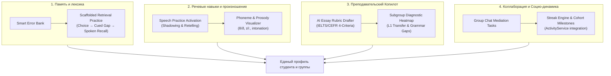

# Комплексный педагогический и архитектурный анализ платформы и расширенная дорожная карта (Advanced SLA & EdTech Roadmap)

## 1. Введение и методологический базис

Настоящий документ представляет собой глубокий анализ обучающей платформы `english-quiz` в сопоставлении с передовыми мировыми практиками прикладной лингвистики, когнитивной психологии и стандартов освоения второго языка (Second Language Acquisition, SLA):
- **CEFR Companion Volume (Совет Европы, 2020)**: Переход от 4 изолированных навыков к четырем макро-активностям: *Reception* (Восприятие), *Production* (Продукция), *Interaction* (Интерактивное общение) и *Mediation* (Медиация/передача смыслов).
- **Принцип четырех компонентов Пола Нейшна (Paul Nation's Four Strands)**: Равномерный баланс между (1) восприятием с фокусом на смысл, (2) речевой продукцией, (3) осознанным анализом языковых форм (grammar/vocab) и (4) беглостью (fluency development).
- **Когнитивные принципы извлечения из памяти (Retrieval Practice & Desirable Difficulties, Roediger & Karpicke, Bjork)**: Активное припоминание с возрастающей сложностью вместо пассивного распознавания.
- **Таксономия ошибок межъязыкового переноса (Error Analysis & L1 Interference)**: Разделение ошибок на интерференцию родного языка (L1 transfer), сверхобобщение правил (overgeneralization) и коллокационные нестыковки.

---

## 2. Аудит текущих внутренних возможностей платформы

В ходе глубокого анализа исходного кода `src/` выявлено, что в платформе уже заложен мощный фундамент, который на данный момент задействован лишь частично:
1. **Речевой движок (`src/speech-assessment.mjs`, `src/speech-coaching.mjs`)**:
   - Уже содержит спецификацию режимов: `pronunciation`, `shadowing`, `retelling`, `dialogue`, `free`.
   - Включает 6 метрик: `accuracy`, `fluency`, `prosody`, `grammar`, `vocabulary`, `task`.
   - Поддерживает пословные и фонемные находки (`findings` с `wordIndex`, `phoneme`, `confidence`, `message`) и тренировочные рекомендации для оценки `< 70`.
   - Реализует многошаговые диалоги (`qr_speech_dialogues`) с ролями, целями и контролем лексики.
2. **Сервис активности и прогресса (`src/learning-activity.mjs`)**:
   - Уже собирает подневные метрики: `answers`, `correct`, `exams`, `examPass`, `learned`, `cards`, `songs`, `seconds`, а также срезы ошибок `byArea`, `cardAreas`, `examFail`.
3. **Лексико-семантическая сеть WordNet (`src/wordnet-runtime.mjs`)**:
   - Синсеты, синонимические ряды, гиперонимы и гипонимы для анализа глубины словарного запаса.
4. **Оценочный и экзаменационный движок (`src/learning-assessment.mjs`, `src/learning-exam-lifecycle.mjs`)**:
   - Поддержка рубрик с критериями, автопроверка объективных заданий, Instant Auto-Publish, защита от конфликтов правок через ревизии (`expectedRevision`).
5. **Мульти-учительская топология (18 подгрупп, 9 уровней CEFR, 54 учителя, 90 студентов)**:
   - Высочайшая плотность внимания: 3 преподавателя на 5 студентов в каждой подгруппе (1.67 ученика на учителя).
   - Изолированные групповые и персональные чаты на базе Durable Objects.

---

## 3. Архитектура расширенных улучшений (6 стратегических модулей)

---

### Модуль 1: Адаптивный банк памяти со ступенчатым усложнением (Scaffolded Retrieval Engine)
- **Проблема**: Обычное интервальное повторение (flashcards) показывает карточку в одном и том же формате, формируя поверхностное узнавание, а не способность применить слово в речи.
- **Решение**: Прогрессивное усложнение механики припоминания (Cognitive Fading):
  - **Шаг 1 (Day 1)**: Cued Recognition — вопрос `Choice` или `Odd one out` (поиск ошибки в контексте).
  - **Шаг 2 (Day 3)**: Cued Production — `Gap fill` с подсказкой первой буквы и грамматического тега (*"She ___ (go) yesterday"* $\to$ *"w___"*).
  - **Шаг 3 (Day 7)**: Meaning-focused Generation — составить и напечатать предложение с целевым словом по правилам коллокации WordNet.
  - **Шаг 4 (Day 21)**: Active Spoken Retrieval — проговорить фразу голосом через `speech-assessment` с проверкой произношения.
- **Статус освоения**: Только после успешного прохождения Шага 4 слово помечается как `Mastered`.

---

### Модуль 2: Диагностический классификатор ошибок подгруппы (Subgroup Diagnostic Heatmap & Error Taxonomy)
- **Проблема**: Учитель видит, что ученик получил 0 баллов, но не видит системной причины ошибки (незнание времени, интерференция родного языка, опечатка или неверная коллокация).
- **Решение**: Автоматическая категоризация ошибок:
  - **L1 Interference (Русскоязычный перенос)**:
    - Порядок слов в вопросах (*"Where you went?"* вместо *"Where did you go?"*).
    - Кальки и ложные друзья переводчика (*"make a photo"* $\to$ *"take a photo"*, *"feel myself good"* $\to$ *"feel good"*).
    - Путаница предлогов (*"depend from"* $\to$ *"depend on"*, *"congratulate with"* $\to$ *"congratulate on"*).
  - **Morphological Overgeneralization**:
    - Ошибки третьего лица (*"he do"*, *"she go"*).
    - Неправильные формы прошедшего времени (*"goed"*, *"bringed"*).
  - **Collocation & Register Clash**:
    - Различие между синонимами через WordNet (*"tall building"* vs *"high building"*, *"do homework"* vs *"make a decision"*).
- **Учительский дашборд подгруппы**:
  - Карточка подгруппы показывает учителям агрегированную тепловую карту:
    *«Группа 101: 70% ошибок на этой неделе — L1 Transfer (кальки предлогов). Рекомендуется 10-минутный фокус на Prepositions of Dependency на следующем занятии»*.

---

### Модуль 3: Активация глубокой речевой практики (Speech Shadowing & Pronunciation)
- **Использование готового кода `speech-assessment.mjs`**:
  - Подключение встроенных режимов `shadowing` и `pronunciation` непосредственно к аудио-материалам уроков и песням (`learning-song-media.mjs`).
- **Фонемная и просодическая обратная связь**:
  - Анализ частых фонетических ловушек:
    - Межзубные согласные: [θ] / [ð] (*think* vs *sink*, *they* vs *day*).
    - Долгота гласных фонем: [iː] vs [ɪ] (*sheep* vs *ship*), [uː] vs [ʊ] (*pool* vs *pull*).
    - Звонкость конечных согласных: оглушение в конце слова (типично для русской речи: *bad* произносится как *bat*).
  - В интерфейсе ученика проблемные слова и фонемы подсвечиваются мягким градиентом с выводом подсказки речевого аппарата (*"Keep tongue between teeth for [θ]"*).

---

### Модуль 4: ИИ-копилот оценивания эссе по 4 критериям CEFR/IELTS (Human-in-the-Loop)
- **Проблема**: Проверка открытых эссе (`Task`) отнимает до 80% времени ко-тичеров, из-за чего задерживается обратная связь студентам.
- **Решение**: Полуавтоматический ассистент на базе существующего `gemini-review-provider.mjs` / `workers-ai-quiz-provider.mjs`:
  - **1. Task Achievement / Response**: Оценил ли студент все поставленные в задании вопросы? Подсчет минимального объема слов.
  - **2. Coherence & Cohesion**: Логика деления на абзацы, связующие слова (*However, Therefore, On the other hand*).
  - **3. Lexical Resource**: Процент уникальной лексики, соответствие уровню группы по CEFR, наличие коллокаций.
  - **4. Grammatical Range & Accuracy**: Доля сложных синтаксических конструкций, выделение грамматических и пунктуационных ошибок.
- **Интерфейс учителя**:
  - Учитель нажимает кнопку **«AI Review Assist»** в панели проверки.
  - Система заполняет поля рубрики, предлагает баллы и формулирует конструктивный комментарий.
  - Преподаватель проверяет предложение, вносит корректировки (если требуется) и утверждает публикацию.

---

### Модуль 5: Коммуникативные задачи медиации и парного обучения в чате (Collaborative Mediation)
- **Методологическая основа**: Согласно CEFR 2020, высшая форма владения языком — медиация (умение перефразировать, объяснить партнеру непонятную мысль, разрешить коммуникативное недопонимание).
- **Интеграция с Durable Objects Chat**:
  - Задания типа **«Peer Jigsaw»** или **«Information Gap»**:
    - Ученик А видит расписание поездов, Ученик Б видит бюджет и цели поездки.
    - В чате подгруппы они должны договориться на английском языке о маршруте.
  - Преподаватели в реальном времени наблюдают за диалогом в чате группы и могут направить беседу или зафиксировать удачные языковые обороты.

---

### Модуль 6: Геймификация и привычки на базе `ActivityService` (Habit & Momentum Engine)
- **Использование существующего `learning-activity.mjs`**:
  - В `ActivityService` уже хранятся `answers`, `correct`, `exams`, `learned`, `seconds`.
- **Новые элементы удержания**:
  - **Daily Streak & Streak Freeze**: Счетчик непрерывных дней занятий с защитой пропуска одного выходного дня в неделю.
  - **Lexicon Size Visualizer**: Наглядный счетчик активного словарного запаса (например: *«Ваш активный лексикон A2: 840 / 1000 слов»* на базе WordNet).
  - **Cohort Weekly Milestone**: Командная цель подгруппы без токсичной конкуренции: шкала заполняется всеми 5 студентами подгруппы, поощряя взаимную поддержку.

---

## 4. Комплексный чеклист реализации

- 🟩 1. Глубокий педагогический и архитектурный анализ платформы (`docs/language-learning-enhancements-roadmap.md`)
- 🟩 2. **Модуль 1**: Схема БД `account_error_items` и логика 4-ступенчатого усложнения SRS (Choice $\to$ Cued Gap $\to$ Generation $\to$ Speech)
- 🟩 3. **Модуль 1**: Клиентский интерфейс «Daily 5-Min Warmup» в дашборде студента
- 🟩 4. **Модуль 2**: Алгоритм классификации ошибок (L1 Transfer, Overgeneralization, Collocation) на базе `examSuggestion` и `wordnet`
- 🟩 5. **Модуль 2**: UI тепловой карты слабостей подгруппы «Diagnostic Heatmap» в карточке группы для учителей
- 🟩 6. **Модуль 3**: Активация сценариев `shadowing` и `pronunciation` из `speech-assessment.mjs` для аудио-блоков уроков
- 🟩 7. **Модуль 3**: UI цветовой подсветки проблемных фонем и речевых подсказок ([θ], [ð], долгота гласных)
- 🟩 8. **Модуль 4**: Серверная генерация черновика рубрики эссе по 4 шкалам CEFR через AI-провайдер
- 🟩 9. **Модуль 4**: UI кнопка «AI Review Assist» в кабинете проверки для ко-тичеров
- 🟨 10. **Модуль 5**: Механика парных интерактивных заданий (Information Gap) в групповом чате подгрупп
- ⬜ 11. **Модуль 6**: Интеграция Daily Streak и визуализатора активного лексикона на базе `ActivityService` и `WordNet`
- ⬜ 12. Сквозное тестирование всех 6 модулей в `test/test-multi-teacher-topology-ui.mjs` и unit-тестах
- ⬜ 13. Сборка продакшен-бандлов (`npm run build:preview && node ops/build-learning-production-assets.mjs`) и прогон `npm run check` (171 скрипт)
