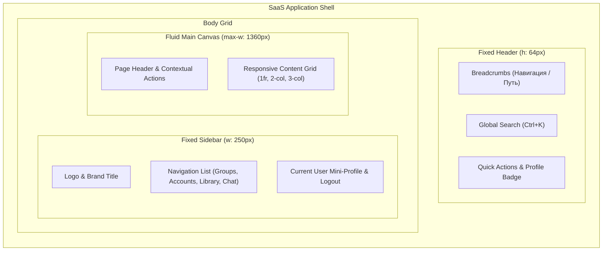

# Концепция и спецификация дизайн-системы веб-приложения (SaaS / CRM)

## 1. Архитектурный каркас (Layout Architecture)

Интерфейс веб-приложения строится на основе фиксированного трехзонного каркаса (3-Tier Layout):



### Сетка и контрольные точки (Breakpoints):
- **Desktop ($\ge 1024\text{px}$)**: Фиксированный сайдбар `250px`, фиксированная шапка `64px`, рабочая область `minmax(0, 1fr)` с центрированием `max-width: 1360px`.
- **Tablet ($768\text{px} - 1023\text{px}$)**: Свернутый компактный сайдбар (`72px` с иконками) или скрытый drawer, контент в 2 или 1 колонку.
- **Mobile ($< 768\text{px}$)**: Сайдбар скрыт за кнопкой гамбургера, снизу фиксированный эргономичный таббар (`60px`), карточки складываются в 1 вертикальный стек.

---

## 2. Дизайн-токены и общие CSS-переменные (`:root`)

Все стили платформы подключаются к централизованным токенам:

```css
:root {
  /* -------------------------------------------------------------
     1. Brand & Accent Tokens (Изумрудно-бирюзовый фирменный стиль)
     ------------------------------------------------------------- */
  --saas-brand: #146c5c;              /* Основной акцентный изумруд */
  --saas-brand-hover: #0f5649;        /* Состояние наведения */
  --saas-brand-active: #0c453b;       /* Состояние нажатия */
  --saas-brand-subtle: #f0fdf9;       /* Мягкий фон для активных элементов */
  --saas-brand-border: #99f6e4;       /* Тонкая граница для акцентов */
  --saas-on-brand: #ffffff;           /* Контрастный текст на брендовом фоне */

  /* -------------------------------------------------------------
     2. Surface & Canvas Colors (Поверхности и подложки)
     ------------------------------------------------------------- */
  --saas-canvas: #f8fafc;             /* Фоновый цвет веб-приложения (slate-50) */
  --saas-card: #ffffff;               /* Чисто-белый фон для карточек */
  --saas-card-muted: #f1f5f9;         /* Второстепенная плашка/подложка */
  --saas-input-bg: #f8fafc;           /* Фон для неактивных полей ввода */
  --saas-input-bg-focus: #ffffff;     /* Фон поля при фокусе */

  /* -------------------------------------------------------------
     3. Border & Line Tokens (Рамки и разделители)
     ------------------------------------------------------------- */
  --saas-border: #e2e8f0;             /* Основная рамка карточек (slate-200) */
  --saas-border-subtle: #f1f5f9;      /* Тонкие внутренние линии (slate-100) */
  --saas-border-focus: #146c5c;       /* Рамка при фокусе */

  /* -------------------------------------------------------------
     4. Typography Colors (Иерархия текста)
     ------------------------------------------------------------- */
  --saas-text-primary: #0f172a;       /* Основные заголовки и значения (slate-900) */
  --saas-text-body: #334155;          /* Читаемый текст контента (slate-700) */
  --saas-text-muted: #64748b;         /* Лейблы, подсказки, дата (slate-500) */
  --saas-text-disabled: #94a3b8;      /* Заблокированные элементы (slate-400) */

  /* -------------------------------------------------------------
     5. Status & Semantic Badges (Цветовая кодировка статусов)
     ------------------------------------------------------------- */
  /* Active / Online / Success */
  --saas-status-active-bg: #ecfdf5;
  --saas-status-active-text: #047857;
  --saas-status-active-border: #a7f3d0;
  --saas-status-active-dot: #10b981;

  /* Warning / Pending / Approval */
  --saas-status-warn-bg: #fffbeb;
  --saas-status-warn-text: #b45309;
  --saas-status-warn-border: #fde68a;
  --saas-status-warn-dot: #f59e0b;

  /* Danger / Destructive / Expired */
  --saas-status-danger-bg: #fff1f2;
  --saas-status-danger-text: #be123c;
  --saas-status-danger-border: #fecdd3;
  --saas-status-danger-dot: #ef4444;
  --saas-btn-danger: #e11d48;
  --saas-btn-danger-hover: #be123c;

  /* Inactive / Hidden / Neutral */
  --saas-status-muted-bg: #f1f5f9;
  --saas-status-muted-text: #64748b;
  --saas-status-muted-border: #cbd5e1;
  --saas-status-muted-dot: #94a3b8;

  /* Role / Info Badge */
  --saas-status-info-bg: #f0fdf9;
  --saas-status-info-text: #0d9488;
  --saas-status-info-border: #99f6e4;

  /* -------------------------------------------------------------
     6. Sizing, Spacing & Corner Radii (Масштаб и скругления)
     ------------------------------------------------------------- */
  --saas-radius-sm: 6px;              /* Теги, бейджики фильтров */
  --saas-radius-md: 10px;             /* Поля ввода, кнопки, селекты */
  --saas-radius-lg: 16px;             /* Карточки, модальные окна */
  --saas-radius-pill: 9999px;         /* Статусные бейджи, круглые аватары */

  --saas-space-1: 4px;
  --saas-space-2: 8px;
  --saas-space-3: 12px;
  --saas-space-4: 16px;
  --saas-space-5: 20px;
  --saas-space-6: 24px;
  --saas-space-8: 32px;

  /* -------------------------------------------------------------
     7. Elevation & Shadows (Тени и глубина)
     ------------------------------------------------------------- */
  --saas-shadow-xs: 0 1px 2px rgba(0, 0, 0, 0.04);
  --saas-shadow-card: 0 1px 3px rgba(0, 0, 0, 0.05), 0 1px 2px rgba(0, 0, 0, 0.03);
  --saas-shadow-md: 0 4px 6px -1px rgba(0, 0, 0, 0.07), 0 2px 4px -1px rgba(0, 0, 0, 0.04);
  --saas-shadow-lg: 0 10px 15px -3px rgba(0, 0, 0, 0.08), 0 4px 6px -2px rgba(0, 0, 0, 0.03);
  --saas-shadow-modal: 0 20px 25px -5px rgba(0, 0, 0, 0.15), 0 10px 10px -5px rgba(0, 0, 0, 0.04);
  --saas-shadow-focus: 0 0 0 3px rgba(20, 108, 92, 0.15);
}
```

---

## 3. Компонентные стандарты и правила разметки

### 3.1. Карточная структура (`Card Pattern`)
Каждая смысловая группа информации упаковывается в белую карточку с четкой иерархией:
```html
<div class="saas-card">
  <div class="saas-card-header">
    <div class="saas-card-title-group">
      <h3 class="saas-card-title">Personal Details & Access</h3>
      <p class="saas-card-subtitle">Manage student profile information and role assignments.</p>
    </div>
    <div class="saas-card-header-actions">
      <!-- Контекстные бейджи или вспомогательные переключатели -->
    </div>
  </div>

  <div class="saas-card-body">
    <!-- Сетка формы или табличный контент -->
  </div>

  <div class="saas-card-footer">
    <span class="saas-card-hint">Passwords are managed externally and securely hashed.</span>
    <div class="saas-card-actions">
      <button type="button" class="saas-btn saas-btn-ghost">Cancel</button>
      <button type="submit" class="saas-btn saas-btn-primary">Save changes</button>
    </div>
  </div>
</div>
```

### 3.2. Сетка форм и инпутов (`Form Grid`)
- Все контролы выравниваются по строгой 2-колоночной сетке (`grid-template-columns: repeat(2, 1fr)` на десктопе, `1fr` на мобильных).
- Полноширинные поля (`Email`, `Address`, `Notes`) используют класс `.is-full` (`grid-column: 1 / -1`).
- Высота полей строго унифицирована: `42px`, паддинги `0 14px`, скругления `10px`.
- Метки полей (`.saas-label`): размер `12px`, полужирный (`600`), приглушенный цвет (`--saas-text-muted`), опциональный `uppercase` с разреженным трекингом (`letter-spacing: 0.04em`).

### 3.3. Устранение дублирующихся кнопок сохранения (UX Unification)
- **Проблема в старых формах**: под каждым отдельным полем (`Login`, `Role`, `Group`) находилась отдельная кнопка («Save details», «Save role», «Reassign group»).
- **SaaS-стандарт**:
  - Все редактируемые параметры карточки объединяются в единую логическую форму.
  - В правом нижнем углу карточки располагается **единая главная кнопка** `Save changes` с опциональной кнопкой `Cancel`.
  - При изменении любого поля кнопка становится активной (с поддержкой подсветки несохраненных изменений).

### 3.4. Статусные бейджи (`Status Badges`)
Единый компонент бейджа с мягкой пастельной заливкой и пульсирующей точкой:
```html
<!-- Active -->
<span class="saas-badge is-active"><span class="badge-dot"></span> Active</span>

<!-- Inactive / Hidden -->
<span class="saas-badge is-muted"><span class="badge-dot"></span> Hidden</span>

<!-- Warning / Pending -->
<span class="saas-badge is-warn"><span class="badge-dot"></span> Pending Approval</span>

<!-- Role Badge -->
<span class="saas-badge is-info">Student</span>
```

### 3.5. Зона опасных действий (`Danger Zone`)
Карточка с нежным розово-красным фоном (`--saas-status-danger-bg`), деструктивной красной рамкой, предупреждающим описанием последствий и обязательным модальным окном подтверждения перед выполнением любого действия.

---

## 4. Карта миграции разделов платформы

| Раздел | Текущее состояние | Целевой SaaS-вид |
| :--- | :--- | :--- |
| **Управление аккаунтом студента (`#adminuser`)** | 2-колоночная сетка SaaS (уже реализована) | Полный эталон дизайн-системы |
| **Список учетных записей (`#admin`)** | Смешанные табы и списки карточек | Карточная сетка с быстрым фильтром, строками-аккаунтами и бейджами групп |
| **Группы и уровни (`#groups`, `#groupdetail`)** | Плоский рендер со старыми кнопками | Сводная карточка группы (KPI по студентам и урокам) + двухколоночный список студентов и преподавателей |
| **Уроки и материалы (`#days`, `#material`)** | Длинный вертикальный поток | Чистый карточный список занятий со статусными бейджами готовности (`Draft` / `Published`) |
| **Глобальная навигация (`.side`, `.app-header`)** | Мобильный сайдбар | Полноценный фиксированный десктопный сайдбар с хлебными крошками и глобальным поиском |

---

## 5. Чеклист реализации дизайн-системы

- 🟩 1. Разработка комплексной спецификации дизайн-системы (`docs/saas-design-system-spec.md`)
- ⬜ 2. Интеграция общих токенов `:root` и базовых утилит в `site/preview.css`
- ⬜ 3. Внедрение унифицированных компонентов карточек, полей ввода и бейджей
- ⬜ 4. Пересборка продакшен-бандлов (`npm run build:preview && node ops/build-learning-production-assets.mjs`)
- ⬜ 5. Прогон полного тестового набора платформы (`npm run check`, 171 скрипт)
