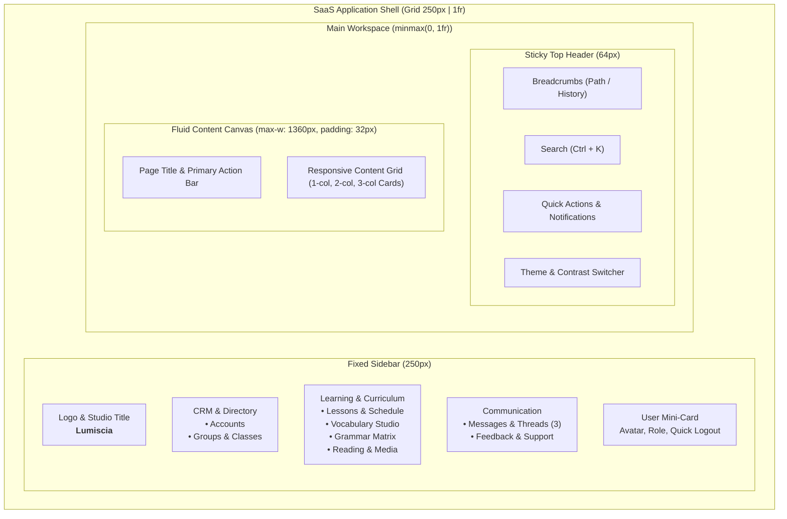

# Мастер-план комплексного рефакторинга веб-приложения в единый современный стиль SaaS

## 1. Архитектурная концепция и единый каркас (Shell Layout)

Цель рефакторинга — трансформация текущего веб-приложения из набора разрозненных мобильно-ориентированных экранов в целостную, профессиональную SaaS/CRM-систему уровня современного enterprise-продукта (Stripe, Linear, Notion, Vercel).

### Трехуровневый каркас интерфейса (3-Tier Layout):

### Адаптивные контрольные точки (Responsive Breakpoints):
- **Desktop ($\ge 1024\text{px}$)**:
  - Фиксированный левый сайдбар шириной `250px` с постоянным отображением всех разделов.
  - Фиксированная верхняя шапка `64px` с динамическими хлебными крошками и глобальным поиском.
  - Центрированная рабочая область с максимальной шириной `1360px` и внутренними отступами `32px`.
- **Tablet ($768\text{px} - 1023\text{px}$)**:
  - Компактный свернутый сайдбар (`72px`) только с иконками или выпадающий Drawer по кнопке.
  - Двухколоночные формы и списки автоматически адаптируются под доступную ширину.
- **Mobile ($< 768\text{px}$)**:
  - Сайдбар скрыт за кнопкой гамбургера в шапке.
  - Нижняя фиксированная навигационная панель (Bottom TabBar `60px`) для быстрого доступа к главным разделам (Home, Lessons, Words, Messages, Settings).
  - Все многоколоночные карточки и формы складываются в один вертикальный стек (`1fr`).

---

## 2. Глубокий аудит 81 боевых секций (+ 3 автономных стенда) и группировка по 9 доменам

В результате сквозного аудита кодовой базы [site/preview.html](file:///Users/tsovakpalakian/PycharmProjects/english-quiz/site/preview.html) и инжектируемых продакшн-шаблонов (`production/essential.html`, `production/grammar-categories.html`, `production/chat.html`, `admingrouplevel`) зафиксирована **точно 81 боевая секция** `<section id="...">` и **3 автономных локальных инструмента** (`quiz-workbench.html`, `quiz-review-local.html`, `local-video-preview.html`). Вся функциональность сгруппирована по 9 целевым доменам:

### Домен 1: Главная панель и дашборд (`#home`, `#cardstat`, `#stats`, `#homeWarmupPanel`, `#homeDashboard`)
- **Текущая архитектура и роли**:
  - **Режим студента (`role: USER`)**:
    - Кольцо прогресса (`#homeDemo .ring`) с процентом и счётчиком выученных карточек («X of Y cards learned»).
    - 4 ключевые сводные плитки: `Unread messages` (счётчик непрочитанных сообщений со ссылкой в чат), `Next lesson` (дата и тема ближайшего занятия), `Weak cards` (слова, требующие повторения), `Still learning` (слова в процессе изучения).
    - **Интерактивный виджет Daily 5-Min Warmup** (`#homeWarmupPanel`): ежедневная разминка по банку ошибок студента из 4 этапов (Level 1: Recognition, Level 2: Cued Recall, Level 3: Context Writing, Level 4: Speech Recall) с мгновенной валидацией, переходом на следующий этап и счётчиком «X due».
    - Карточка «Ваша группа» (`#homeGroupTitle`, количество уроков/экзаменов, кнопка перехода к занятиям «Open group / Continue studying»).
    - Лента недавней активности (`#homeRecentList`) с быстрыми ссылками на последние посещённые разделы.
  - **Режим преподавателя (`role: ADMIN`, `DEVELOPER`)**:
    - Сводные показатели студии (студенты, активные группы, всего изучено карточек).
    - Очередь работ, ожидающих проверки (Pending exam reviews).
    - Быстрые действия: создание урока, приглашение студента, переход к проверке экзаменов, запуск AI Workbench.
- **SaaS-решение**: Внедрение переключателя контекста ролей (Student / Teacher View) на главной странице с полным сохранением всей интерактивной логики виджета Warmup, кольца прогресса и аналитических карточек.

### Домен 2: Управление учетными записями CRM (`#admin`, `#adminuser`, `#account`, `#profile`)
- **Текущие проблемы**: Неудобные списки с кучей разрозненных кнопок сохранения («Save details», «Save role», «Reassign group»), отсутствие фильтров и пагинации, опасные действия без подтверждения.
- **SaaS-решение**:
  - `#admin`: Интерактивная таблица пользователей с табами статусов (Все, Студенты, Преподаватели, Ожидают подтверждения, Архив), быстрый поиск, бейджи групп, экспорт/импорт, генерация инвайт-ссылок и QR-кодов.
  - `#adminuser`: Эталонный двухколоночный SaaS-макет (карточка-сводка студента слева, карточка данных и доступа справа с единой кнопкой сохранения, отдельная карточка Danger Zone с модальными подтверждениями).
  - `#account`, `#profile`: Центр безопасности пользователя (WebAuthn/Passkeys, 2FA, пароль, персональные данные).

### Домен 3: Учебные группы и уровневая иерархия (`#groups`, `#groupdetail`, `#groupteachers`, `#groupstudents`, `#admingroup`)
- **Текущая архитектура и уровневая фильтрация**:
  - Корневой раздел `#groups` группирует учебные группы по **уровням CEFR**: кнопки `A1`, `A2`, `B1`, `B2`, `C1`, `C2`, `Unassigned`.
  - При выборе уровня отображаются группы соответствующей сложности (например, в A1: `A1 General English`, `A1 Intensive`).
  - Для студента: клик по группе сразу открывает её учебный план занятий (`#days`).
  - Для преподавателя: клик открывает страницу группы `#groupdetail` с блоками:
    - Преподаватели (`#groupDetailTeachers` / `#groupteachers`) с указанием со-преподавателей.
    - Студенты (`#groupDetailStudents` / `#groupstudents`) со строкой поиска и просмотром личного профиля.
    - Сводка уроков группы и ссылка на уроки.
    - Сводка экзаменов (Assigned works, Ready for review, Completed).
    - Диагностика целостности группы (`paintGroupDiagnostic`).
- **SaaS-решение**: Сохранение строгой фильтрации по табам уровней CEFR, визуализация карточек групп с кураторами, студентами и расписанием, компактная панель детального просмотра группы со всеми связями.

### Домен 4A: Программа занятий и материалы уроков (`#days`, `#material`, `#lesson`, `#word`, `#pdfview`)
- **Текущая архитектура**:
  - `#days`: Хронологический календарный реестр занятий с плашками дат (`19 Oct`), названиями тем, номерами юнитов и индикаторами видимости (глазок: Published / Hidden / Draft).
  - `#material`: Полнофункциональная среда конспекта и автора урока:
    - Drag-and-drop импорт готовых PDF-слайдов с автоматическим распознаванием лексики и упражнений.
    - Метаданные урока (название, календарный пикер даты, класс, юнит, занятие).
    - Конструктор блоков: теория, словарь с аудио, транскрипцией и примерами, грамматические правила, классные задания.
    - Управление статусом: «Save draft», «Publish», «Copy» (копирование урока в другие группы).
    - Тонкая настройка: индивидуальное скрытие/показ уроков для конкретных студентов (`toggleManagedVisibility`).
  - `#lesson`: Интерактивный плеер урока (слайды, флип-карточки, пошаговые упражнения).
  - `#pdfview`: Встроенный просмотрщик PDF-материалов со слайдами и раздаточными листами.
- **SaaS-решение**: Современный календарно-списочный вид уроков с бейджами статуса публикации, боковой выдвижной просмотрщик конспекта и встроенный PDF-ридер без потери ни единого инструмента редактирования.

### Домен 4B: Экзамены и центр тестирования (`#exams`, `#examblocks`, проверка и автопубликация)
- **Текущая архитектура**:
  - `#exams`: Реестр экзаменов с фильтрацией по группам/уровням и табами `Active` (текущие работы) и `Completed` (завершённые).
  - `#examblocks`: Конструктор экзаменационных блоков (грамматика, словарь, чтение, аудирование, эссе, множественный выбор, пропуски).
  - **Сдача экзамена студентом**: таймер обратного отсчета, пошаговая навигация по блокам, фоновое автосохранение ответов, отправка работы (`#examSave`).
  - **Проверка преподавателем**:
    - Автоматическая оценка объективных заданий (Multiple choice, gap fill).
    - **Instant Auto-publish**: моментальная автоматическая публикация оценки при 100% объективном тесте без задержки.
    - Ручная проверка открытых эссе преподавателем с начислением баллов и рецензией.
    - **AI Review Assist copilot**: встроенный ИИ-помощник анализа эссе с карточкой предложенных рекомендаций и фидбека.
    - Инструменты управления проверкой: `Publish results`, `Reopen submission` (отправка на доработку), `Amend review` (коррекция оценки), `History` (журнал ревизий).
- **SaaS-решение**: Полноценный экран «Exams & Testing Center» в сайдбаре с переключением между активными и сданными работами, статусами проверки и выдвижной карточкой проверки с AI Copilot.

### Домен 5: Словарный тренажер и карточки (`#wordcollections`, `#allwords`, `#word`, `#choice`, `#flip`, `#type`, `#gap`, `#build`, `#judge`, `#tap`, `#multi`, `#pairs`, `#errors`)
- **Текущие проблемы**: Тренажеры перегружены отдельными экранами без единого контекста и быстрой смены режима тренировки.
- **SaaS-решение**: Студия слов с каталогом коллекций, фильтрацией по частотности и частям речи, карточка слова с аудио и примерами, единый интерактивный тренажер с панелью переключения режимов (Flashcards, Choice, Typing, Gap Fill).

### Домен 6: Полная система грамматики (5 категорий), медиатека и караоке (`#tenses`, `#grammarcategories`, `#rules`, `#music`, `#song`, `#speakout`)
- **Полная система грамматики (5 исчерпывающих категорий)**:
  1. *12 Verb Tenses*: интерактивная матрица $4 \times 3$, формулы (+, -, ?), шкала времени и маркеры.
  2. *Grammatical Categories*: 4 базовые колоды (Parts of Speech, Sentence Constituents, Morphology, Higher Units).
  3. *Lesson Rules (`#rules`)*: урочные конспекты (`window.DAY_RULES`) с переключателем `data-rule-lang="en"/"ru"`.
  4. *Specialized Handbooks*: справочники артиклей (`#articles`), фразовых глаголов (`#phrasal`), идиом (`#idioms`), указательных местоимений (`#demonstratives`) и неправильных глаголов (`#verbs`).
  5. *Custom Teacher & Dev Rules Studio*: интерфейс создания (`+ Add Custom Rule`) и редактирования (`Edit Rule`) правил преподавателями и разработчиками.
- **Универсальная история правок (Universal Audit Log & Visual Diff)**:
  - Сквозное версионирование и фиксация изменений («кто, когда, с чего на что») для всех сущностей (правила, карточки, уроки, экзамены, группы, аккаунты CRM), за исключением приватного мессенджера `#messages`.
  - Визуальный дифф (красный фон/зачеркивание для удаленного, зеленый для добавленного) и функция безопасного отката к версии (`Restore version`).
- **Музыкальный центр и Караоке-студия (`#music`, `#song`, `#lyricadd`, `#musicword`)**:
  - Синхронизированный плеер караоке с двойным прогресс-баром, субтитрами Original/Translation, управлением темпом (0.5x–1.5x), повтором фраз (Loop phrase) и аудиопотоком из R2.
  - Дровер подгонки таймингов LRC (`#lyricadd`) и фонетический инспектор слова (`#musicword`) с двойной озвучкой UK/US и IPA.
  - Защита приватности ученика (`hideStudentSongs()`): автоматическое скрытие личных песен, текстов и фонов студента при CRM-инспекции преподавателем (`viewAccount`).

### Домен 7: Системные настройки и AI-воркбенч (`#settings`, `#themes`, `#workbenchqueue`, `#workbenchmine`, `#workbenchproviders`)
- **Пользовательские настройки**: темы оформления (Almond blossom, Mint, Night sky), контрастность, типографика (Aa: Normal, Large, Extra large), уведомления и звуковые сигналы.
- **AI Workbench**: SaaS-интерфейс генерации уроков через Gemini и Azure Speech с мониторингом очередей и квот.

### Домен 8: Мессенджер и коммуникации (`#messages`, `production/chat/*`)
- **Архитектура**: Трехпанельный корпоративный мессенджер (Rail-навигация с аватаром и вкладками, колонка диалогов с поиском и категориями Personal/Study Alerts/Contacts, лента сообщений с датами, аудиоволнами, круглыми видео и прикрепленными карточками уроков).

### Домен 9: Системная диагностика, Логи сбоев и Центр мониторинга (`#bugs`, `#stats`, CRM Audit)
- **Инженерный центр отладки и баг-трекер (`#bugs`)**:
  - Строго изолирован для роли `DEVELOPER` (`isDeveloper()`, автопереход `roleHome()`).
  - 3 функциональные вкладки: `Active Failures` (сгруппированные по сигнатуре сбои), `Resolved` (история закрытых инцидентов), `User Feedback` (сообщения пользователей).
  - Диагностическая карточка: HTTP-метод, эндпоинт, статус-код (`500`, `404`), счетчик повторений (`hits`), таймкоды UTC, тело запроса/ответа, полный стектрейс Cloudflare Worker, кнопка `Copy Error Package` и кнопка `Mark as Resolved`.
  - Таблицы хранения в D1: `bug_reports` и `bug_history`.
- **Монитор живучести сервиса (`#stats`)**:
  - Вкладка `System health`: индикатор связи с сетью (Online/Offline), мониторинг очереди фонового кэширования ассетов.
- **Журнал изменений CRM (`#admin`, вкладка `history`)**:
  - Эндпоинт `/api/admin/changes`: протоколирование всех мутаций прав, инвайтов и статусов аккаунтов.

---

## 3. Архитектура экранов интерактивного макета (Showcase)

Для того чтобы вы могли локально изучить и протестировать каждую страницу до внесения правок в продакшен-код, создается интерактивный локальный Showcase-файл `site/saas-showcase.html`.

### Состав экранов макета:
1. **Screen 1: Dashboard / Home (Двухрежимный переключатель Student / Teacher)**:
   - **Student View**: Кольцо прогресса (`#homeDemo .ring`) с % выученного, 4 плитки (Unread messages, Next lesson, Weak cards, Still learning), интерактивный виджет **Daily 5-Min Warmup** (4 этапа отработки ошибок), карточка «Your group» и история «Recent activity».
   - **Teacher View**: KPI аналитики студии (Студенты, Группы, Выучено, Очередь проверки), активные классы, быстрые действия создания контента.
2. **Screen 2: Accounts & Users CRM** — реестр пользователей с табами статусов (`approved`, `requests`, `invite`, `groups`, `history`), фильтрами по ролям и группам, строками-аккаунтами и кнопками действий.
3. **Screen 3: Student Account Management** — эталонная страница профиля студента (2 колонки, карточка-сводка, форма личных данных с единой кнопкой, Danger Zone и диалог подтверждения).
4. **Screen 4: Classes & Academic Groups (с иерархией уровней CEFR)**:
   - Кнопки уровней CEFR: `A1`, `A2`, `B1`, `B2`, `Unassigned`.
   - Карточки учебных групп соответствующего уровня с кураторами, количеством студентов и расписанием.
   - Детальный вид группы (`#groupdetail`) со списками преподавателей, студентов, уроков и статусов экзаменов.
5. **Screen 5: Curriculum & Lessons** — программа обучения с календарными уроками по датам, статусами готовности (`Published`, `Draft`), Drag-and-drop импортом PDF, конструктором блоков и индивидуальной видимостью.
6. **Screen 6: Vocabulary Studio & Drills** — коллекции слов, каталог Essential Vocabulary (1300+ двуязычных статей), словарные карточки и 10 режимов интерактивных тренировок (Flip, Choice, Typing, Gap Fill, Speakout и др.).
7. **Screen 7: Grammar Matrix & Library** — интерактивная таблица 12 времен английского языка, библиотека текстов для параллельного чтения и песни с караоке-строками.
8. **Screen 8: Settings & Security** — профиль пользователя, аутентификация через WebAuthn / Passkeys, переключатель тем (Almond blossom, Mint, Night sky), настройки типографики и масштабирования.
9. **Screen 9: Messages & Enterprise Chat** — трехпанельный корпоративный мессенджер с Rail-навигацией, категориями (Personal, Study Alerts, Contacts), закрепленным баннером, волновыми аудиозаписями, круглыми видеосообщениями и контекстной карточкой группы.
10. **Screen 10: Exams & Testing Center**:
    - Вкладки реестра: `Active Exams` и `Completed Exams`.
    - Фильтрация по группам и уровням CEFR.
    - Карточки экзаменов со статусами (`In Progress`, `Ready for Review`, `Instant Auto-Published`, `Graded`).
    - Выдвижная панель проверки преподавателя: автоматический подсчет баллов, **AI Review Assist copilot** с карточкой предложенного анализа эссе, кнопки `Publish results`, `Reopen submission`, `Amend review` и история аудита.
    - Интерфейс прохождения теста студентом с таймером и автосохранением.
11. **Screen 11: Screen Sitemap & Hierarchy Tree (`#screen-sitemap`)**:
    - Интерактивное дерево всех 81 боевых секций приложения и 3 автономных стендов.
    - Каталог всех 77 сквозных навигационных цепочек с визуализацией рекордной 9-уровневой цепочки вложенности.
12. **Screen 12: Music & Karaoke Studio (`#screen-music`)**:
    - Синхронизированный плеер караоке (`#song`) с подсветкой оригинального текста и перевода.
    - Досье слова `#musicword` с фонетикой UK/US и транскрипцией IPA.
    - Дровер добавления и тайминга строк `#lyricadd`.
13. **Screen 13: System Logs & Bug Diagnostics (`#screen-bugs`)**:
    - Инженерная консоль отладки с вкладками `Active Failures`, `Resolved`, `User Feedback`.
    - Раскрывающиеся карточки инцидентов со стектрейсами, телами запросов/ответов, счетчиком `hits` и кнопками `Copy` и `Resolve`.
    - Панель системного здоровья `System Health` (сеть, кэш, фоновая очередь).

### Инструменты инспекции в Showcase:
- **Viewport Switcher**: переключение в один клик между Desktop ($1360\text{px}$), Tablet ($820\text{px}$) и Mobile ($390\text{px}$).
- **Feedback & Review Drawer**: панель заметок, позволяющая фиксировать ваши комментарии к каждому конкретному экрану.

---

## 4. Поэтапный план рефакторинга

- **Этап 1: Создание локального интерактивного Showcase (`site/saas-showcase.html`)**
  - Разработка единого макета всех 9 ключевых страниц со встроенным переключателем.
  - Локальный запуск, визуальная проверка и сбор ваших замечаний.
- **Этап 2: Интеграция глобальных токенов `:root` (`site/preview.css`)**
  - Подключение стандартизированных CSS-переменных (бренд `#146c5c`, подложки, шрифты, радиусы, тени).
  - Создание базовых переиспользуемых классов `.saas-card`, `.saas-btn`, `.saas-badge`, `.saas-form-grid`.
- **Этап 3: Рефакторинг глобального каркаса (Sidebar + Header)**
  - Обновление `<aside class="side">` и шапки для поддержки фиксированной десктопной навигации.
  - Обеспечение 100% обратной совместимости с существующими селекторами тестов Playwright (`[data-jump]`, `[data-nav-back]`).
- **Этап 4: Миграция раздела пользователей CRM (`#admin`, `#adminuser`, `#account`)**
  - Перевод таблицы аккаунтов на SaaS-сетку с бейджами и фильтрами.
- **Этап 5: Миграция учебных групп (`#groups`, `#groupdetail`)**
  - Обновление интерфейса управления группами и назначения преподавателей.
- **Этап 6: Миграция уроков и учебных материалов (`#days`, `#material`)**
  - Карточки уроков со статусами готовности и современный просмотр материалов.
- **Этап 7: Миграция словаря, грамматики и настроек**
  - Обновление витрины коллекций слов и настроек тем оформления.
- **Этап 8: Полный цикл тестирования и валидация продакшен-сборки**
  - Сборка продакшен-бандлов (`npm run build:preview && node ops/build-learning-production-assets.mjs`).
  - Прогон полного набора тестов платформы (`npm run check`, 171 тестовый сценарий).

---

## 5. Чеклист реализации

- 🟩 1. Глубокий аудит и актуализация визуальной карты сайта (`docs/saas-visual-sitemap-and-hierarchy.md` — 81 экран + 3 стенда, 77 цепочек, логи `#bugs`, караоке)
- 🟩 2. Разработка спецификации грамматики и аудита (`docs/grammar-rules-and-audit-history-spec.md` — 5 категорий правил, редактор, универсальный Audit Diff)
- 🟩 3. Расширение матрицы сохранения функционала (`docs/functional-inventory-and-preservation-matrix.md` — 126 эндпоинтов, 142 таблицы, 444 кнопки, скрытая логика)
- 🟩 4. Синхронизация мастер-плана рефакторинга (`docs/saas-refactoring-master-plan.md` — выравнивание по 9 доменам и 81 экрану)
- 🟨 5. Актуализация интерактивного макета Showcase (`site/saas-showcase.html` — добавление экрана `#screen-bugs` в витрину)
- ⬜ 6. Валидация сборщика продакшн-ассетов и прогон тестов сохранения функционала
- ⬜ 7. Переход к Этапу 2 рефакторинга CSS (стандартизация токенов `:root` и базовых классов)
