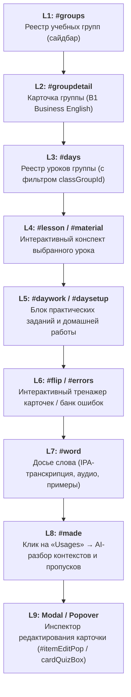

# Визуальный макет и архитектурная карта глубокой вложенности сайта

> **Назначение документа:**  
> Полная визуализация графа переходов, уровней вложенности (от Level 1 до Level 4) и взаимосвязей всех 74 секций веб-приложения Lumiscia и коммуникационного модуля мессенджера.

---

## 1. Глобальная трехуровневая архитектура системы

```mermaid
flowchart TD
    subgraph Level0 ["Уровень 0: Входная и гостевая зона (Гостевой режим)"]
        GuestHome["#home (Гостевой вид)<br/>• Мобильный hero-блок<br/>• Кнопка входа Log In"]
        GuestAuth["#account (Гостевая авторизация)<br/>• Форма логина / пароля<br/>• Вход по Passkey / Google<br/>• Сброс пароля (OTP)"]
        AuthSky["#authSky (Холст звёздного неба)<br/>• 88 созвездий<br/>• Инспектор звезд и экзопланет"]
    end

    subgraph Level1 ["Уровень 1: Авторизованная рабочая зона (Фиксированный сайдбар)"]
        DashRoot["1. Dashboard<br/>#home, #cardstat"]
        CRMRoot["2. Accounts CRM<br/>#admin"]
        GroupsRoot["3. Classes & Groups<br/>#groups (CEFR A1-B2)"]
        LessonsRoot["4. Lessons & Days<br/>#days"]
        ExamsRoot["5. Exams & Testing<br/>#exams"]
        WordsRoot["6. Words Studio<br/>#wordcollections, #allwords"]
        GrammarRoot["7. Grammar Matrix<br/>#tenses, #library"]
        ChatRoot["8. Messages & Chat<br/>#messages (3 панели)"]
        WorkbenchRoot["9. AI Workbench<br/>#workbenchqueue"]
        SettingsRoot["10. Settings & Themes<br/>#settings, #themes"]
    end

    subgraph Level2 ["Уровень 2: Детальные страницы сущностей и реестры"]
        DashWarmup["Студенческий Warmup<br/>#homeWarmupPanel (4 этапа)"]
        StudentProfile["Профиль студента CRM<br/>#adminuser (2 колонки)"]
        GroupDetail["Детали группы<br/>#groupdetail (Кураторы, Ученики)"]
        MaterialEditor["Редактор урока<br/>#material (PDF drag-drop)"]
        ExamBlocks["Блоки экзамена<br/>#examblocks (Таймер, секции)"]
        WordView["Карточка слова<br/>#word, #made (IPA, примеры)"]
        TenseView["Справочник времени<br/>#tense, #marker (Формулы)"]
        ParallelTexts["Библиотека текстов<br/>#texts (Двуязычные тексты)"]
        SongsList["Песни и аудиотека<br/>#music (Караоке-плеер)"]
        SpeakoutList["Разговорная студия<br/>#speakout (Shadowing)"]
        ChatRoom["Активный тред диалога<br/>.chat-timeline, #msgCompose"]
    end

    subgraph Level3 ["Уровень 3: Глубокие рабочие среды и плееры"]
        PdfViewer["PDF Viewer конспекта<br/>#pdfview (Слайды, тетради)"]
        LessonPlayer["Интерактивный урок<br/>#lesson, #daywork, #rules"]
        Drills10["10 режимов тренажеров<br/>#flip, #choice, #gap, #type, #pairs"]
        ParallelReader["Параллельный ридер<br/>#textread (Перевод по клику)"]
        SongPlayer["Караоке-плеер песни<br/>#song, #lyricadd (Разбор идиом)"]
        SpeakoutEditor["Редактор фонетики<br/>#speakouteditor (Rich text)"]
        ExamReview["AI Review Assist Drawer<br/>Автогрейдинг + Copilot эссе"]
    end

    subgraph Level4 ["Уровень 4: Модальные окна, подтверждения и экспорт"]
        DangerConfirm["Danger Zone Modal<br/>.danger-confirm-dialog"]
        InviteQrModal["Генератор инвайтов & QR<br/>#inviteQrDialog"]
        AuditHistory["История ревизий проверки<br/>#assessmentHistory"]
        PasskeyRegister["Регистрация Passkeys<br/>WebAuthn биометрия"]
        ChatMediaView["Просмотр фото / видео / Mute<br/>.chat-photo-crop, .chat-dialog"]
    end

    GuestHome --> GuestAuth
    GuestAuth --> DashRoot
    GuestAuth --> AuthSky

    DashRoot --> DashWarmup
    CRMRoot --> StudentProfile
    StudentProfile --> DangerConfirm
    CRMRoot --> InviteQrModal

    GroupsRoot --> GroupDetail
    GroupDetail --> LessonsRoot
    GroupDetail --> ExamsRoot

    LessonsRoot --> MaterialEditor
    MaterialEditor --> PdfViewer
    MaterialEditor --> LessonPlayer
    LessonPlayer --> Drills10

    ExamsRoot --> ExamBlocks
    ExamsRoot --> ExamReview
    ExamReview --> AuditHistory

    WordsRoot --> WordView
    WordsRoot --> Drills10

    GrammarRoot --> TenseView
    GrammarRoot --> ParallelTexts
    ParallelTexts --> ParallelReader
    GrammarRoot --> SongsList
    SongsList --> SongPlayer
    GrammarRoot --> SpeakoutList
    SpeakoutList --> SpeakoutEditor

    ChatRoot --> ChatRoom
    ChatRoom --> ChatMediaView

    SettingsRoot --> PasskeyRegister
```



---

## 2. Детальная иерархия по функциональным доменам

### Домен 1: Главная панель и студенческая разминка (Dashboard)
- **Level 1**: `#home` (Главный экран).
  - *Student Mode*:
    - `#homeDemo .ring`: Кольцо прогресса выученных карточек с процентами.
    - `#homeUnreadTile`: Плитка непрочитанных сообщений со ссылкой в `#messages`.
    - `#homeNextLesson`: Плитка даты и темы ближайшего урока со ссылкой в `#days`.
    - `[data-stat="weak"]`: Плитка слабых слов со ссылкой в `#wordcollections`.
    - `[data-stat="learning"]`: Плитка слов в процессе изучения.
    - `#homeWarmupPanel` (**Level 2**): Интерактивная 5-минутная разминка ошибок:
      - Stage 1: Прямое распознавание слова.
      - Stage 2: Подстановка с подсказкой пропущенного слова.
      - Stage 3: Написание законченного контекстного предложения.
      - Stage 4: Произношение и проверка речи.
    - `#homeGroupTitle`: Карточка назначенной группы с кнопкой перехода в занятия группы.
    - `#homeRecentList`: История быстрого перехода к последним посещённым экранам.
  - *Teacher Mode*:
    - KPI аналитики студии (Студенты, Группы, Выучено, Очередь проверки).
    - Таблица активных классов с прогрессом и статусами.
    - Панель быстрых действий создания уроков и генерации через AI Workbench.

---

### Домен 2: CRM пользователей и администрирование (`#admin`, `#adminuser`)
- **Level 1**: `#admin` (Реестр аккаунтов).
  - Табы реестра:
    - `[data-admin-tab="accounts"]`: Подтверждённые активные учетные записи с фильтром по группам.
    - `[data-admin-tab="requests"]`: Очередь заявок на регистрацию с кнопками одобрения/отклонения.
    - `[data-admin-tab="invite"]`: Генератор одноразовых инвайт-ссылок.
      - **Level 3 (Modal)**: `#inviteQrDialog` — отображение векторного QR-кода и кнопки копирования в буфер.
    - `[data-admin-tab="history"]`: Журнал аудита регистраций с временными метками.
- **Level 2**: `#adminuser` (Двухколоночный профиль студента).
  - Левая колонка: Карточка-сводка студента (аватар, дата регистрации, последний вход, количество активностей).
  - Правая колонка: Карточка личных данных (Имя, логин, email, назначение группы, роль) с кнопкой сброса пароля через OTP.
  - Карточка Danger Zone:
    - Кнопки: `Hide user`, `Deactivate user`, `Archive user`.
    - **Level 3 (Modal)**: `.danger-confirm-dialog` — обязательное диалоговое окно подтверждения необратимых действий.

---

### Домен 3: Академические группы и иерархия уровней (`#groups`, `#groupdetail`)
- **Level 1**: `#groups` (Корневой список групп).
  - Панель выбора уровня CEFR: `A1`, `A2`, `B1`, `B2`, `C1`, `C2`, `Unassigned`.
  - Карточки групп выбранного уровня с куратором, расписанием и прогрессом.
- **Level 2**: `#groupdetail` (Страница детального обзора группы).
  - `#groupDetailTeachers` (**Level 3**): Реестр кураторов и со-преподавателей (`#groupteachers`).
  - `#groupDetailStudents` (**Level 3**): Реестр зачисленных студентов (`#groupstudents`) с поиском и инспекцией аккаунта.
  - `#groupDetailDays`: Прямой переход к учебному плану уроков группы (`#days`).
  - `#groupDetailExamSummary`: Сводка назначенных и проверенных экзаменов с прямым переходом в `#exams`.
  - `#groupDetailStatus`: Мониторинг целостности связей и кнопка повторной синхронизации.

---

### Домен 4: Учебный план, уроки и материалы (`#days`, `#material`, `#lesson`, `#pdfview`)
- **Level 1**: `#days` (Хронологический список занятий по датам).
  - Плашки уроков с чипами дат (`19 Oct`), названиями тем и глазом видимости (Published / Hidden / Draft).
- **Level 2**: `#material` (Конспект и конструктор урока).
  - `data-lesson-pdf-import`: Drag-and-drop зона импорта PDF-слайдов с авто-парсингом лексики.
  - Форма метаданных (название, календарный пикер даты, класс, юнит, номер занятия).
  - Блоки контента (теория, словарь с аудио и транскрипцией, правила грамматики, классные задания).
  - Кнопки управления: `Save draft`, `Publish`, `Copy` (копирование урока в другие группы).
- **Level 3**:
  - `#pdfview`: Встроенный просмотрщик PDF-оригиналов уроков и раздаточных тетрадей.
  - `#lesson`: Пошаговый интерактивный плеер занятия со слайдами.
  - `#rules`: Справочные правила урока с формулами.
  - `#daywork`, `#daywords`: Наборы упражнений и лексики дня.
- **Level 4**: Интерактивные тренировочные модули дня:
  - `#dayq`, `#daychoice`, `#dayflip`, `#dayjudge`.

---

### Домен 5: Экзамены и центр тестирования (`#exams`, `#examblocks`)
- **Level 1**: `#exams` (Реестр контрольных и экзаменов).
  - Табы: `Active Exams` (текущие сдачи) и `Completed & Graded` (завершённые).
  - Фильтр по учебным группам и уровням CEFR.
  - Бейдж статуса: `Instant Auto-Publish Enabled` (мгновенная публикация результатов для тестов).
- **Level 2**:
  - `#examblocks`: Конструктор секций экзамена (грамматика, аудирование, чтение, эссе).
  - Интерфейс сдачи экзамена студентом: обратный таймер, вопросы, автосохранение ответов, кнопка `Submit`.
- **Level 3**: Панель проверки преподавателя и AI Copilot:
  - Секция 1: Объективные тесты (автоматическая оценка, 100% точность, мгновенный результат).
  - Секция 2: Открытые задания (эссе, развернутые ответы).
  - **AI Review Assist Copilot**: встроенный ИИ-ассистент анализа эссе с проверкой временных форм, оценкой лексики и кнопкой применения рекомендации `[Apply AI Feedback]`.
- **Level 4**:
  - `#assessmentPublish`: Публикация оценки в профиль студента.
  - `#assessmentReopen`: Возврат работы студенту на повторную доработку.
  - `#assessmentAmend`: Внесение правок в ранее выставленную оценку.
  - `#assessmentHistory`: Модальное окно журнала истории всех правок и оценок.

---

### Домен 6: Студия словаря и 10 режимов запоминания (`#wordcollections`, `#allwords`)
- **Level 1**: `#wordcollections` (Витрина словарных коллекций).
  - Карточки коллекций: `All words`, `My words`, `Everyday topics`, `Phrasal verbs`, `Idioms`.
  - Быстрое добавление нового слова (`.here-add`).
- **Level 2**: `#allwords` (Сводный реестр всех карточек словаря).
  - Сетка карточек с поиском и фильтром по частотным спискам.
  - `#word`, `#made`: Детальная карточка слова с британской транскрипцией (IPA), аудио озвучкой, частью речи и контекстными примерами.
- **Level 3**: 10 интерактивных режимов запоминания:
  1. `#flip`: Флип-карточки (двусторонний переворот).
  2. `#choice`: Выбор одного из 4 вариантов.
  3. `#type`: Ввод слова с клавиатуры по смысловому описанию.
  4. `#gap`: Заполнение пропущенного слова в предложении.
  5. `#build`: Сборка слова из перемешанных букв.
  6. `#judge`: Оценка истинности/ложности перевода.
  7. `#tap`: Пошаговый выбор верных лексем.
  8. `#multi`: Множественный выбор подходящих значений.
  9. `#pairs`: Сопоставление английских и русских пар.
  10. `#errors`: Поиск и исправление ошибок в предложении.

---

### Домен 7: Полная система грамматики (5 категорий), медиатека и караоке (`#tenses`, `#grammarcategories`, `#rules`, `#music`, `#song`, `#speakout`)
- **Полная иерархия 5 категорий правил и грамматики**:
  1. **12 Verb Tenses (Времена глаголов)**:
     - **Level 1**: `#tenses` — Интерактивная матрица 12 времен (Simple, Continuous, Perfect, Perfect Continuous на Past, Present, Future).
     - **Level 2**: `#tense`, `#marker` — Детальный разбор времени, формулы образования (+, -, ?), маркеры времени с примерами EN / RU.
  2. **Grammatical Categories (Категории и части речи)**:
     - **Level 1**: `#grammarcategories` — 4 базовые колоды: *Parts of Speech*, *Sentence Constituents*, *Morphology*, *Higher Units*.
     - **Level 2**: `#grammarcategory` — Интерактивные карточки выбранной категории (существительные, глаголы, предлоги и т.д.).
     - **Level 3**: `#grammarrule` — Детальное интерактивное правило с разбором структуры, таблицами и примерами.
  3. **Lesson Rules (Урочные правила конспектов)**:
     - **Level 2**: `#rules` — Интерактивный реестр правил текущего урока (`window.DAY_RULES`).
     - Переключатель языка объяснений `English` / `Russian` (`data-rule-lang`).
  4. **Specialized Handbooks (Специализированные справочники)**:
     - `#phrasal`: 300+ фразовых глаголов с частицами и контекстными примерами.
     - `#idioms`: Идиоматические выражения английского языка с образными объяснениями.
     - `#articles`: Исчерпывающий справочник определенного (`the`), неопределенного (`a`/`an`) и нулевого артикля.
     - `#demonstratives`: Указательные местоимения (this, that, these, those).
     - `#verbs`: Справочник неправильных глаголов с тремя формами и озвучкой.
  5. **Custom Teacher & Developer Rules (Пользовательские правила)**:
     - Интерфейс создания: кнопка `+ Add Custom Rule` для ролей `TEACHER` и `DEVELOPER`.
     - Инспектор редактирования `Edit Rule`: мультиязычные поля EN/RU, привязка к урокам или категориям.
     - **Сквозная история правок (Universal Audit Log)**: фиксация автора, даты UTC и визуальный Diff (с чего на что изменено).

- **Музыкальный центр и Караоке-студия (`#music`, `#song`, `#lyricadd`, `#musicword`)**:
  - **Level 1**: `#music` — Каталог песен по уровням сложности CEFR (A1–C2) и жанрам.
  - **Level 2**: `#song` — Синхронизированный караоке-плеер:
    - Двойной прогресс-бар трека и текущей строки караоке.
    - Автоскролл текста с подсветкой активной строки (Dual lyrics: Original / English translation).
    - Управление скоростью воспроизведения (0.5x, 0.75x, 1.0x, 1.25x, 1.5x) и повтор фразы (Loop phrase).
    - Воспроизведение потокового аудио из бакета R2 `QUIZ_MEDIA`.
  - **Level 3**: `#lyricadd` — Дровер загрузки LRC-файлов, импорта треков и ручной подгонки тайминга миллисекундных меток.
  - **Level 3**: `#musicword` — Фонетическое досье слова песни:
    - Двойное аудиопроизношение: Британский (UK) и Американский (US) диалекты.
    - Международная транскрипция (IPA), ударение в слогах, частотный ранг слова.
  - **Student Privacy Guard (`hideStudentSongs()`)**:
    - Защита приватности ученика: при просмотре аккаунта студента преподавателем/администратором через CRM (`viewAccount && authUser.role === "ADMIN"`) персональные песни, пользовательские тексты и кастомные темы студента скрываются, а тема жестко фиксируется на безопасной палитре Van Gogh.

- **Параллельные тексты и Разговорная студия**:
  - `#texts` -> `#textread`: Двухколоночный ридер параллельных текстов с мгновенным переводом по клику.
  - `#speakout` -> `#speakouteditor`: Студия теневого повторения (speech shadowing) с редактором темпа речи и эталонов произношения.

---

### Домен 8: Корпоративный мессенджер (`#messages`)
- **Level 1**: Трехпанельный мессенджер.
  - **Left Rail (Колонка 1)**: Аватар пользователя (`#msgProfile`), список диалогов (`#msgChats`), список контактов (`#msgContacts`), настройки (`#msgSettings`), кнопка выхода (`#msgExit`).
  - **Chat List (Колонка 2)**: Поиск диалогов (`#msgRoomSearch`), глобальный поиск логинов (`#msgLookup`), фильтр непрочитанных (`#msgUnread`), создание чата (`#msgNew`), табы категорий (`Personal`, `Study alerts`, `Contacts`), карточки диалогов с пинами и бейджами непрочитанных.
- **Level 2**:
  - **Active Timeline (Колонка 3)**: Заголовок комнаты (`#msgRoomInfo`), закрепленный баннер (`#msgPinned`), лента сообщений с датами и статусами доставки.
  - Мультимедиа в сообщениях: интерактивная аудио-волна (`.chat-audio-wave`), круглые видео-кружочки (`.chat-round-video`), прикрепленные учебные карточки (`.chat-study-reference`), реакции-эмодзи.
  - Редактор сообщений (`#msgCompose`): поле ввода с авторесайзом, цитирование ответа (`#msgReply`), эмодзи/стикер-пикер, запись голосовых (`#msgMic`), запись видео (`#msgVideo`), прикрепление файлов (`#msgAttach`).
- **Level 3**:
  - `#msgRight`: Правая панель информации диалога и полнотекстового поиска сообщений (`#msgTextSearch`).
- **Level 4 (Modals & Dialogs)**:
  - Диалог отключения уведомлений (Mute на 1ч, 8ч, 1д, 1нед, навсегда).
  - Инструмент кадрирования и масштабирования фото аватара (`canvas.chat-photo-crop`).
  - Папка архивированных диалогов (`[data-chat-archive]`).

---

### Домен 9: Системная диагностика, Логи и Баг-трекер (`#bugs`, `#stats`, CRM Audit)
- **Level 1**: `#bugs` — Инженерный центр отладки и инцидентов (доступен строго роли `DEVELOPER` через `isDeveloper()`, автопереход `roleHome()`).
  - **Табы консоли**:
    - `[data-bug-tab="active"]`: Активные непогашенные сбои системы с группировкой по хэшу ошибки.
    - `[data-bug-tab="resolved"]`: Архив решенных инцидентов с датой закрытия и исполнителем.
    - `[data-bug-tab="feedback"]`: Пользовательские баг-репорты и тикеты обратной связи.
  - **Функционал карточки сбоя**:
    - Метод и эндпоинт: `POST /api/cards/study-progress`, `GET /api/words/lookup`.
    - HTTP-статус: бейджи `500 Server Error`, `404 Not Found`, `401 Unauthorized`.
    - Счетчик повторений (`hits`): например, `14 occurrences across 3 users`.
    - Точные таймкоды первого и последнего проявления (UTC).
    - Инспектор инцидента: Request Payload (JSON), Response Body, полный Stack Trace с номерами строк Cloudflare Worker.
    - Действия: кнопка копирования всего диагностического пакета в буфер обмена `Copy Error Package`, кнопка подтверждения исправления `Mark as Resolved`.
  - **Хранилище данных**: D1 таблицы `bug_reports` и `bug_history` в базе `STUDY_DB`.
- **Level 1**: `#stats` (Вкладка `System health`) — Монитор живучести сервиса:
  - Индикатор сетевого соединения (Online / Offline ping worker).
  - Очередь фоновой предзагрузки ассетов (Prefetch Asset Queue).
  - Статистика локального хранилища и кэша IndexedDB.
- **Level 1**: `#admin` (Вкладка `history`) — CRM Журнал аудита:
  - Эндпоинт `/api/admin/changes`: фиксация всех мутаций аккаунтов (создание, смена роли, привязка групп, генерация инвайтов, сбросы паролей).

---

## 3. Таблица маршрутизации всех 81 боевых секций приложения (+ 3 автономных стенда)

| # | ID секции | Название экрана | Уровень вложенности | Родительский экран | Кнопка возврата (`data-fallback`) | Роль доступа |
| :--- | :--- | :--- | :--- | :--- | :--- | :--- |
| 1 | `#home` | Главная панель / Студенческий дашборд | Level 1 | — | — | Все |
| 2 | `#cardstat` | Статистика выученных карточек | Level 2 | `#home` | `home` | Студент |
| 3 | `#wordcollections` | Каталог коллекций слов | Level 1 | `#home` | `home` | Все |
| 4 | `#allwords` | Реестр всех слов словаря | Level 2 | `#wordcollections` | `wordcollections` | Все |
| 5 | `#library` | Развлекательный медиацентр | Level 1 | `#home` | `home` | Все |
| 6 | `#archive` | Архив удаленных материалов | Level 2 | `#home` | `home` | Преподаватель |
| 7 | `#texts` | Каталог текстов для чтения | Level 2 | `#library` | `library` | Все |
| 8 | `#textedit` | Редактор параллельных текстов | Level 3 | `#texts` | `texts` | Преподаватель |
| 9 | `#textread` | Параллельный двуязычный ридер | Level 3 | `#texts` | `texts` | Все |
| 10 | `#speakouteditor` | Редактор уроков разговорной речи | Level 3 | `#speakout` | `speakout` | Преподаватель |
| 11 | `#speakout` | Разговорный тренажер (Shadowing) | Level 2 | `#library` | `library` | Все |
| 12 | `#phrasal` | Коллекция фразовых глаголов | Level 2 | `#wordcollections` | `wordcollections` | Все |
| 13 | `#idioms` | Коллекция идиом | Level 2 | `#wordcollections` | `wordcollections` | Все |
| 14 | `#articles` | Тренажер артиклей | Level 2 | `#wordcollections` | `wordcollections` | Все |
| 15 | `#demonstratives` | Тренажер указательных местоимений | Level 2 | `#wordcollections` | `wordcollections` | Все |
| 16 | `#setup` | Настройка режима словарного тренажера | Level 2 | `#wordcollections` | `wordcollections` | Все |
| 17 | `#choice` | Тренажер: Выбор одного варианта | Level 3 | `#setup` | `setup` | Все |
| 18 | `#flip` | Тренажер: Флип-карточки | Level 3 | `#setup` | `setup` | Все |
| 19 | `#type` | Тренажер: Написание слова | Level 3 | `#setup` | `setup` | Все |
| 20 | `#gap` | Тренажер: Заполнение пропуска | Level 3 | `#setup` | `setup` | Все |
| 21 | `#build` | Тренажер: Сборка слова из букв | Level 3 | `#setup` | `setup` | Все |
| 22 | `#judge` | Тренажер: Проверка перевода (True/False)| Level 3 | `#setup` | `setup` | Все |
| 23 | `#tap` | Тренажер: Выбор верных слов по порядку| Level 3 | `#setup` | `setup` | Все |
| 24 | `#multi` | Тренажер: Множественный выбор | Level 3 | `#setup` | `setup` | Все |
| 25 | `#pairs` | Тренажер: Сопоставление пар | Level 3 | `#setup` | `setup` | Все |
| 26 | `#exam` | Экспресс-тест по карточкам | Level 3 | `#setup` | `setup` | Все |
| 27 | `#errors` | Тренажер: Поиск и исправление ошибок | Level 3 | `#setup` | `setup` | Все |
| 28 | `#tenses` | Таблица 12 времен английского | Level 1 | `#home` | `home` | Все |
| 29 | `#marker` | Маркеры времени в грамматике | Level 2 | `#tenses` | `tenses` | Все |
| 30 | `#tense` | Детальный разбор формы времени | Level 2 | `#tenses` | `tenses` | Все |
| 31 | `#groups` | Академические группы (CEFR A1-B2) | Level 1 | `#home` | `home` | Преподаватель |
| 32 | `#groupdetail` | Детальная страница группы | Level 2 | `#groups` | `groups` | Преподаватель |
| 33 | `#groupteachers` | Со-преподаватели группы | Level 3 | `#groupdetail` | `groupdetail` | Преподаватель |
| 34 | `#groupstudents` | Студенты группы с поиском | Level 3 | `#groupdetail` | `groupdetail` | Преподаватель |
| 35 | `#days` | Календарный реестр занятий | Level 1 | `#groups` | `groups` | Все |
| 36 | `#exams` | Реестр экзаменов и контрольных | Level 1 | `#home` | `home` | Все |
| 37 | `#examblocks` | Конструктор секций экзамена | Level 2 | `#exams` | `exams` | Все |
| 38 | `#material` | Конспект и редактор урока (PDF drag) | Level 2 | `#days` | `days` | Все |
| 39 | `#lesson` | Интерактивный плеер урока | Level 3 | `#material` | `material` | Все |
| 40 | `#word` | Карточка слова из урока | Level 3 | `#material` | `material` | Все |
| 41 | `#daywork` | Классная работа дня | Level 3 | `#material` | `material` | Все |
| 42 | `#daywords` | Словарь конкретного урока | Level 3 | `#material` | `material` | Все |
| 43 | `#rules` | Правила грамматики к уроку | Level 3 | `#material` | `material` | Все |
| 44 | `#daysetup` | Настройка тренажера урока | Level 3 | `#material` | `material` | Все |
| 45 | `#dayq` | Тестовые вопросы к уроку | Level 4 | `#daysetup` | `daysetup` | Все |
| 46 | `#daychoice` | Выбор варианта по уроку | Level 4 | `#daysetup` | `daysetup` | Все |
| 47 | `#dayflip` | Флип-карточки по уроку | Level 4 | `#daysetup` | `daysetup` | Все |
| 48 | `#dayjudge` | Проверка фраз урока | Level 4 | `#daysetup` | `daysetup` | Все |
| 49 | `#music` | Каталог песен | Level 2 | `#library` | `library` | Все |
| 50 | `#lyricadd` | Добавление караоке-текста песни | Level 3 | `#music` | `music` | Преподаватель |
| 51 | `#song` | Плеер песни с синхронизацией строк | Level 3 | `#music` | `music` | Все |
| 52–56 | `#lesson07`–`#lesson23` | Фикстурные эталонные уроки | Level 3 | `#days` | `days` | Все |
| 57 | `#add` | Мои добавленные слова | Level 2 | `#wordcollections` | `wordcollections` | Студент |
| 58 | `#made` | Карточка созданного пользователем слова | Level 3 | `#add` | `add` | Студент |
| 59 | `#guide` | Руководство по навигации | Level 2 | `#home` | `home` | Все |
| 60 | `#musicword` | Словарная карточка из песни | Level 3 | `#song` | `song` | Все |
| 61 | `#pdfview` | Встроенный PDF-ридер урока | Level 3 | `#material` | `material` | Все |
| 62 | `#verbs` | Таблица неправильных глаголов | Level 2 | `#tenses` | `tenses` | Все |
| 63 | `#stats` | Детальная аналитика прогресса | Level 2 | `#home` | `home` | Все |
| 64 | `#themes` | Палитра тем оформления | Level 2 | `#settings` | `settings` | Все |
| 65 | `#settings` | Настройки студии и доступности | Level 1 | `#home` | `home` | Все |
| 66 | `#workbenchqueue` | Очередь генерации AI уроков | Level 1 | `#home` | `home` | Преподаватель |
| 67 | `#workbenchmine` | Мои сгенерированные уроки | Level 2 | `#workbenchqueue` | `workbenchqueue`| Преподаватель |
| 68 | `#workbenchproviders` | Настройки провайдеров (Gemini/Azure) | Level 2 | `#workbenchqueue` | `workbenchqueue`| Разработчик |
| 69 | `#bugs` | Баг-трекер и журнал ошибок | Level 1 | `#home` | `home` | Разработчик |
| 70 | `#account` | Вход и регистрация (гостевой режим) | Level 0 | — | — | Гость |
| 71 | `#profile` | Центр безопасности и учетная запись | Level 2 | `#settings` | `settings` | Все |
| 72 | `#admin` | CRM учетных записей студии | Level 1 | `#profile` | `profile` | Преподаватель |
| 73 | `#adminuser` | Детальный профиль студента (2 колонки) | Level 2 | `#admin` | `admin` | Преподаватель |
| 74 | `#admingroup` | Детальное управление группой в CRM | Level 2 | `#admin` | `admin` | Преподаватель |
| 75 | `#everyday` | Каталог тем повседневного английского (Essential Decks) | Level 2 | `#library` | `library` | Все |
| 76 | `#everydaygroup` | Поиск тем и слов группы Essential с режимом study | Level 3 | `#everyday` | `everyday` | Все |
| 77 | `#everydaytopic` | Карточки темы Essential со списком слов и изучением | Level 4 | `#everydaygroup` | `everydaygroup` | Все |
| 78 | `#grammarcategories` | Справочник грамматических категорий и частей речи | Level 2 | `#library` | `library` | Все |
| 79 | `#grammarcategory` | Карточки конкретной грамматической категории | Level 3 | `#grammarcategories` | `grammarcategories` | Все |
| 80 | `#grammarrule` | Интерактивное грамматическое правило с примерами | Level 4 | `#grammarcategory` | `grammarcategory` | Все |
| 81 | `#admingrouplevel` | Детальный фильтр групп по потокам CEFR в CRM | Level 2 | `#admin` | `admin` | Преподаватель / Dev |

### Автономные локальные студии и пилоты (Standalone Tools):
| Стенд / Файл | Назначение | Уровень | Роли | Описание |
| :--- | :--- | :--- | :--- | :--- |
| `site/quiz-workbench.html` | Локальный верстак квизов | Standalone | Teacher / Student Anna | Верстак упражнений с переключением ролей, темами Light/Ocean и вкладками `Words`, `Review queue`, `My proposals`, `Shared templates`. |
| `site/quiz-review-local.html` | Пилот рецензирования квизов | Standalone | Teacher / Curator | Локальная среда рецензирования с 5 диалогами (`#editor`, `#decision`, `#history`, `#kit-session`, `#material-report`). |
| `site/local-video-preview.html` | Прототип генерации AI Video | Standalone | Developer | Генератор синтетических контекстных видеосцен к словам уроков. |


---

## 4. Полный реестр всех 77 сквозных навигационных цепочек приложения

Каждая цепочка представляет собой функциональный сценарий пользователя или преподавателя, проходящий через стек навигации `navStack` (глубина стека до 40 уровней) с сохранением фокуса и позиции скролла.

### 4.1. Рекордная цепочка системы: 9 уровней вложенности (L1 → L9)



---

### 4.2. Полный каталог всех 77 пользовательских цепочек по доменам

#### Домен 1: Вход, Дашборд, Профиль и Звёздное небо (7 цепочек)
1. **D1 — Гостевая авторизация и восстановление (3 уровня)**: `#home` (гость) $\to$ `#account` $\to$ Вход по паролю / Passkey / Запрос OTP $\to$ `#home` (авторизованный).
2. **D2 — Инспектор небесной сферы и созвездий (3 уровня)**: `#account` $\to$ `#authSky` (холст звёздного неба) $\to$ Инспектор 88 созвездий и экзопланет $\to$ Возврат в форму логина.
3. **D3 — Студенческий 4-этапный Daily Warmup (6 уровней)**: `#home` $\to$ Виджет `#homeWarmupPanel` $\to$ Active Recall $\to$ Cued Recall $\to$ Multiple Choice $\to$ Spelling $\to$ `#cardstat`.
4. **D4 — Анализ кривых забывания SRS и прогресса (4 уровня)**: `#home` $\to$ Кольцо прогресса `#homeDemo` $\to$ `#cardstat` (анализ карточек по дням/песням) $\to$ `#word`.
5. **D5 — Глобальная статистика активности и серии (3 уровня)**: `#home` $\to$ Плитка аналитики $\to$ `#stats` (тепловая карта занятий, учебный стрик).
6. **D6 — Личный профиль и управление аккаунтом (3 уровня)**: `#home` $\to$ Меню профиля $\to$ `#profile` $\to$ Запрос смены email/пароля/имени.
7. **D7 — Баг-трекер и рабочий стол разработчика (3 уровня)**: `#home` (роль DEVELOPER) $\to$ Авторедирект `roleHome()` $\to$ `#bugs` $\to$ Карточка инцидента.

#### Домен 2: Enterprise CRM и жизненный цикл пользователей (5 цепочек)
8. **A1 — Аудит и утверждение заявок на регистрацию (3 уровня)**: `#admin` $\to$ Вкладка `Pending Requests` $\to$ Просмотр заявки $\to$ Утверждение роли (Student/Teacher).
9. **A2 — Двухколоночное досье студента и матрица успеваемости (3 уровня)**: `#admin` $\to$ Карточка пользователя $\to$ `#adminuser` $\to$ Просмотр успеваемости по дням и тестам.
10. **A3 — Генерация одноразового инвайта и QR-кода (3 уровня)**: `#admin` $\to$ Кнопка `Generate Invite` $\to$ Диалог `#inviteQrDialog` $\to$ Экспорт QR / копирование ссылки.
11. **A4 — Привязка студента к учебным группам (4 уровня)**: `#admin` $\to$ `#adminuser` $\to$ Кнопка `Assign Groups` $\to$ `#admingroup` $\to$ Выбор потока CEFR.
12. **A5 — Деструктивные действия и блокировка/удаление (4 уровня)**: `#adminuser` $\to$ Кнопка `Revoke / Delete` $\to$ Диалог `.danger-confirm-dialog` $\to$ Подтверждение и аудит.

#### Домен 3: Классы, Группы и CEFR-потоки (4 цепочки)
13. **G1 — Фильтрация и мониторинг групп по CEFR A1–B2 (3 уровня)**: `#groups` $\to$ Фильтр `[A1 / A2 / B1 / B2]` $\to$ Список групп $\to$ `#groupdetail`.
14. **G2 — Назначение и управление преподавателями группы (3 уровня)**: `#groups` $\to$ `#groupdetail` $\to$ Кнопка `Teachers` $\to$ `#groupteachers` $\to$ Добавление куратора.
15. **G3 — Студенческий ростер и тепловая карта ошибок группы (3 уровня)**: `#groups` $\to$ `#groupdetail` $\to$ Кнопка `Students` $\to$ `#groupstudents` $\to$ Диагностика ошибок `#groupDetailDiagnostic`.
16. **G4 — Педагогический онбординг и регламент группы (3 уровня)**: `#groups` $\to$ `#groupdetail` $\to$ Ссылка на руководство $\to$ `#guide` (регламент обучения).

#### Домен 4A: Уроки, Материалы и Интерактивный плеер (16 цепочек)
17. **L1 — Интерактивный конспект урока (4 уровня)**: `#days` $\to$ Карточка дня $\to$ `#lesson` $\to$ Слайды урока $\to$ Аудио озвучка $\to$ `#daywords`.
18. **L2 — Классная и домашняя работа урока (4 уровня)**: `#days` $\to$ `#lesson` $\to$ `Homework / Classwork` $\to$ `#daywork` $\to$ Список упражнений.
19. **L3 — Двухстраничный PDF-ридер рабочих тетрадей (4 уровня)**: `#days` $\to$ `#lesson` $\to$ `Lesson PDF` $\to$ `#pdfview` $\to$ Dual-page развороты с масштабированием.
20. **L4 — Теоретические грамматические правила урока (4 уровня)**: `#days` $\to$ `#lesson` $\to$ `Grammar Rules` $\to$ `#rules` $\to$ Формулы и интерактивные примеры.
21. **L5 — Настройки аудиоплеера урока (4 уровня)**: `#days` $\to$ `#lesson` $\to$ `#daysetup` $\to$ Настройка скорости речи (0.75x–1.25x) и пауз.
22. **L6 — Тематический воркспейс Lesson 07 (3 уровня)**: `#days` $\to$ `#lesson07` (Travelling & Airport Dialogues).
23. **L7 — Тематический воркспейс Lesson 09 (3 уровня)**: `#days` $\to$ `#lesson09` (Hotel Check-in & Reservations).
24. **L8 — Тематический воркспейс Lesson 14 (3 уровня)**: `#days` $\to$ `#lesson14` (Business Negotiations & Emails).
25. **L9 — Тематический воркспейс Lesson 16 (3 уровня)**: `#days` $\to$ `#lesson16` (Daily Routines & Time Management).
26. **L10 — Тематический воркспейс Lesson 23 (3 уровня)**: `#days` $\to$ `#lesson23` (Advanced Presentation Skills).
27. **L11 — Встроенный квиз самопроверки Day Question (5 уровней)**: `#daywork` $\to$ `#dayq` (Быстрый опрос по содержанию урока).
28. **L12 — Встроенный квиз 4-вариантного выбора (5 уровней)**: `#daywork` $\to$ `#daychoice` (4-вариантный тест формы слова).
29. **L13 — Встроенный флип-тренажер самоконтроля (5 уровней)**: `#daywork` $\to$ `#dayflip` (3D карточка самоконтроля).
30. **L14 — Встроенный блиц-квиз True/False (5 уровней)**: `#daywork` $\to$ `#dayjudge` (Блиц-оценка True/False на время).
31. **L15 — Преподавательский Drag-and-Drop редактор материалов (3 уровня)**: `#days` $\to$ `Edit Material` $\to$ `#material` $\to$ Загрузка PDF в R2 $\to$ Авторазметка страниц.
32. **L16 — Справочник и тренажер 3 форм неправильных глаголов (3 уровня)**: `#days` / `#library` $\to$ `#verbs` $\to$ Поиск глагола $\to$ Infinitive, Past, Participle $\to$ Аудио.

#### Домен 4B: Экзамены и Центр тестирования (5 цепочек)
33. **E1 — Создание и компоновка структуры экзамена (3 уровня)**: `#exams` $\to$ `New Exam` $\to$ `#examblocks` $\to$ Добавление секций (Listening, Grammar, Reading).
34. **E2 — Настройка весов вопросов и таймеров экзамена (4 уровня)**: `#examblocks` $\to$ Клик по блоку $\to$ `#material` (режим `examOwned`) $\to$ Ввод вопросов и лимитов.
35. **E3 — Прохождение экзамена студентом с таймером (3 уровня)**: `#exams` $\to$ Выбор теста $\to$ `#exam` $\to$ Таймер обратного отсчета $\to$ Сдача ответов.
36. **E4 — Мгновенный автоматический грейдинг Instant Auto-Publish (2 уровня)**: Сдача теста $\to$ Автоматическая оценка системой $\to$ Публикация результата в `#exams`.
37. **E5 — Преподавательское рецензирование с AI Review Copilot (4 уровня)**: `#exams` $\to$ `Review Submissions` $\to$ Drawer `#assessmentHistory` $\to$ Подсказки AI Copilot $\to$ Ручной оверрайд.

#### Домен 5: Студия лексики и 10 режимов тренажеров (15 цепочек)
38. **V1 — Каталог готовых тематических колод (3 уровня)**: `#wordcollections` $\to$ Выбор колоды (Oxford 3000, Business) $\to$ `#setup` $\to$ Настройка параметров.
39. **V2 — Глобальный словарь и живой поиск слов (3 уровня)**: `#wordcollections` $\to$ `#allwords` $\to$ Поиск слова $\to$ `#word` (карточка слова).
40. **V3 — Тренажер 3D Flip Flashcards (4 уровня)**: `#setup` $\to$ `#flip` (3D карточки переворота).
41. **V4 — Тренажер Multiple Choice Quiz (4 уровня)**: `#setup` $\to$ `#choice` (4-вариантный выбор перевода).
42. **V5 — Тренажер Fill in the Blank / Gap (4 уровня)**: `#setup` $\to$ `#gap` (Вставка пропущенного слова).
43. **V6 — Тренажер Typing & Spelling Recall (4 уровня)**: `#setup` $\to$ `#type` (Ввод с клавиатуры по аудио).
44. **V7 — Тренажер Sentence Building (4 уровня)**: `#setup` $\to$ `#build` (Сборка предложения из кирпичиков).
45. **V8 — Тренажер Rapid True/False Judge (4 уровня)**: `#setup` $\to$ `#judge` (Блиц-оценка True/False).
46. **V9 — Тренажер Rapid Word-Meaning Matcher (4 уровня)**: `#setup` $\to$ `#tap` (Скоростное соединение пар).
47. **V10 — Тренажер Multi-Select Challenge (4 уровня)**: `#setup` $\to$ `#multi` (Мульти-выбор нескольких верных вариантов).
48. **V11 — Интерактивная плиточная игра Memory Pairs (4 уровня)**: `#setup` $\to$ `#pairs` (Интерактивная плиточная игра Memory Match).
49. **V12 — Целевая отработка банка ошибок Error Bank (4 уровня)**: `#setup` $\to$ `#errors` (Отработка личного банка ошибок).
50. **V13 — Досье слова с IPA, транскрипцией и озвучкой (L7 в сквозном треке)**: Из любого тренажера $\to$ `#word` $\to$ Аудио US/UK $\to$ Контекстные примеры.
51. **V14 — AI-генератор карточек и разбор употребления (L8 в сквозном треке)**: `#word` $\to$ Кнопка `Usages` $\to$ `openUsages()` $\to$ `#made` $\to$ Извлечение примеров из Cambridge/WooordHunt.
52. **V15 — Ручное добавление и верификация нового слова (3 уровня)**: `#wordcollections` $\to$ `Add Word` $\to$ `#add` $\to$ Ввод слова $\to$ Генерация карточки `#made`.

#### Домен 6: Грамматика, Библиотека контента и Медиатека (14 цепочек)
53. **M1 — Матрица 12 времен английского языка (3 уровня)**: `#tenses` $\to$ Таймлайн времен $\to$ `#tense` (формула и правила времени).
54. **M2 — Сигнальные слова и временные маркеры (3 уровня)**: `#tenses` $\to$ `#marker` $\to$ Справочник маркеров (since, for, already, yet).
55. **M3 — Компаратор времен и контрастный анализ (4 уровня)**: `#tense` $\to$ Режим сравнения `openCompare` (Past Simple vs Present Perfect).
56. **M4 — Справочник Phrasal Verbs (2 уровня)**: `#library` $\to$ `#phrasal` (Фразовые глаголы).
57. **M5 — Справочник Idioms (2 уровня)**: `#library` $\to$ `#idioms` (Идиоматические выражения).
58. **M6 — Справочник Articles (2 уровня)**: `#library` $\to$ `#articles` (Артикли a/an/the).
59. **M7 — Справочник Demonstratives (2 уровня)**: `#library` $\to$ `#demonstratives` (Указательные местоимения).
60. **M8 — Двуязычный параллельный ридер с переводом по клику (4 уровня)**: `#library` $\to$ `#texts` $\to$ `#textread` $\to$ Клик по выражению $\to$ Мгновенный разбор.
61. **M9 — Редактор параллельных текстов для преподавателя (3 уровня)**: `#texts` $\to$ `Edit Text` $\to$ `#textedit` $\to$ Markdown-редактор с предпросмотром.
62. **M10 — Караоке-плеер с синхронизацией строк песен (3 уровня)**: `#library` $\to$ `#music` $\to$ `#song` $\to$ Воспроизведение песни с подсветкой текущей строки.
63. **M11 — Синхронизация текстов песен по таймкодам (3 уровня)**: `#music` $\to$ `#lyricadd` $\to$ Привязка таймкодов к строкам текста песни.
64. **M12 — Экстрактор лексики из песен (4 уровня)**: `#song` $\to$ Кнопка `Vocabulary` $\to$ `#musicword` $\to$ Экстракция уникальных слов песни $\to$ `#word`.
65. **M13 — Речевая студия Shadowing и запись голоса (6 уровней)**: `#library` $\to$ `#speakout` $\to$ Уровень сложности (A1–B2) $\to$ Юнит $\to$ Урок $\to$ `#speakouteditor` (студия записи звука и разбора интонации).
66. **M14 — Архив устаревших и резервных материалов (2 уровня)**: `#library` $\to$ `#archive` $\to$ Доступ к архивным учебным модулям.

#### Домен 7: Корпоративный мессенджер, AI Workbench и Безопасность (11 цепочек)
67. **C1 — Личные и групповые диалоги в 3-панельном мессенджере (3 уровня)**: `#messages` $\to$ Выбор канала/чата в левой панели $\to$ Активная лента сообщений по центру $\to$ Правое досье участника.
68. **C2 — Ветки обсуждения к конкретным сообщениям (Thread Replies, 4 уровня)**: `#messages` $\to$ Клик на сообщение $\to$ Выдвижной тред ответов (Thread Drawer) $\to$ Отправка ответа в тред.
69. **C3 — Отправка и кадрирование медиа-вложений (4 уровня)**: `#messages` $\to$ Иконка вложения $\to$ Выбор изображения $\to$ Инструмент кадрирования `.chat-media-crop` $\to$ Отправка.
70. **C4 — Модерация чата и временное заглушение (4 уровня)**: `#messages` $\to$ Меню участника $\to$ Диалог заглушения `#muteModal` (15m, 1h, 8h, 24h) $\to$ Подтверждение.
71. **W1 — AI-генерация пакетов упражнений (3 уровня)**: `#workbenchqueue` $\to$ Выбор модели и промпта $\to$ Запуск батч-генерации $\to$ Мониторинг очереди.
72. **W2 — Персональный конвейер черновиков и диффов (3 уровня)**: `#workbenchqueue` $\to$ `#workbenchmine` $\to$ Просмотр сгенерированных карточек $\to$ Принятие/отклонение изменений.
73. **W3 — Подключение и настройка внешних LLM-провайдеров (3 уровня)**: `#workbenchqueue` $\to$ `#workbenchproviders` $\to$ Ввод API-ключей (OpenAI, Anthropic, Gemini, DeepSeek) $\to$ Тест соединения.
74. **S1 — Управление беспарольным входом Passkeys / WebAuthn (3 уровня)**: `#settings` $\to$ Вкладка `Security` $\to$ Добавление Touch ID / Face ID $\to$ Регистрация аппаратного ключа.
75. **S2 — Двухфакторная аутентификация OTP (3 уровня)**: `#settings` $\to$ Генерация TOTP-ключа $\to$ Ввод 6-значного кода подтверждения $\to$ Резервные коды.
76. **S3 — Аудит активных сессий и принудительный отзыв (3 уровня)**: `#settings` $\to$ Вкладка `Active Sessions` $\to$ Список устройств и IP $\to$ Кнопка `Terminate All Other Sessions`.
77. **S4 — Кастомизация темы оформления (3 уровня)**: `#settings` $\to$ `#themes` $\to$ Переключение режимов (Light / Almond / Dark / High-Contrast).


---

## 5. Физическая топология данных и облачной инфраструктуры (Full-Stack Infrastructure Topology)

Приложение Lumiscia опирается на высоконадежную бессерверную архитектуру Cloudflare Workers, распределенные акторы Durable Objects, хранилище медиа R2 и три независимые реляционные базы данных D1 SQLite.

```mermaid
flowchart TD
    subgraph ClientLayer ["Клиентский уровень (Браузер / PWA)"]
        UI["74 Секции UI (#home ... #admin)<br/>preview.html + preview.js"]
        ChatUI["3-панельный мессенджер (#messages)<br/>production/chat/"]
        SkyEngine["Астрономический холст (#authSky)<br/>88 созвездий IAU"]
        SpeechEngine["Речевой коучинг и Shadowing<br/>Web Audio API"]
        Cache["Локальный кэш<br/>localStorage + IndexedDB"]
    end

    subgraph EdgeLayer ["Глобальный Edge-уровень (Cloudflare Workers)"]
        RouterWorker["learning-production-worker.mjs<br/>(Основной роутер lumiscia.org)"]
        CronTrigger["Cron Trigger (*/5 * * * *)<br/>Фоновые задачи синхронизации"]
        EmailGateway["Cloudflare Email Routing<br/>noreply@ / info@lumiscia.org"]
    end

    subgraph DurableObjectsLayer ["Стейтфул-акторы (Durable Objects)"]
        AuthBudget["StageAuthBudget<br/>(Лимиты запросов и защита от брутфорса)"]
        ChatRoomDO["ChatRoom<br/>(WebSocket комнаты реального времени)"]
        ChatInboxDO["ChatInbox<br/>(Непрочитанные и пуш-доставка)"]
        ChatBridgeDO["ChatBridge<br/>(Межакторный мост)"]
    end

    subgraph DatabaseLayer ["Реляционные базы данных (Cloudflare D1 SQLite)"]
        DB_Main[("DB: learn-english<br/>Пользователи, сессии, группы,<br/>инвайты, QR, аудит")]
        DB_Study[("STUDY_DB: learn-english-study<br/>Прогресс, Error Bank, экзамены,<br/>рецензии кураторов")]
        DB_Wordnet[("WORDNET_DB: learn-english-wordnet<br/>Онтология WordNet 3.0,<br/>синонимы, дефиниции")]
    end

    subgraph StorageLayer ["Объектные хранилища (Cloudflare R2 Buckets)"]
        R2_Media["MEDIA: learn-english-media<br/>Аудио, системные звуки"]
        R2_Content["CONTENT_MEDIA: production-media<br/>PDF-конспекты, страницы уроков"]
        R2_Workbench["WORKBENCH_MEDIA: workbench-private<br/>Черновики AI, ассеты генерации"]
    end

    subgraph ExternalServices ["Внешние сервисы и микросервисы"]
        NLP_Service["Expression Analyzer (sslip.io)<br/>Нейросетевая разметка идиом текста"]
        AI_Providers["AI Модели: Gemini 2.0 / Workers AI<br/>Генерация учебных пакетов"]
        Azure_Speech["Azure Speech / Workers AI Whisper<br/>Оценка произношения"]
        TelegramBot["Telegram Bot API<br/>Уведомления о статусах CI/CD"]
    end

    UI --> RouterWorker
    ChatUI <--> ChatRoomDO
    ChatRoomDO <--> ChatInboxDO
    ChatInboxDO <--> ChatBridgeDO
    RouterWorker --> AuthBudget
    RouterWorker --> DB_Main
    RouterWorker --> DB_Study
    RouterWorker --> DB_Wordnet
    RouterWorker --> R2_Media
    RouterWorker --> R2_Content
    RouterWorker --> R2_Workbench
    RouterWorker --> NLP_Service
    RouterWorker --> AI_Providers
    RouterWorker --> Azure_Speech
    CronTrigger --> RouterWorker
    RouterWorker --> EmailGateway
