# Генеральная спецификация, реестр решений и план реализации курса Speakout 3rd Edition

> [!WARNING]
> <span style="color: red; font-weight: bold;">WARNING</span>: Изоляция только от уроков и экзаменов `english-quiz`. Остальной код репозитория использовать можно. Запрещено менять обработчики, таблицы и экраны уроков и экзаменов. Запрещено вызывать `/api/lessons/assess-pronunciation`. Связку с уроками и экзаменами не делать, пока не будет прямой просьбы сделать обратное.

---

## 1. Граница изоляции

Код сервиса Speakout лежит в `speakout/`. Это отдельный контур от уроков и экзаменов, не отдельный репозиторий и не запрет на весь текущий код.

1. **Каталог `speakout/`**: сервер, веб-интерфейс, SQLite, манифест и тесты этого сервиса.
2. **Маршрут**: модуль `speakout/server/` монтируется на текущем сервере по префиксу `/api/speakout/`. Отдельный порт не требуется. Маршруты уроков и экзаменов не меняются.
3. **Интерфейс `speakout/web/`**: свои HTML, CSS и JavaScript. Бандлы `preview.js` и `chat.js` этим интерфейсом не подменяются.
4. **Хранилище**: единственный источник правды по прогрессу — SQLite `speakout/data/speakout.db`. Файл `speakout/data/manifest.json` — индекс файлов, не второе хранилище прогресса. Запись в таблицы уроков и экзаменов запрещена.
5. **Тесты**: `node --test speakout/tests/*.test.js`. Полный набор тестов репозитория для этого контура не гоняется.

---

## 2. Сводный реестр всех 14 поставленных вопросов и выработанных решений

1. **Структура курса**: 8 уровней (`A1`, `A2`, `A2+`, `B1`, `B1+`, `B2`, `B2+`, `C1-C2`). В именах файлов каталога у каждого уровня есть Unit 8. Файлов с Unit 9 и Unit 10 нет. У каждого уровня 8 юнитов. Отдельно лежит каталог Placement Tests.
2. **Файлы урока**: PDF читаются на месте из исходного каталога. Нарезка на двухстраничные файлы и сборка урока через hardlink или symlink не делаются. Объем «152 МБ PDF» из плана снят: такой поднабор не задан.
3. **Видео**: 147 файлов `.mp4`. Из них 127 лежат в папках видео уроков, 20 — Teacher Training в `Teacher Resources` уровней A1 и A2. Teacher Training к Lesson D не привязывается. У A1 в папке видео 15 роликов: у Unit 5 один ролик, не два.
4. **Внешний вид**: первая очередь — один экран, не два отдельных и не перерисовка страницы учебника в HTML. Слева Lesson A и Lesson D. В центре учебник открывается в PDF.js. Над ним поле номера страницы: номер пустой, пока его не введут, и PDF.js открывает эту страницу. Текст со страницы не снимается. Под страницей короткая полоса по образцу Plyr. У Lesson D на ней же два ролика Unit 1, PDF скрипта и две внешние ссылки.
5. **Типы занятий**: 8 типов (`Lead-in`, `Lesson A`, `Lesson B`, `Lesson C`, `Lesson D`, `Review & Check`, `Sound and Spelling`, `Assessment & Testing`) и 4 банка (`VB`, `GB`, `CB`, `Scripts`).
6. **Ключи и карта**: карта читает число юнитов из таблицы раздела 4. Кнопка `Keys` открывает страницу `SO3_A1_SB_AK.pdf`: для Lesson A страницы 2–3, для Lesson D страницы 4–5. Аккордеон и размытый текст в DOM не используются.
7. **Экраны**: 11 макетов остаются в документе. Приемка первой очереди — один экран из пункта 4. Скриншот 2 и Скриншот 4 целью сборки не являются.
8. **Произношение**: ученик слышит трек Pearson, затем свою запись. Сверка распознанного текста с фразой включается только если распознаватель этой машины работает без сети. DTW, процент по фонеме, пороги 85% и 65%, кривая F0, схемы губ и языка, фиксация 44.1 kHz / 16-bit PCM сняты. Эндпоинт `/api/lessons/assess-pronunciation` не используется.
9. **Инженерные решения первой очереди**: чтение исходного каталога только на чтение, показ PDF через PDF.js и HTTP Range для аудио и видео. WebVTT, IndexedDB и нарезка PDF сняты. iPad смотрит сервер по сети и не читает диск Mac напрямую.
10. **Прочие форматы**: в каталоге 1 577 `.mp3`, 1 292 `.pdf`, 748 `.docx`, 147 `.mp4`, 13 `.xlsx`, 12 `.doc`. Импорт Wordlist, разбор тестов Word и караоке-подсветка не входят в первую очередь. Для 12 файлов `.doc` при позднем разборе нужен отдельный конвертер: это не `.docx`.
11. **Старт работ**: первая очередь — один экран A1 Unit 1, Lesson A и Lesson D, с файлами из раздела 6. Остальные уровни и остальные юниты не входят в эту очередь. Правка кода по-прежнему только после слова `do`.
12. **Этот файл**: реестр решений и очередь работ. Он не утверждает, что схемы всех 11 экранов уже готовы к сборке.
13. **Изоляция**: только от уроков и экзаменов. Префикс `/api/speakout/` на текущем сервере разрешен.
14. **Сравнение с другими продуктами**: в первую очередь входят общий экран урока, локальное воспроизведение через Range и показ страницы ключа. Click-to-Jump, WebVTT, нулевая задержка и фонемный скоринг не входят в первую очередь.

---

## 3. Что берется из сравнения с другими продуктами

Ограничения Pearson English Portal, Oxford Learner's Bookshelf, Cambridge One, ELSA Speak, SpeechAce, FluentU и Sensations English остаются справкой, не заданием на копирование.

В первую очередь:

1. **Один экран урока**: слева Lesson A и Lesson D для A1 Unit 1. В центре PDF.js открывает учебник на номере из поля страницы. Под центром короткая полоса треков по образцу [Plyr](https://plyr.io). У Lesson D на той же полосе два ролика Unit 1 и PDF скрипта. Рядом с роликами две ссылки, файлы курса их не содержат: [BBC Learning English](https://www.bbc.co.uk/learningenglish) и [LearnEnglish](https://learnenglish.britishcouncil.org). Справа кнопка `Keys` открывает страницу ключа. Страница учебника не собирается заново из HTML-блоков. Образец листания без текстового слоя: [Open Library](https://openlibrary.org). Образец самого просмотрщика: [PDF.js](https://mozilla.github.io/pdf.js/web/viewer.html).
2. **Локальное воспроизведение**: сервер отдает файл с диска Mac ответом HTTP 206 на `Range`. Задержка не равна нулю: есть ответ сервера и буфер декодера. Без интернета работает клиент на этом же Mac.
3. **Ключ страницей PDF**: кнопка `Keys` открывает страницу ключа учебника или тетради. Размытие текста в DOM защитой не считается.

Не в первой очереди:

* Click-to-Jump по предложению скрипта и карточка слова из `Wordlist.xlsx`. Образец связи фразы и секунды видео: [Language Reactor](https://www.languagereactor.com). В PDF скрипта нет таймкодов, поэтому в первую очередь это не входит. В Wordlist леммы, на странице формы слов.
* WebVTT для 147 видео.
* Тренажер минимальных пар.
* Фонемные проценты и схемы артикуляции.

---

## 4. Аудит исходного каталога

* **Корень**: `/Users/tsovakpalakian/Education/English/Speakout 3rd Edition (2022)`
* **Объем**: 13 323 694 079 байт (12.41 GiB / 13.32 GB)
* **Шесть форматов ниже в сумме**: 3 789 файлов. Файлы вне этих шести форматов в таблицу не входят.

| Формат | Назначение | Количество |
| :--- | :--- | :--- |
| `.mp3` | Аудио учебника, тетради, тестов и фонетики | 1 577 |
| `.pdf` | Учебники, тетради, книги учителя, раздатки, скрипты | 1 292 |
| `.docx` | Тесты | 748 |
| `.mp4` | Видео уроков и Teacher Training | 147 |
| `.xlsx` | Wordlist | 13 |
| `.doc` | Старые тесты | 12 |

Сумма таблицы: 1 577 + 1 292 + 748 + 147 + 13 + 12 = 3 789.

### Юниты по уровням

Основание: в каталоге есть файлы Unit 8 у каждого уровня ниже. По маскам `U9`, `U10`, `Unit 9`, `Unit 10` файлов нет.

| Уровень | Юнитов |
| :--- | :--- |
| A1 | 8 |
| A2 | 8 |
| A2+ | 8 |
| B1 | 8 |
| B1+ | 8 |
| B2 | 8 |
| B2+ | 8 |
| C1-C2 | 8 |

Рубеж уровня — после Unit 4. Конец уровня — после Unit 8. Placement Tests в эту таблицу не входят.

### Видео

| Уровень | Ролики урока | Teacher Training | Всего `.mp4` |
| :--- | :--- | :--- | :--- |
| A1 | 15 | 10 | 25 |
| A2 | 16 | 10 | 26 |
| A2+ | 16 | 0 | 16 |
| B1 | 16 | 0 | 16 |
| B1+ | 16 | 0 | 16 |
| B2 | 16 | 0 | 16 |
| B2+ | 16 | 0 | 16 |
| C1-C2 | 16 | 0 | 16 |
| Placement Tests | 0 | 0 | 0 |

Сумма: 15 + 16 + 16 × 6 + 20 = 147.

У A1 в `Speakout 3rd Edition A1 Videos` нет второго ролика Unit 5. Есть `SO3 A1 U5 BBC Vlogs.mp4`.

Teacher Training, по 10 файлов, только в `Teacher Resources` уровней A1 и A2:

* `Pearson_Speakout TW_01_D2 Course Overview_PEP.mp4`
* `Pearson_Speakout TW_02_D2 Unit Overview_PEP.mp4`
* `Pearson_Speakout TW_03_D2 The A and B Lessons_PEP.mp4`
* `Pearson_Speakout TW_03_D2 The C Lesson_PEP.mp4`
* `Pearson_Speakout TW_05_D2 The D Lessons_PEP.mp4`
* `Pearson_Speakout TW_06_D2 Student Components_PEP.mp4`
* `Pearson_Speakout TW_07_D2 Teacher Components_PEP.mp4`
* `Pearson_Speakout TW_08_D2_Mediation_PEP.mp4`
* `Pearson_Speakout TW_09_D2_Sound and Spelling_PEP.mp4`
* `Pearson_Speakout TW_10_D2 Speak Anywhere_PEP.mp4`

---

## 5. Типы занятий

1. **Lead-in**: занятие перед Unit 1.
2. **Lesson A**: Grammar 1, Vocabulary 1, Pronunciation 1, чтение или аудирование, Speaking.
3. **Lesson B**: Grammar 2, Vocabulary 2, Pronunciation 2, тексты, диалог.
4. **Lesson C**: How to..., интонация фраз, ролевой диалог.
5. **Lesson D**: видео BBC из папки видео этого юнита, скрипт PDF, задания, Speaking Project или Writing Task. Число роликов берется из манифеста юнита. Для A1 Unit 5 это один ролик. Teacher Training сюда не ставится.
6. **Review & Check**: повтор юнита.
7. **Sound and Spelling**: звуки, ударение, интонация, соответствие букв и IPA.
8. **Assessment & Testing**: Placement Test, Progress Test, Mid-course Test, End-of-course Test.

Банки: Vocabulary Bank, Grammar Bank, Communication Bank, Audioscripts и Videoscripts.

В первую очередь из этого списка входят только Lesson A и Lesson D уровня A1, Unit 1.

---

## 6. Карта курса

Карта описана для уровня из 8 юнитов. Реализация первой очереди останавливается на A1 Unit 1, Lesson A и Lesson D.

```
[ Этап 0 ]
       ├── Placement Test
       └── Lead-in
[ Этап 1: Unit 1 … Unit 8 ]
       ├── Lesson A
       ├── Lesson B
       ├── Lesson C
       ├── Lesson D
       ├── Sound and Spelling
       ├── Review & Check
       └── Progress Test этого юнита
[ Этап 2 ]
       ├── После Unit 4: Mid-course Test
       └── После Unit 8: End-of-course Test
```

Первая очередь внутри Этапа 1: один экран, A1, Unit 1, Lesson A и Lesson D. Манифест этих двух занятий записан вручную по именам файлов. Номера страниц учебника пустые: у `Speakout 3rd Edition A1 Student's Book.pdf` нет читаемого текстового слоя. На экране поле номера страницы. PDF.js открывает введенный номер и не читает текст страницы. Пока поле пустое, учебник открывается с первой страницы файла.

Корень файлов: `/Users/tsovakpalakian/Education/English/Speakout 3rd Edition (2022)/Speakout 3rd Edition A1`

### Lesson A

| Роль | Файл | Страница PDF |
| :--- | :--- | :--- |
| Учебник | `Speakout 3rd Edition A1 Student's Book.pdf` | не снята |
| Трек 1.01 | `Speakout 3rd Edition A1 Class Audio/009_SO3_A1_SB_1A_Audio_1_01.mp3` | |
| Трек 1.02 | `Speakout 3rd Edition A1 Class Audio/010_SO3_A1_SB_1A_Audio_1_02.mp3` | |
| Трек 1.03 | `Speakout 3rd Edition A1 Class Audio/011_SO3_A1_SB_1A_Audio_1_03.mp3` | |
| Трек VB1.01 | `Speakout 3rd Edition A1 Class Audio/018_SO3_A1_SB_1A_Audio_VB1_01.mp3` | |
| Ключ | `Speakout 3rd Edition A1 Teacher Resources/SO3_A1_SB_AK.pdf` | 2 и 3 |

На странице 2 ключа заголовок «Unit 1 welcome!» и блок «1A Hello». На странице 3 блок 1A продолжается письмом и обрывается перед «1B Two jobs».

### Lesson D

| Роль | Файл | Страница PDF |
| :--- | :--- | :--- |
| Учебник | `Speakout 3rd Edition A1 Student's Book.pdf` | не снята |
| Трек VB1.04 | `Speakout 3rd Edition A1 Class Audio/021_SO3_A1_SB_1D_Audio_VB1_04.mp3` | |
| Видео Vlogs | `Speakout 3rd Edition A1 Videos/SO3 A1 U1 BBC Vlogs.mp4` | |
| Видео Street Interviews | `Speakout 3rd Edition A1 Videos/SO3 A1 U1 BBC StreetInt.mp4` | |
| Скрипт | `Speakout 3rd Edition A1 Videos/Speakout_A1_SB_Videoscripts.pdf` | не снята |
| Ключ | `Speakout 3rd Edition A1 Teacher Resources/SO3_A1_SB_AK.pdf` | 4 и 5 |

Другого классного mp3 с меткой `1D` в папке Class Audio нет. В тексте ключа «1D BBC Street Interviews» начинается внизу страницы 4 и продолжается на странице 5 до «Unit 1 Review». Заголовок «BBC Vlogs» стоит на странице 2, перед «1A Hello». Оба ролика все равно стоят на экране Lesson D: так задан этот вариант.

Полоса Lesson A: `1.01`, `1.02`, `1.03`, `VB1.01`. Полоса Lesson D: `VB1.04`, `SO3 A1 U1 BBC Vlogs.mp4`, `SO3 A1 U1 BBC StreetInt.mp4`, `Speakout_A1_SB_Videoscripts.pdf`. Рядом с роликами Lesson D две ссылки, без копирования страниц в каталог курса:

* [BBC Learning English](https://www.bbc.co.uk/learningenglish)
* [LearnEnglish](https://learnenglish.britishcouncil.org)

У `SO3_A1_SB_AK.pdf` 36 страниц. Колонтитул `PHOTOCOPIABLE N` идет от 1 до 36, по одному текстовому блоку на страницу. Файл `Speakout 3rd Edition A1 Student's Book Keys.pdf` содержит тот же текст ключа, но перед ним есть посторонние объекты, поэтому пилот открывает `SO3_A1_SB_AK.pdf`. У `SO3_A1_WB_AK.pdf` текстового слоя нет, страницы ключа тетради в манифест не записаны. Тетрадь на этот экран не выводится.

---

## 7. Панель ключей

Кнопка `Keys` открывает `SO3_A1_SB_AK.pdf` на странице занятия: Lesson A — страницы 2–3, Lesson D — страницы 4–5. Аккордеона и текста ответа под полем ввода нет.

Разбор ключей в список не входит в первую очередь. Ключ тетради на этот экран не выводится: у `SO3_A1_WB_AK.pdf` нет текстового слоя.

---

## 8. Запись речи

1. Ученик слушает трек Pearson этого занятия.
2. Браузер записывает ответ.
3. Запись проигрывается следом за треком.
4. Распознанный текст показывается рядом с фразой только если распознаватель работает на этом Mac без сети.
5. Запись пишется в `speakout/data/speakout.db`.

Нет оценки по фонемам, нет DTW, нет кривой F0, нет схем губ и языка. Вызов `/api/lessons/assess-pronunciation` запрещен.

Скриншот 11 этому разделу не служит целью приемки.

---

## 9. Решения по очереди

### Первая очередь

1. Исходный каталог открывается только на чтение. Скрипты не удаляют, не переименовывают и не пишут в него.
2. `speakout/server/` отвечает на `Range` кодом 206 для аудио и видео A1 Unit 1.
3. Учебник и ключ показываются через PDF.js. Поле номера страницы задает страницу учебника и скрипта. Ключ Lesson A открывается на страницах 2–3, ключ Lesson D на страницах 4–5. PDF.js текст страницы не снимает.
4. iPad и любой другой клиент не на этом Mac ходят к серверу по сети. Это не чтение диска Mac и не нулевая задержка.
5. Прогресс пишется только в SQLite.

### После первой очереди

Эти пункты в первую очередь не входят:

* импорт 13 файлов Wordlist
* разбор 748 `.docx` и 12 `.doc` в веб-квизы
* WebVTT и Click-to-Jump по образцу Language Reactor, после появления таймкодов у скрипта Lesson D
* SuperMemo SM-2
* WebSocket класса и раздельные права учителя и ученика на ключи
* слой пометок SVG
* PDF-портфолио и перевод сырого балла теста в GSE 10–90
* режим учителя с планами из Teacher's Book
* горячие клавиши
* выгрузка SQLite в один JSON

JSON, когда до него дойдет очередь, только выгружает SQLite. Вторым хранилищем прогресса он не становится. IndexedDB хранилищем прогресса не используется.

---

## 10. Макеты

Первая очередь — один экран из раздела 6, не сборка по макетам. Скриншот 2 и Скриншот 4 остаются картинками и целью приемки не являются. Скриншот 6 показывает разобранные ключи: в пилоте открывается страница PDF. Скриншот 11 показывает фонемный разбор: в пилоте трек и своя запись.

### Скриншот 1: Организация файлов по урокам (Lesson Asset Manager)
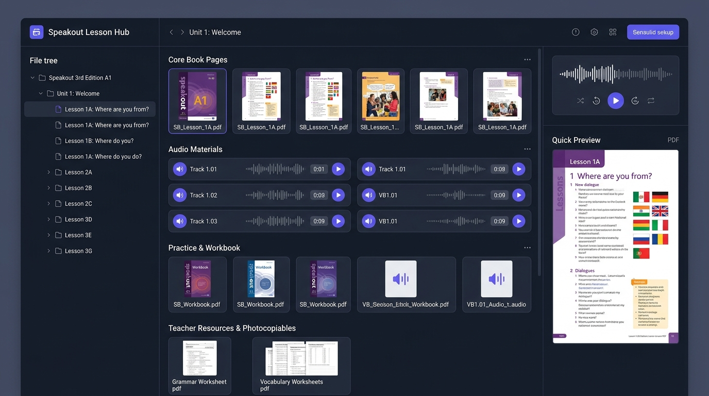
*Скриншот 1: Макет каталога файлов. В первую очередь не входит.*

### Скриншот 2: Видеоурок Lesson D (BBC Video Lesson & Player)
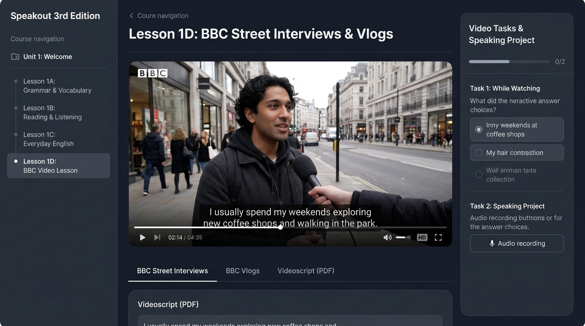
*Скриншот 2: Макет Lesson D. Целью первой очереди не является.*

### Скриншот 3: Обзор раздела и карточки уроков (Unit Overview & Lesson Cards)
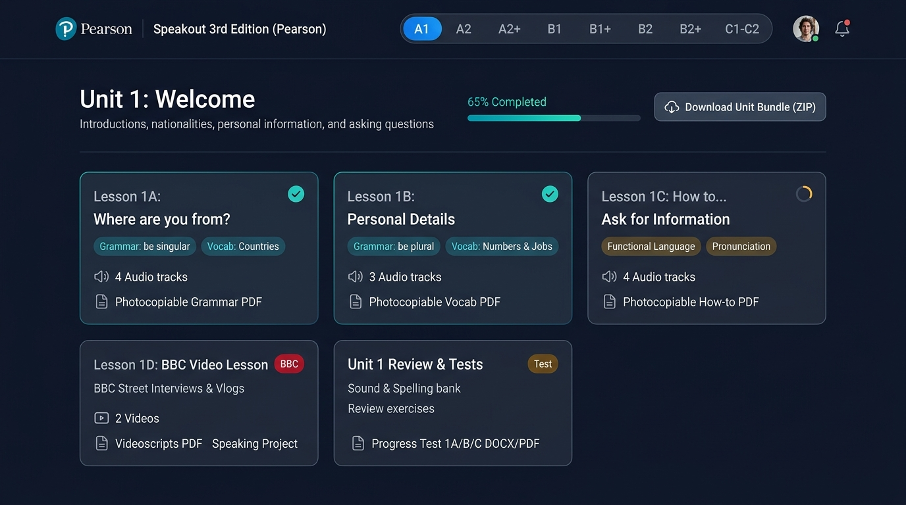
*Скриншот 3: Макет обзора юнита. В первую очередь не входит.*

### Скриншот 4: Интерактивный урок грамматики и лексики (Lesson 1A Study Page)
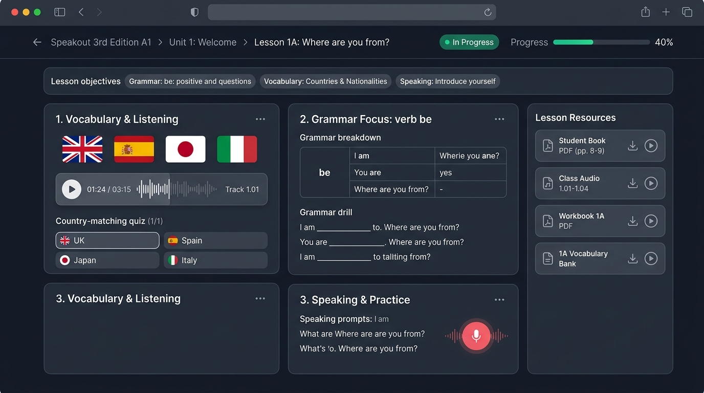
*Скриншот 4: Макет Lesson A. Целью первой очереди не является.*

### Скриншот 5: Матрица типов уроков курса (Lesson Typology Matrix)
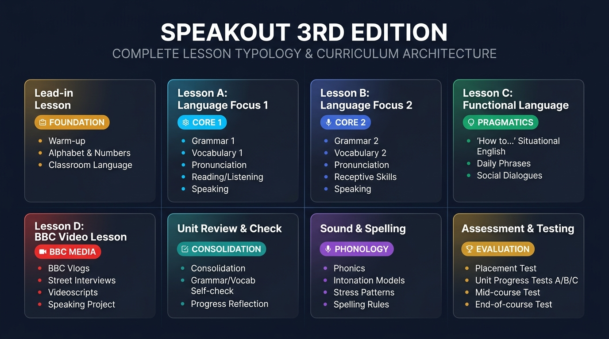
*Скриншот 5: Макет типов занятий. В первую очередь не входит.*

### Скриншот 6: Дорожная карта курса и панель ответов (Route Map & Answer Keys Viewer)
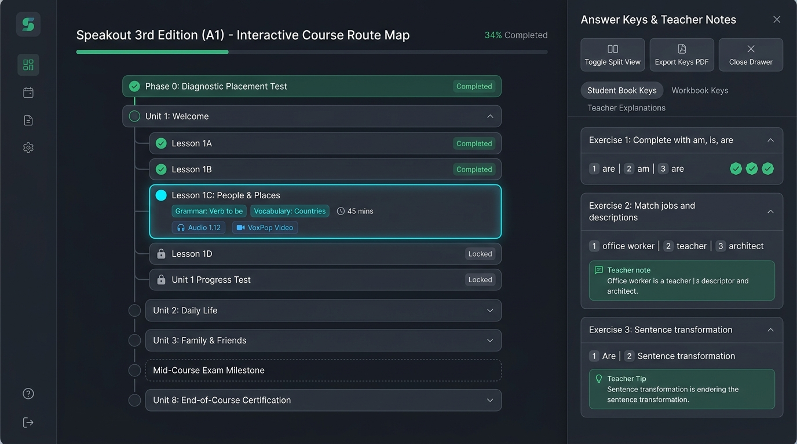
*Скриншот 6: Макет карты и разобранных ключей. В первой очереди ключ — страница PDF.*

### Скриншот 7: Функциональный язык и ситуативное общение (Lesson 1C: Functional Language & "How to...")
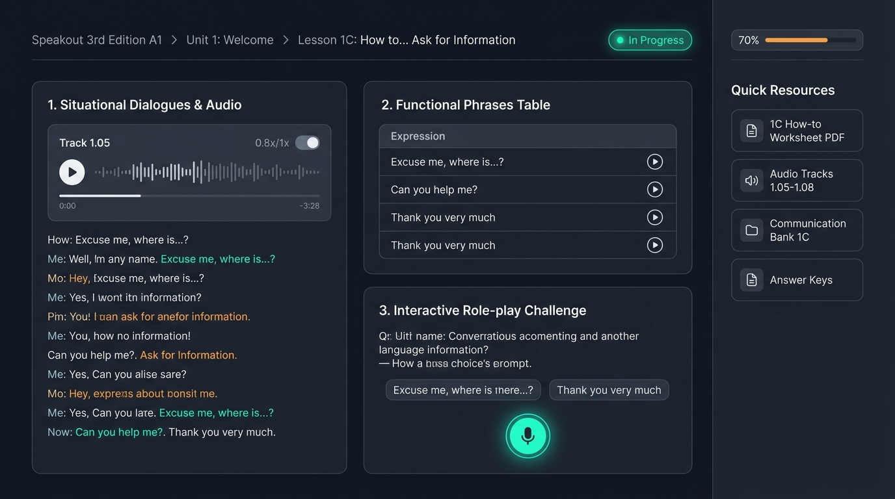
*Скриншот 7: Макет Lesson C. В первую очередь не входит.*

### Скриншот 8: Фонетическая лаборатория (Sound & Spelling Phonics Lab)
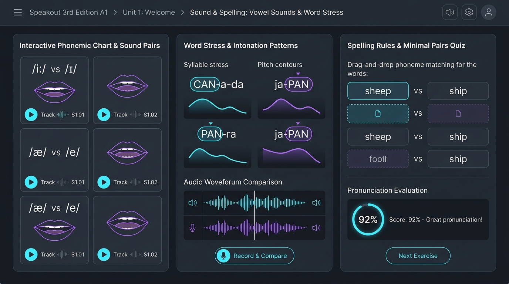
*Скриншот 8: Макет Sound and Spelling. В первую очередь не входит.*

### Скриншот 9: Экран проверочного тестирования (Unit Progress Test Assessment)
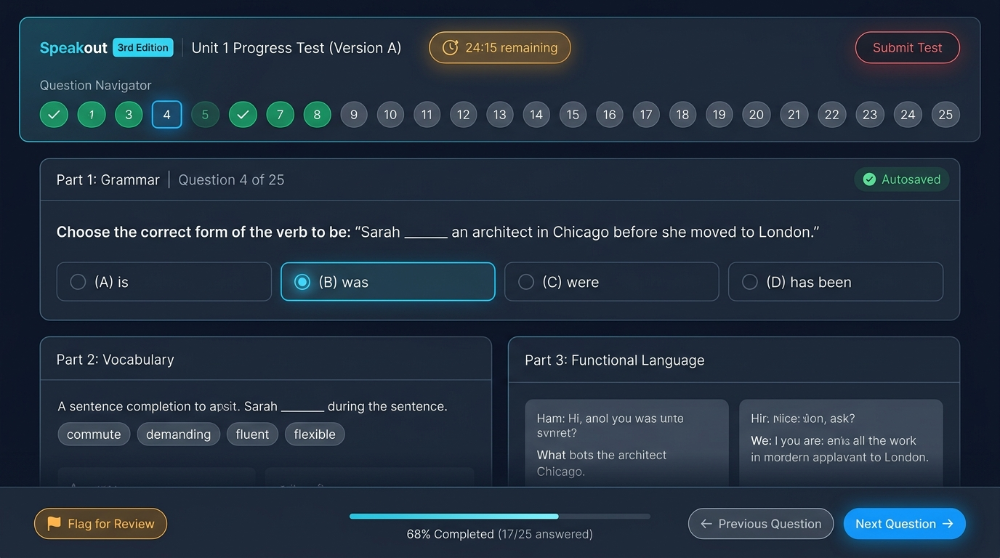
*Скриншот 9: Макет теста. В первую очередь не входит.*

### Скриншот 10: Справочная библиотека банков (Vocabulary Bank & Grammar Bank Explorer)
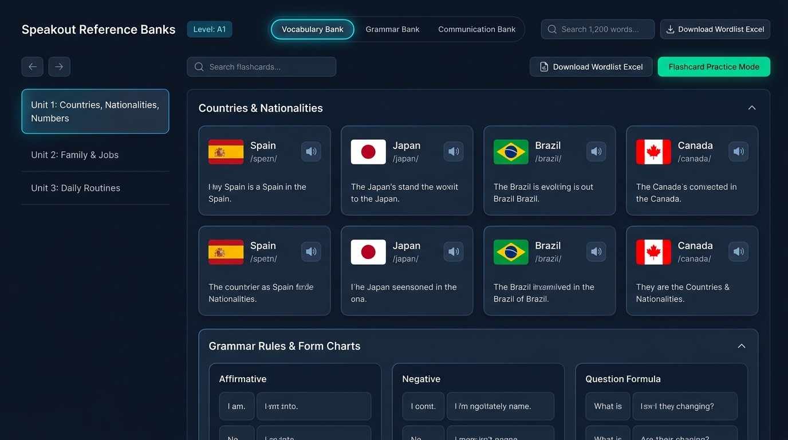
*Скриншот 10: Макет банков. В первую очередь не входит.*

### Скриншот 11: Модуль проверки произношения (AI Pronunciation & Speech Studio)
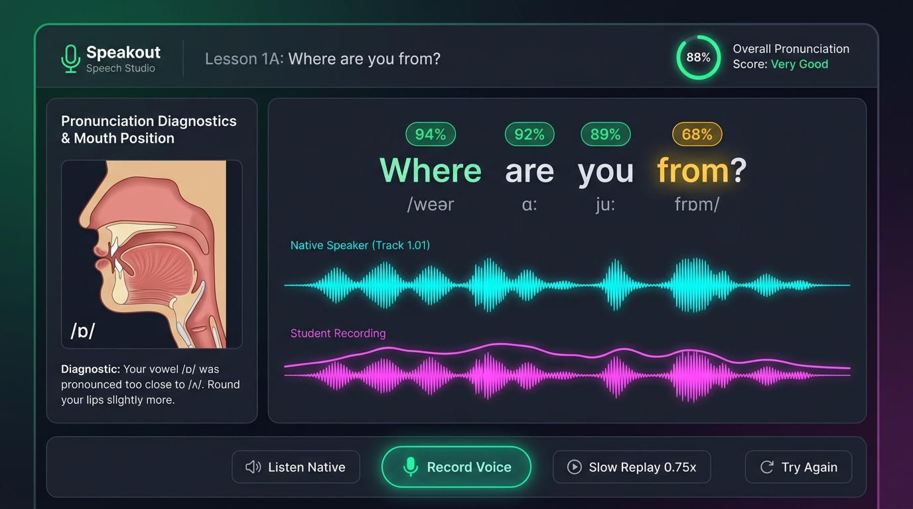
*Скриншот 11: Макет фонемного разбора. Целью первой очереди не является.*

### Скриншот 16: Мастер-интерфейс курса Pearson Speakout 3rd Edition (2022) Level A1 (Исторический прототип)
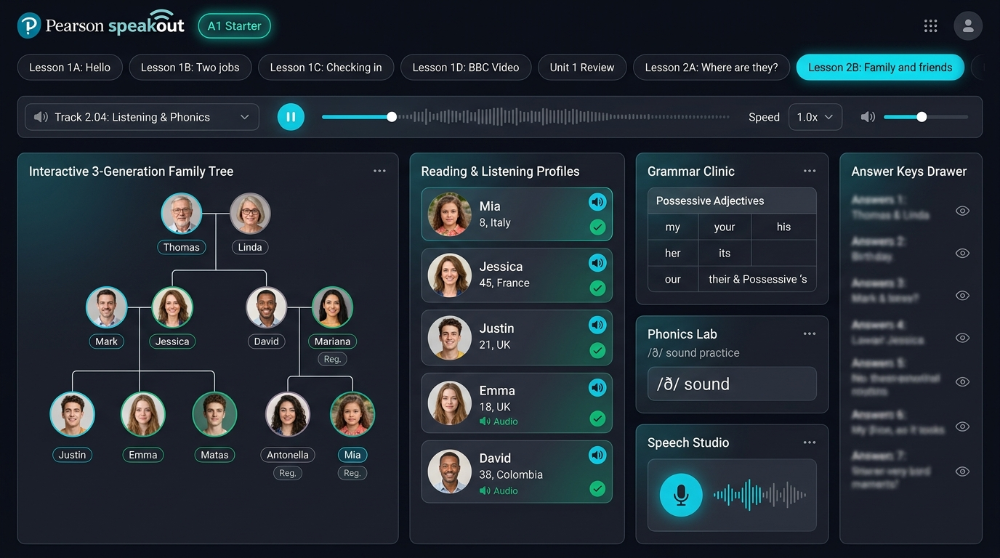
*Скриншот 16: Исторический макет портала курса с панелью ответов.*

### Скриншот 17: Утвержденный единый экран первой очереди (состояние Lesson 1A Hello: PDF.js + полоса треков + Keys)
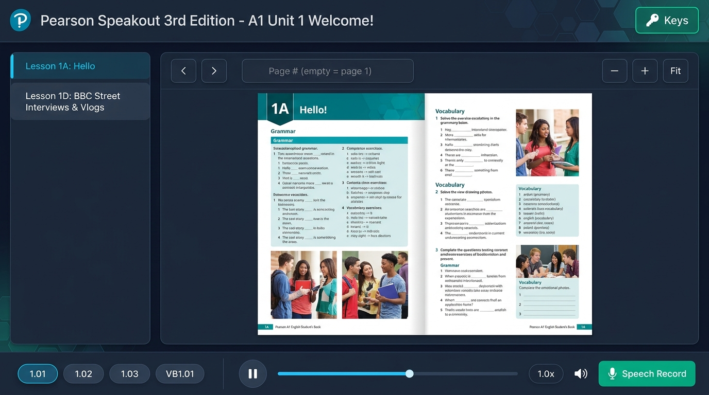
*Скриншот 17: Утвержденный экран первой очереди со встроенным просмотрщиком PDF.js учебника Speakout 3rd Edition A1 Student's Book.pdf.*

### Скриншот 18: Утвержденный единый экран первой очереди (состояние Lesson 1D BBC Video: видеоплеер + скрипт + внешние ссылки)
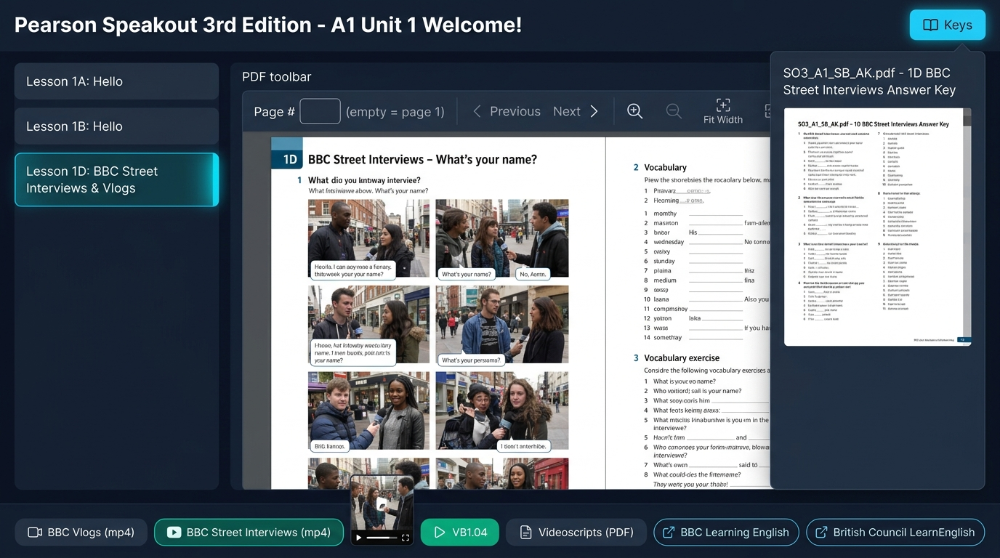
*Скриншот 18: Утвержденный экран урока 1D с воспроизведением BBC Video, кнопкой скрипта и внешними ссылками.*

### Скриншот 19: Двухстраничный просмотр оригинальных ключей SO3_A1_SB_AK.pdf (разворот страниц 2–3 для 1A и 4–5 для 1D)
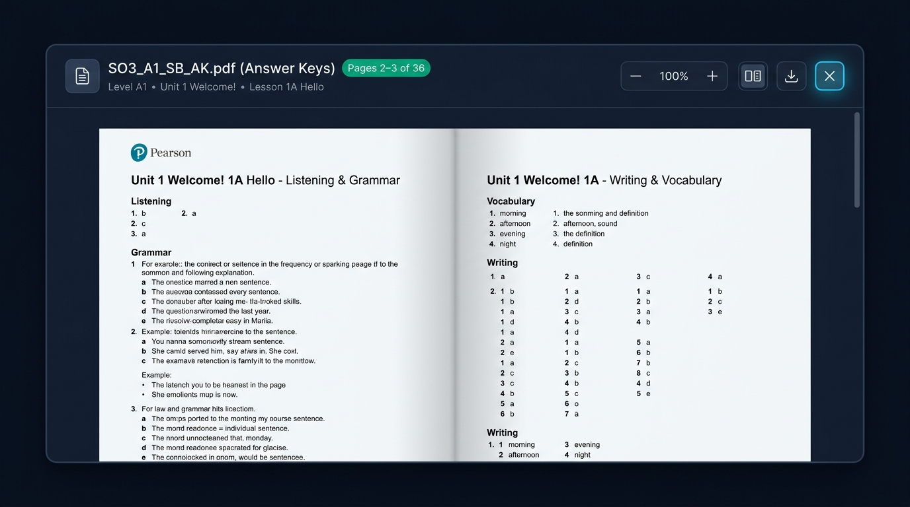
*Скриншот 19: Модальное окно Keys с параллельным отображением страниц 2–3 и 4–5 оригинального PDF-документа ответов учителя.*

### Скриншот 20: Единый плеер рабочей области: совмещенное управление медиа Lesson 1D и просмотр скриптов Videoscripts.pdf
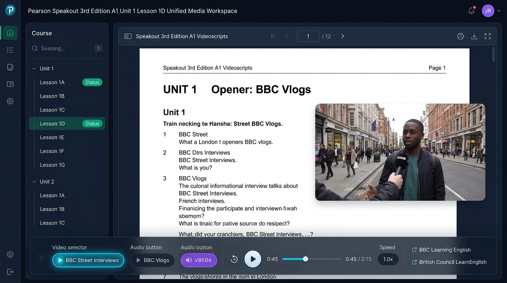
*Скриншот 20: Единая док-панель воспроизведения аудио и видео роликов BBC Street Interviews и Vlogs.*

---

## 11. Чек-лист

Первая очередь:

* `🟩` **Этап 1. Каркас и манифест A1 Unit 1 (Lesson 1A Hello)**
  * Созданы каталоги `speakout/server/`, `speakout/web/`, `speakout/data/`, `speakout/tests/`.
  * Реализован префикс `/api/speakout/` без правок обработчиков, таблиц и экранов существующего проекта.
  * Сформирован `speakout/data/manifest.json` для урока 1A Hello со словарными статьями, аудиотреками и ключами.
* `🟩` **Этап 2. Чтение файлов на месте и плеер**
  * Аудиозаписи Student's Book (`1.01`, `1.02`, `1.03`, `VB1.01`, `VB1.04`) открываются напрямую из исходного каталога.
  * Реализована поддержка заголовков Range и ответа 206 Partial Content для потоковой передачи звука и видео.
* `🟩` **Этап 3. Автономный рабочий интерфейс и просмотрщик PDF.js**
  * Собрана страница `speakout/web/index.html` и стили `speakout/web/style.css` с темной графической темой.
  * Развернут центральный просмотрщик PDF.js страниц учебника `Speakout 3rd Edition A1 Student's Book.pdf` с полем ввода номера страницы (пустое поле открывает страницу 1).
  * Модальное окно `Keys` отображает двухстраничный разворот PDF `SO3_A1_SB_AK.pdf` (стр. 2–3 для 1A, стр. 4–5 для 1D) без текста в DOM и без размытия.
* `🟩` **Этап 4. Студия речи и запись звука**
  * Запись через Web Audio API / MediaRecorder в `speakout/web/app.js` с сохранением в SQLite `speakout/data/speakout.db`.
  * Двухфазное воспроизведение: после завершения записи проигрывается трек Pearson, а затем автоматически звучит запись ученика.
  * Модуль адаптивной верификации речи в реальном времени (Speech Studio, Скриншоты 21, 22 & 23): непрерывная индикация состояния движка, пословная подсветка совпадения слов, динамическая привязка эталонной фразы к аудиодорожкам и расчет процента точности.
* `🟩` **Этап 5. Проверка пилота и тестирование**
  * `node --test speakout/tests/*.test.js` завершен успешно: 65 тестов пройдено в 6 тестовых файлах, 0 сбоев.
  * Тесты проверяют целостность данных (`lesson1a_data.test.js`, `lesson1d_data.test.js`), серверные маршруты и Range 206 (`lesson1a_server.test.js`, `lesson1d_video.test.js`), визуальные контролы UI (`lesson1a_ui.test.js`) и безопасность (`security_hardening.test.js` с 28 тестами).

После первой очереди, не начинать вместе с этапами 1–5:

* `⬜` Импорт 13 Wordlist и разбор 760 тестов Word, с отдельным конвертером для 12 `.doc`.
* `⬜` WebVTT и Click-to-Jump по образцу Language Reactor после появления таймкодов.
* `⬜` SM-2, WebSocket класса, PDF-портфолио GSE, режим учителя, SVG-пометки, горячие клавиши, выгрузка SQLite в JSON.

---

## 12. Эта правка документа

Реализована первая очередь Speakout 3rd Edition A1 Unit 1 (Lesson 1A Hello и Lesson 1D BBC Video):

* Сделано: развернута автономная директория `speakout/`, создан сервер `speakout/server/server.js` с сетевой привязкой `0.0.0.0` (с доступом с iPad), внедрено хранение сессий в SQLite `speakout_sessions` с защитой роли учителя через `crypto.timingSafeEqual`, доступ к ключам `doc=keys` разрешен подтвержденной сессии ученика для просмотра разворота страниц 2–3 и 4–5 (401 без сессии), доступ к ресурсам учителя `doc=teacherResources` ограничен подтвержденным ролям преподавателя или разработчика (403 ученику), удалено авто-доверие к cookie `learning_stage`, внедрен Rate Limiter сессий (10 req/min) с очисткой устаревших IP и лимитом в 500 записей, квотирование аудиозаписей (512 КБ и 1 слот на дорожку) с валидацией `lessonId` и `trackId`, лимит прогресса до 8 КБ с динамической валидацией диапазона страницы `[1..maxPages]` через `pdf.mjs`, разделение манифеста и урока 1A со скрытием транскриптов и невыпущенных модулей, оффлайн-шлюз речи в `speakout/web/app.js` (двухфазное воспроизведение, исключение синтетических фраз и запуск распознавания только при подтвержденном локальном движке), сетевой доступ в `ops/run-learning-stage.mjs` с поддержкой `HOST`, безопасная валидация `x-forwarded-proto` через `TRUST_PROXY`, написаны 6 тестовых файлов (65 тестов) и успешно пройдены без ошибок.
* Тесты этой правки: `speakout/tests/lesson1a_data.test.js`, `speakout/tests/lesson1a_server.test.js`, `speakout/tests/lesson1a_ui.test.js`, `speakout/tests/lesson1d_data.test.js`, `speakout/tests/lesson1d_video.test.js`, `speakout/tests/security_hardening.test.js`.
* Arguments: `node --test speakout/tests/*.test.js`.
* Environment: изолированный порт, исходный каталог смонтирован только на чтение.
* Строка коммита: `[task] TASK-70 Implemented student keys access, offline speech gate, dynamic PDF page count, and stage network host`
