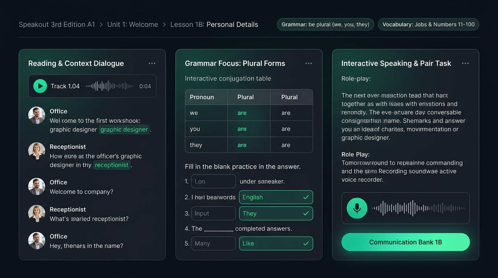

# План реализации модуля Lesson 1B (Two Jobs) курса Speakout 3rd Edition A1

> [!WARNING]
> **Блок изоляции области работ и защиты смежного функционала**:
> Запрещено затрагивать, модифицировать или нарушать функционал, не относящийся к текущему уроку Lesson 1B. Изменения вносятся строго изолированно в директорию `speakout/`. Рабочие директории существующего проекта `english-quiz` (`client/`, `production/`, `site/`), глобальные стили, серверные обработчики и базы данных проекта не затрагиваются. Все ранее реализованные функции Lesson 1A и Lesson 1D сохраняют полную работоспособность.

---

### Скриншот 13: Рабочее пространство урока 1B (Lesson 1B Two Jobs)

*Скриншот 13: Утвержденный макет пользовательского интерфейса интерактивного урока 1B (Two Jobs & Personal Details).*

---

### Этапы и контрольный список реализации

| Статус | Идентификатор этапа | Описание работ и артефакты |
| :--- | :--- | :--- |
| 🟩 | `STAGE-1B-01` | **Извлечение данных и генерация манифеста Lesson 1B**: парсинг 15 названий профессий из `Speakout 3rd A1 Wordlist.xlsx`, аудиотреков Student's Book (`1.04`, `1.0X`, `VB1.02`, `VB1.03`) и Workbook (`1.05`), текстов профилей Carol Harris и Silvio Rossi, матрицы ответов `SO3_A1_SB_AK.pdf` в [speakout/data/manifest.json](file:///Users/tsovakpalakian/PycharmProjects/english-quiz/speakout/data/manifest.json) |
| 🟩 | `STAGE-1B-02` | **Серверные эндпоинты урока 1B**: добавление маршрута `GET /api/speakout/lesson/A1/1B` и поддержка треков `1.04`, `1.0X`, `VB1.02`, `VB1.03`, `WB1.05` в [speakout/server/server.js](file:///Users/tsovakpalakian/PycharmProjects/english-quiz/speakout/server/server.js) |
| 🟩 | `STAGE-1B-03` | **Пользовательский интерфейс урока 1B**: переключатель уроков (1A / 1B / 1D), аудиоконтроллер дорожек 1B, карточки чтения двух профилей, упражнения сопоставления профессий и правил артиклей `a`/`an`, спряжение `be` (he, she, it) и секция ответов в Answer Keys Drawer в [speakout/web/index.html](file:///Users/tsovakpalakian/PycharmProjects/english-quiz/speakout/web/index.html), [speakout/web/style.css](file:///Users/tsovakpalakian/PycharmProjects/english-quiz/speakout/web/style.css), [speakout/web/app.js](file:///Users/tsovakpalakian/PycharmProjects/english-quiz/speakout/web/app.js) |
| 🟩 | `STAGE-1B-04` | **Автоматизированное тестирование**: создание тестов [speakout/tests/lesson1b_data.test.js](file:///Users/tsovakpalakian/PycharmProjects/english-quiz/speakout/tests/lesson1b_data.test.js), [speakout/tests/lesson1b_server.test.js](file:///Users/tsovakpalakian/PycharmProjects/english-quiz/speakout/tests/lesson1b_server.test.js), [speakout/tests/lesson1b_ui.test.js](file:///Users/tsovakpalakian/PycharmProjects/english-quiz/speakout/tests/lesson1b_ui.test.js) |
| 🟩 | `STAGE-1B-05` | **Верификация полного сьюта тестов**: запуск `node --test speakout/tests/*.test.js` со 100% прохождением всех сьютов (55 тестов успешно) |

---

### Архитектурные спецификации компонентов Lesson 1B

1. **Данные и контент**:
   - 15 словарных единиц профессий с IPA и дефинициями.
   - 5 аудиотреков (`1.04`, `1.0X`, `VB1.02`, `VB1.03`, `WB1.05`).
   - Чтение: профили Carol Harris (врач в будни, певица в выходные) и Silvio Rossi (водитель такси в будни, официант в выходные).
2. **Интерактивные упражнения**:
   - `Exercise 1`: сопоставление профессий и выбор артикля `a`/`an`.
   - `Exercise 2`: чтение и заполнение сетки профилей (Carol & Silvio).
   - `Exercise 3`: грамматика present simple be (he, she, it: affirmative, negative, questions).
   - `Speech Studio 1B`: тренировка фразы *"She is a doctor and he is a waiter"*.
3. **Панель проверки ответов (Answer Keys)**:
   - Вкладка ключей 1B в шторке с размытием `filter: blur(6px)` и пошаговым открытием.
