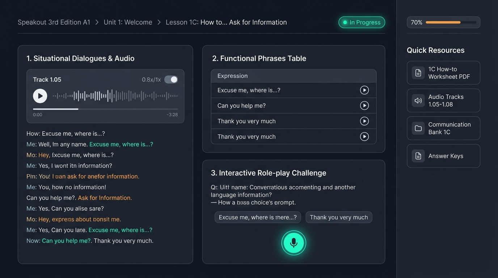

# План реализации модуля Lesson 1C (Checking in) курса Speakout 3rd Edition A1

> [!WARNING]
> **Блок изоляции области работ и защиты смежного функционала**:
> Запрещено затрагивать, модифицировать или нарушать функционал, не относящийся к текущему уроку Lesson 1C. Изменения вносятся строго изолированно в директорию `speakout/`. Рабочие директории существующего проекта `english-quiz` (`client/`, `production/`, `site/`), глобальные стили, серверные обработчики и базы данных проекта не затрагиваются. Все ранее реализованные функции уроков 1A, 1B и 1D сохраняют полную работоспособность.

---

### Скриншот 7: Функциональный язык и ситуативное общение (Lesson 1C: Functional Language & "How to...")

*Скриншот 7: Утвержденный макет пользовательского интерфейса интерактивного урока 1C (Checking in & How to ask/answer simple questions).*

---

### Этапы и контрольный список реализации

| Статус | Идентификатор этапа | Описание работ и артефакты |
| :--- | :--- | :--- |
| 🟩 | `STAGE-1C-01` | **Извлечение данных и генерация манифеста Lesson 1C**: извлечение 26 букв алфавита с транскрипцией IPA, 7 фонематических звуковых групп, 6 фраз регистрации в отеле из `Speakout 3rd A1 Wordlist.xlsx`, аудиотреков Student's Book (`1.05`, `1.06`, `1.07`, `1.08`) и Workbook (`1.06`–`1.11`), ключей ответов `SO3_A1_SB_AK.pdf` в [speakout/data/manifest.json](file:///Users/tsovakpalakian/PycharmProjects/english-quiz/speakout/data/manifest.json) |
| 🟩 | `STAGE-1C-02` | **Серверные эндпоинты урока 1C**: регистрация маршрута `GET /api/speakout/lesson/A1/1C` и поддержка потоковой передачи аудиодорожек `1.05`, `1.06`, `1.07`, `1.08`, `WB1.06`–`WB1.11` в [speakout/server/server.js](file:///Users/tsovakpalakian/PycharmProjects/english-quiz/speakout/server/server.js) |
| 🟩 | `STAGE-1C-03` | **Пользовательский интерфейс урока 1C**: добавление вкладки `Lesson 1C: Checking in` в переключатель уроков, интерактивная таблица 7 фонематических групп алфавита, симулятор диалога регистрации в отеле (Imogen Clarke, Amelia Menzie, Eduardo Lopez), тренажер фраз "How to...", карточки словарного запаса и вкладка ответов в Answer Keys Drawer в [speakout/web/index.html](file:///Users/tsovakpalakian/PycharmProjects/english-quiz/speakout/web/index.html), [speakout/web/style.css](file:///Users/tsovakpalakian/PycharmProjects/english-quiz/speakout/web/style.css), [speakout/web/app.js](file:///Users/tsovakpalakian/PycharmProjects/english-quiz/speakout/web/app.js) |
| 🟩 | `STAGE-1C-04` | **Автоматизированное тестирование**: создание тестов [speakout/tests/lesson1c_data.test.js](file:///Users/tsovakpalakian/PycharmProjects/english-quiz/speakout/tests/lesson1c_data.test.js), [speakout/tests/lesson1c_server.test.js](file:///Users/tsovakpalakian/PycharmProjects/english-quiz/speakout/tests/lesson1c_server.test.js), [speakout/tests/lesson1c_ui.test.js](file:///Users/tsovakpalakian/PycharmProjects/english-quiz/speakout/tests/lesson1c_ui.test.js) |
| 🟩 | `STAGE-1C-05` | **Верификация полного сьюта тестов**: запуск `node --test speakout/tests/*.test.js` со 100% прохождением тестов для всех 4 уроков |

---

### Архитектурные спецификации компонентов Lesson 1C

1. **Данные и контент**:
   - 26 букв алфавита с фонетической группировкой по звукам (/eɪ/, /iː/, /e/, /aɪ/, /əʊ/, /uː/, /ɑː/).
   - 6 выражений функционального языка (first name, surname, phone number, address, spell, repeat).
   - 3 диалога регистрации в отеле (Conversations 1, 2, 3).
   - 10 аудиотреков (`1.05`, `1.06`, `1.07`, `1.08`, `WB1.06`–`WB1.11`).
2. **Интерактивные упражнения**:
   - `Exercise 1`: классификация букв алфавита по 7 гласным звукам.
   - `Exercise 2`: аудирование диалогов регистрации и заполнение формы гостя (Guest Registration Form: name, surname, address, phone number).
   - `Exercise 3`: симулятор вежливого диалога ("How do you spell that?", "Can you repeat that, please?", "Just a minute").
   - `Speech Studio 1C`: тренировка фразы *"How do you spell your surname, please?"*.
3. **Панель проверки ответов (Answer Keys)**:
   - Вкладка ключей 1C в шторке с размытием `filter: blur(6px)` и пошаговым открытием.
