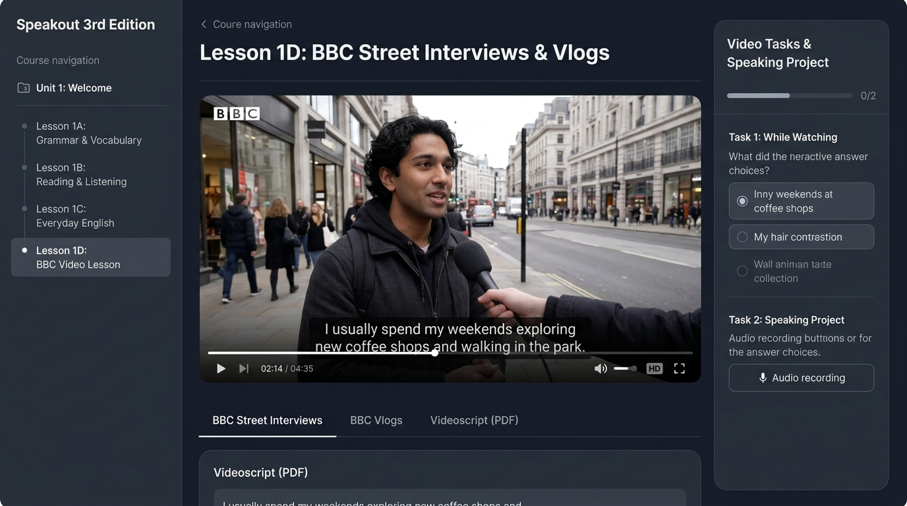

# План реализации модуля Lesson 1D (BBC Video Lesson) курса Speakout 3rd Edition A1

> [!WARNING]
> **Блок изоляции области работ и защиты смежного функционала**:
> Запрещено затрагивать, модифицировать или нарушать функционал, не относящийся к текущему уроку Lesson 1D. Изменения вносятся строго изолированно в директорию `speakout/`. Рабочие директории существующего проекта `english-quiz` (`client/`, `production/`, `site/`), глобальные стили, серверные обработчики и базы данных проекта не затрагиваются. Все ранее реализованные функции Lesson 1A сохраняют полную работоспособность.

---

### Скриншот 2: Видеоурок Lesson D (BBC Video Lesson & Player)

*Скриншот 2: Утвержденный макет пользовательского интерфейса видеоурока 1D (BBC Street Interviews & Vlogs).*

---

### Этапы и контрольный список реализации

| Статус | Идентификатор этапа | Описание работ и артефакты |
| :--- | :--- | :--- |
| 🟩 | `STAGE-1D-01` | **Извлечение данных и генерация манифеста Lesson 1D**: извлечение 13 словарных статей Common Objects из `Speakout 3rd A1 Wordlist.xlsx`, транскриптов из `Speakout_A1_SB_Videoscripts.pdf`, проверочных ответов из `SO3_A1_SB_AK.pdf` и `SO3_A1_WB_AK.pdf` в [speakout/data/manifest.json](file:///Users/tsovakpalakian/PycharmProjects/english-quiz/speakout/data/manifest.json) |
| 🟩 | `STAGE-1D-02` | **Стриминг видеофайлов через HTTP Range в сервере**: реализация эндпоинта `/api/speakout/video` в [speakout/server/server.js](file:///Users/tsovakpalakian/PycharmProjects/english-quiz/speakout/server/server.js) с поддержкой HTTP 206 Partial Content для потоковой передачи `SO3 A1 U1 BBC StreetInt.mp4` и `SO3 A1 U1 BBC Vlogs.mp4` |
| 🟩 | `STAGE-1D-03` | **Пользовательский интерфейс видеоурока Lesson 1D**: переключатель уроков (1A / 1D) в шапке, HTML5 видеоплеер с кнопками переключения роликов BBC, панель транскрипта с репликами спикеров, интерактивные карточки упражнений (буквы имен, категоризация сумок Bag A / Bag B, грамматика have/has) и интеграция с панелью Answer Keys в [speakout/web/index.html](file:///Users/tsovakpalakian/PycharmProjects/english-quiz/speakout/web/index.html), [speakout/web/style.css](file:///Users/tsovakpalakian/PycharmProjects/english-quiz/speakout/web/style.css), [speakout/web/app.js](file:///Users/tsovakpalakian/PycharmProjects/english-quiz/speakout/web/app.js) |
| 🟩 | `STAGE-1D-04` | **Модульное и интеграционное тестирование**: создание сьютов [speakout/tests/lesson1d_video.test.js](file:///Users/tsovakpalakian/PycharmProjects/english-quiz/speakout/tests/lesson1d_video.test.js), [speakout/tests/lesson1d_data.test.js](file:///Users/tsovakpalakian/PycharmProjects/english-quiz/speakout/tests/lesson1d_data.test.js), [speakout/tests/lesson1d_ui.test.js](file:///Users/tsovakpalakian/PycharmProjects/english-quiz/speakout/tests/lesson1d_ui.test.js) |
| 🟩 | `STAGE-1D-05` | **Верификация тестов и фиксация результатов**: запуск сьюта `node --test speakout/tests/*.test.js` со 100% прохождением тестов (37 тестов успешно) |

---

### Архитектурные спецификации компонентов Lesson 1D

1. **Серверный видеостриминг**:
   - Эндпоинт: `GET /api/speakout/video?file=<filename>`
   - MIME: `video/mp4`
   - Заголовки ответа: `Accept-Ranges: bytes`, `Content-Range: bytes <start>-<end>/<total>`, `Content-Length: <chunk>`
   - Защита: отклонение путей с относительными переходами (`..`, `/`, `\`) кодом 400.
2. **Интерактивные упражнения**:
   - `Exercise 1`: правописание имен спикеров по буквам (William, Rachael, Chris, Sharron, Ian, Simnit, Layan, Tom).
   - `Exercise 2`: разделение предметов по сумкам (Bag A: an umbrella, a mobile phone, a purse; Bag B: a laptop, two books).
   - `Exercise 3`: грамматика singular/plural nouns, неопределенные артикли a/an, глаголы have/has.
3. **Панель проверки ответов (Answer Keys)**:
   - Ступенчатое раскрытие ключей к заданиям Preview, View и Grammar Bank с эффектом размытия `filter: blur(6px)`.
