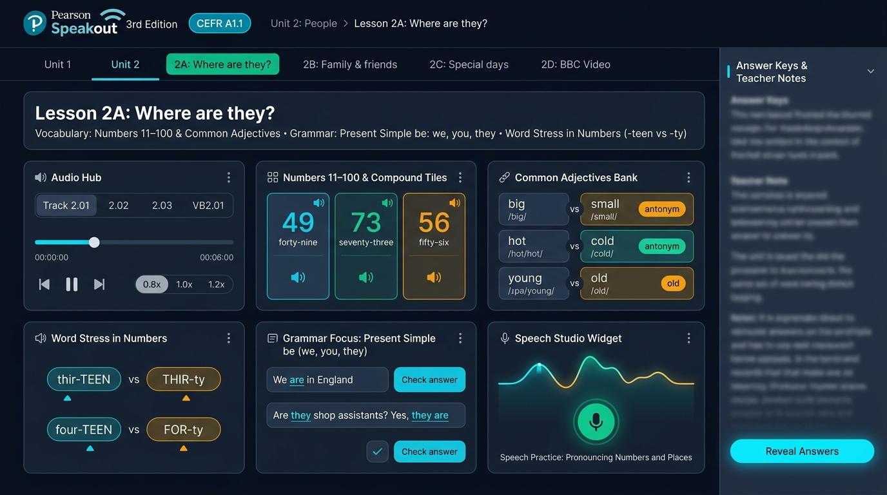

# План реализации модуля Lesson 2A (Where are they?) курса Speakout 3rd Edition A1

> [!WARNING]
> **Блок изоляции области работ и защиты смежного функционала**:
> Запрещено затрагивать, модифицировать или нарушать функционал, не относящийся к текущему уроку Lesson 2A. Изменения вносятся строго изолированно в директорию `speakout/`. Рабочие директории существующего проекта `english-quiz` (`client/`, `production/`, `site/`), глобальные стили, серверные обработчики и базы данных проекта не затрагиваются. Все ранее реализованные функции Unit 1 (уроки 1A, 1B, 1C, 1D, Review и Test) сохраняют полную работоспособность.

---

### Скриншот 14: Интерактивный урок 2A: Where are they? (Numbers 11–100, Adjectives & Verb be plural)

*Скриншот 14: Утвержденный макет пользовательского интерфейса интерактивного урока 2A (Where are they? • Numbers 11–100 & Common Adjectives • Present Simple be: we, you, they).*

---

### Этапы и контрольный список реализации

| Статус | Идентификатор этапа | Описание работ и артефакты |
| :--- | :--- | :--- |
| 🟩 | `STAGE-2A-01` | **Извлечение данных и генерация манифеста Lesson 2A**: извлечение 18 числительных (11–100) и 18 базовых прилагательных из листа `Unit 2` (`sheet3.xml`) файла `Speakout 3rd A1 Wordlist.xlsx`, аудиотреков Student's Book (`2.01`, `2.02`, `2.03`, `2.0X`, `VB2.01`) и Workbook (`2.01`–`2.03`), текстов о людях в Англии и Уэльсе, проверочных ключей ответов `SO3_A1_SB_AK.pdf` (Stream 33) в [speakout/data/manifest.json](file:///Users/tsovakpalakian/PycharmProjects/english-quiz/speakout/data/manifest.json) |
| 🟩 | `STAGE-2A-02` | **Серверные эндпоинты урока 2A**: регистрация маршрута `GET /api/speakout/lesson/A1/2A` и поддержка потоковой передачи аудиодорожек `2.01`–`2.03`, `2.0X`, `VB2.01`, `WB2.01`–`WB2.03` в [speakout/server/server.js](file:///Users/tsovakpalakian/PycharmProjects/english-quiz/speakout/server/server.js) |
| 🟩 | `STAGE-2A-03` | **Пользовательский интерфейс урока 2A**: добавление переключателя юнитов (Unit 1 / Unit 2) и вкладки `Lesson 2A: Where are they?`, интерактивный аудиоплеер 2A, компаратор ударения в числительных (-teen vs -ty), плиточный тренажер составных чисел, банк 18 прилагательных с полярными парами, упражнения на глагол be (we, you, they), Speech Studio 2A и вкладка ответов в Answer Keys Drawer в [speakout/web/index.html](file:///Users/tsovakpalakian/PycharmProjects/english-quiz/speakout/web/index.html), [speakout/web/style.css](file:///Users/tsovakpalakian/PycharmProjects/english-quiz/speakout/web/style.css), [speakout/web/app.js](file:///Users/tsovakpalakian/PycharmProjects/english-quiz/speakout/web/app.js) |
| 🟩 | `STAGE-2A-04` | **Автоматизированное тестирование**: создание тестов [speakout/tests/lesson2a_data.test.js](file:///Users/tsovakpalakian/PycharmProjects/english-quiz/speakout/tests/lesson2a_data.test.js), [speakout/tests/lesson2a_server.test.js](file:///Users/tsovakpalakian/PycharmProjects/english-quiz/speakout/tests/lesson2a_server.test.js), [speakout/tests/lesson2a_ui.test.js](file:///Users/tsovakpalakian/PycharmProjects/english-quiz/speakout/tests/lesson2a_ui.test.js) |
| 🟩 | `STAGE-2A-05` | **Верификация полного сьюта тестов**: запуск `node --test speakout/tests/*.test.js` со 100% прохождением тестов для всех модулей Unit 1 и Unit 2A (~110+ тестов) |

---

### Архитектурные спецификации компонентов Lesson 2A

1. **Данные и контент**:
   - 18 числительных от 11 до 100: eleven, twelve, thirteen, fourteen, fifteen, sixteen, seventeen, eighteen, nineteen, twenty, thirty, forty, fifty, sixty, seventy, eighty, ninety, a hundred.
   - 18 базовых прилагательных с транскрипцией IPA: bad, beautiful, big, cold, difficult, easy, favourite, friendly, good, happy, hot, new, old (возраст), old (предмет), sad, small, tired, young.
   - Составные числительные: 49 (forty-nine), 73 (seventy-three), 56 (fifty-six), 67 (sixty-seven), 34 (thirty-four), 98 (ninety-eight), 52 (fifty-two), 25 (twenty-five), 88 (eighty-eight).
   - 8 аудиотреков: 5 треков Student's Book (`2.01`, `2.02`, `2.03`, `2.0X`, `VB2.01`) и 3 трека Workbook (`WB2.01`, `WB2.02`, `WB2.03`).
   - Чтение: профили людей в Англии и Уэльсе (A: England, B: England, C: Wales) с вопросами True/False.
   - Грамматика: Present Simple *be (we, you, they)*:
     * Утверждения: *We're / They're shop assistants.*
     * Вопросы: *Are they from Scotland? Where are you?*
     * Отрицания: *They aren't here. / We aren't tired.*
2. **Интерактивные упражнения**:
   - `Exercise 1`: Плиточный тренажер и клавиатура составных чисел (49, 73, 56, 67, 34, 98, 52, 25, 88).
   - `Exercise 2`: Компаратор словесного ударения (thir-TEEN vs THIR-ty, four-TEEN vs FOR-ty).
   - `Exercise 3`: Чтение профилей и проверка True/False (England vs Wales).
   - `Exercise 4`: Грамматический тренажер глагола *be (we, you, they)*.
   - `Speech Studio 2A`: Практика произношения предложения *"We are in England, and they are in Wales."* (/wiː ɑːr ɪn ˈɪŋɡlənd ənd ðeɪ ɑːr ɪn weɪlz/).
3. **Панель проверки ответов (Answer Keys Drawer)**:
   - Вкладка `2A Where are they?` с размытием ответов `filter: blur(6px)` и кнопками раздельного открытия.
