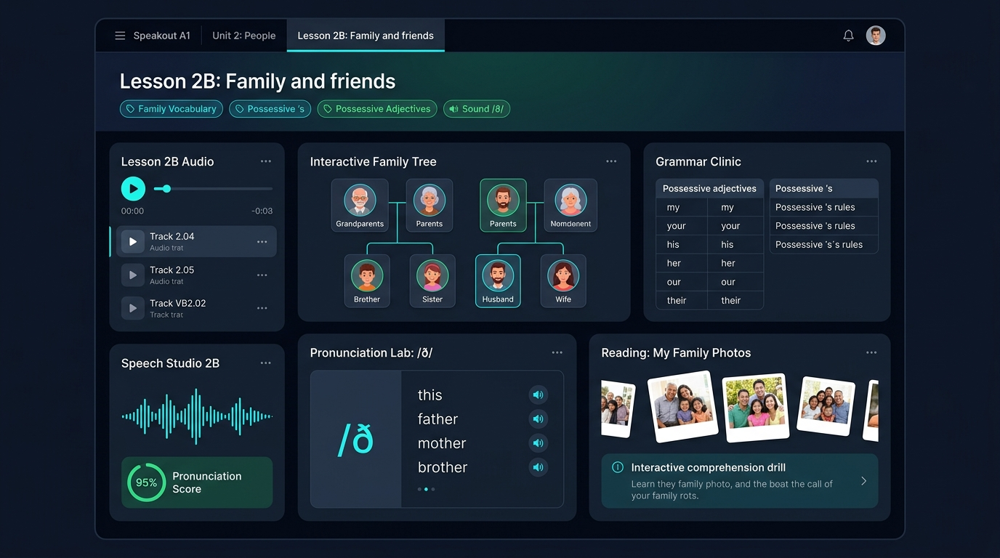

# План реализации модуля Lesson 2B (Family and friends) курса Speakout 3rd Edition A1

> [!WARNING]
> **Блок изоляции области работ и защиты смежного функционала**:
> Запрещено затрагивать, модифицировать или нарушать функционал, не относящийся к текущему уроку Lesson 2B. Изменения вносятся строго изолированно в директорию `speakout/`. Рабочие директории существующего проекта `english-quiz` (`client/`, `production/`, `site/`), глобальные стили, серверные обработчики и базы данных проекта не затрагиваются. Все ранее реализованные функции Unit 1 (уроки 1A, 1B, 1C, 1D, Review и Test) и Lesson 2A сохраняют полную работоспособность.

---

### Скриншот 15: Интерактивный урок 2B: Family and friends (Family Members, Possessive 's & Adjectives)

*Скриншот 15: Утвержденный макет пользовательского интерфейса интерактивного урока 2B (Family and friends • Family Members & People • Possessive Adjectives: my, your, his, her, its, our, their • Sound /ð/).*

---

### Этапы и контрольный список реализации

| Статус | Идентификатор этапа | Описание работ и артефакты |
| :--- | :--- | :--- |
| 🟩 | `STAGE-2B-01` | **Извлечение данных и генерация манифеста Lesson 2B**: извлечение 18 лексических единиц (10 членов семьи и 8 слов категории People) из листа `Unit 2` (`sheet3.xml`) файла `Speakout 3rd A1 Wordlist.xlsx`, аудиотреков Student's Book (`2.04`, `2.05`, `VB2.02`, `VB2.03`) и Workbook (`WB2.04`, `WB2.05`, `WB2.06`), профилей 5 героев (Mia, Jessica, Justin, Emma, David), проверочных ключей ответов `SO3_A1_SB_AK.pdf` (Stream 6 и 7) в [speakout/data/manifest.json](file:///Users/tsovakpalakian/PycharmProjects/english-quiz/speakout/data/manifest.json) |
| 🟩 | `STAGE-2B-02` | **Серверные эндпоинты урока 2B**: регистрация маршрута `GET /api/speakout/lesson/A1/2B` и поддержка потоковой передачи аудиодорожек `2.04`, `2.05`, `VB2.02`, `VB2.03`, `WB2.04`–`WB2.06` в [speakout/server/server.js](file:///Users/tsovakpalakian/PycharmProjects/english-quiz/speakout/server/server.js) |
| 🟩 | `STAGE-2B-03` | **Пользовательский интерфейс урока 2B**: добавление вкладки `Lesson 2B: Family and friends`, интерактивный аудиоплеер 2B, интерактивное семейное древо Family Tree Explorer, грамматическая клиника притяжательных местоимений и падежа 's, фонетический тренажер звонкого согласного `/ð/`, карточки чтения My Family Photos, модуль Speech Studio 2B и вкладка ответов в Answer Keys Drawer в [speakout/web/index.html](file:///Users/tsovakpalakian/PycharmProjects/english-quiz/speakout/web/index.html), [speakout/web/style.css](file:///Users/tsovakpalakian/PycharmProjects/english-quiz/speakout/web/style.css), [speakout/web/app.js](file:///Users/tsovakpalakian/PycharmProjects/english-quiz/speakout/web/app.js) |
| 🟩 | `STAGE-2B-04` | **Автоматизированное тестирование**: создание тестов [speakout/tests/lesson2b_data.test.js](file:///Users/tsovakpalakian/PycharmProjects/english-quiz/speakout/tests/lesson2b_data.test.js), [speakout/tests/lesson2b_server.test.js](file:///Users/tsovakpalakian/PycharmProjects/english-quiz/speakout/tests/lesson2b_server.test.js), [speakout/tests/lesson2b_ui.test.js](file:///Users/tsovakpalakian/PycharmProjects/english-quiz/speakout/tests/lesson2b_ui.test.js) |
| 🟩 | `STAGE-2B-05` | **Верификация полного сьюта тестов**: запуск `node --test speakout/tests/*.test.js` со 100% прохождением тестов для всех модулей Unit 1, Lesson 2A и Lesson 2B |

---

### Архитектурные спецификации компонентов Lesson 2B

1. **Данные и контент**:
   - 10 терминов родства: mother, father, parents, son, daughter, children, brother, sister, husband, wife.
   - 8 терминов категории People: baby, boy, child, friend, girl, man, person, woman.
   - 7 притяжательных местоимений: my, your, his, her, its, our, their.
   - 5 аудиотреков Student's Book (`2.04`, `2.05`, `VB2.02`, `VB2.03`) и 3 трека Workbook (`WB2.04`, `WB2.05`, `WB2.06`).
   - Аудирование и чтение: профили 5 героев (Mia — 8 лет, Италия, школьница; Jessica — 45 лет, Франция, владелица ресторана; Justin — 21 год, Великобритания, журналист; Emma — 18 лет, Великобритания, студентка; David — 38 лет, Колумбия, врач).
   - Грамматика: Possessive Adjectives (*my, your, his, her, its, our, their*) и Possessive 's (*David's wife, Mark's daughter*).
   - Фонетика: слоговая структура (1 слог vs 2 слога) и отработка звонкого межзубного согласного `/ð/` (*this, brother, father, mother, their*).
2. **Интерактивные упражнения**:
   - `Exercise 1`: Интерактивное семейное древо Family Tree Explorer с карточками персонажей.
   - `Exercise 2`: Грамматический тренажер притяжательных местоимений (заполнение пропусков).
   - `Exercise 3`: Анализ профилей и сопоставление возраста, страны и рода занятий героев.
   - `Exercise 4`: Фонетический компаратор слогов и согласного `/ð/`.
   - `Speech Studio 2B`: Запись и оценка фразы *"This is my brother and that is their father."* (/ðɪs ɪz maɪ ˈbrʌðə ənd ðæt ɪz ðeər ˈfɑːðə/).
3. **Панель проверки ответов (Answer Keys Drawer)**:
   - Вкладка `2B Family and friends` с размытием ответов `filter: blur(6px)` и кнопками раздельного открытия.
