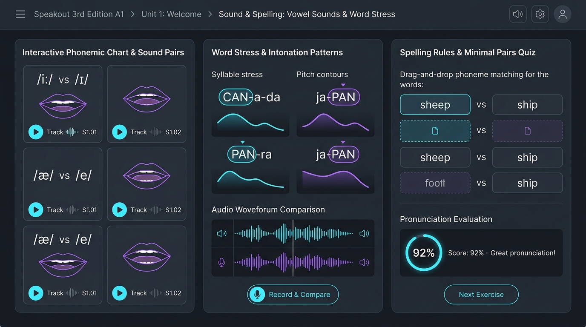
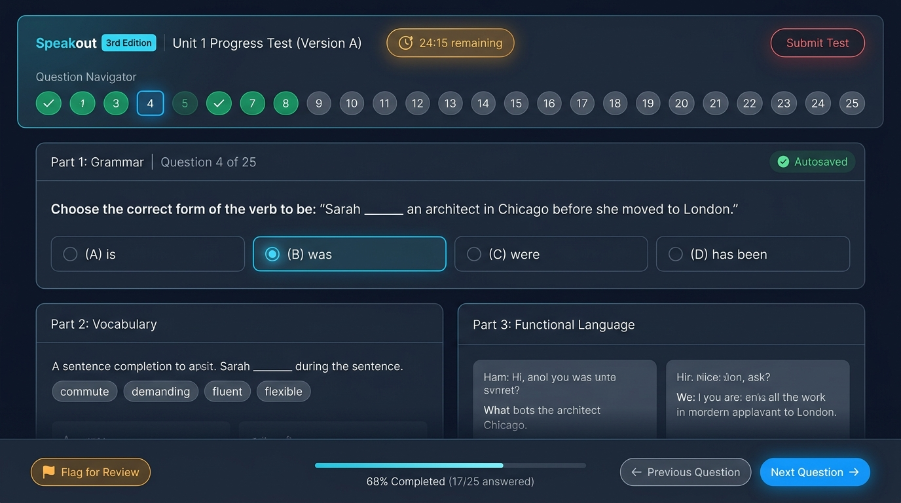

# План реализации модуля Unit 1 Review, Sound and Spelling и Progress Test (Speakout 3rd Edition A1)

> [!WARNING]
> **Блок изоляции области работ и защиты смежного функционала**:
> Запрещено затрагивать, модифицировать или нарушать функционал, не относящийся к закрепляющему модулю Unit 1 Review & Progress Test. Изменения вносятся строго изолированно в директорию `speakout/`. Рабочие директории существующего проекта `english-quiz` (`client/`, `production/`, `site/`), глобальные стили, серверные обработчики и базы данных проекта не затрагиваются. Все ранее реализованные функции уроков 1A, 1B, 1C и 1D сохраняют полную работоспособность.

---

### Скриншот 8: Лаборатория фонетики (Phonics & Sound and Spelling Lab)

*Скриншот 8: Утвержденный макет пользовательского интерфейса лаборатории звуков, минимальных пар и редукции гласных (Sound and Spelling / Phonics Lab).*

---

### Скриншот 9: Модуль комплексного тестирования и оценки (Unit 1 Progress Test & Assessment)

*Скриншот 9: Утвержденный макет пользовательского интерфейса официального Pearson Unit 1 Test (50 баллов: Grammar, Vocabulary, Functional Language).*

---

### Этапы и контрольный список реализации

| Статус | Идентификатор этапа | Описание работ и артефакты |
| :--- | :--- | :--- |
| 🟩 | `STAGE-REV-01` | **Извлечение данных и генерация манифеста Unit 1 Review & Test**: извлечение проверочных заданий Student's Book (pp. 16–17), Sound and Spelling (шва /ə/, окончания множественного числа /s/, /z/, /ɪz/), официального теста `SO3_A1_Unit_Test_U1A.docx` (Part A: 50 баллов) и ключей ответов `SO3_A1_Tests_Answer+Key.docx` в [speakout/data/manifest.json](file:///Users/tsovakpalakian/PycharmProjects/english-quiz/speakout/data/manifest.json) |
| 🟩 | `STAGE-REV-02` | **Серверные эндпоинты Unit 1 Review & Test**: регистрация маршрутов `GET /api/speakout/lesson/A1/Review` и `GET /api/speakout/test/A1/U1` в [speakout/server/server.js](file:///Users/tsovakpalakian/PycharmProjects/english-quiz/speakout/server/server.js) |
| 🟩 | `STAGE-REV-03` | **Пользовательский интерфейс Review & Phonics Lab & Test**: добавление вкладки `Unit 1 Review & Test` в переключатель уроков, интерактивный тренажер Phonics Lab (звуки /ə/, /s/, /z/, /ɪz/), интерактивные упражнения Review (страны, be, профессии, приветствия), адаптивный тест на 50 баллов с динамическим расчетом CEFR-оценки и рекомендаций, секция ответов в Answer Keys Drawer в [speakout/web/index.html](file:///Users/tsovakpalakian/PycharmProjects/english-quiz/speakout/web/index.html), [speakout/web/style.css](file:///Users/tsovakpalakian/PycharmProjects/english-quiz/speakout/web/style.css), [speakout/web/app.js](file:///Users/tsovakpalakian/PycharmProjects/english-quiz/speakout/web/app.js) |
| 🟩 | `STAGE-REV-04` | **Автоматизированное тестирование**: создание тестов [speakout/tests/review_data.test.js](file:///Users/tsovakpalakian/PycharmProjects/english-quiz/speakout/tests/review_data.test.js), [speakout/tests/review_server.test.js](file:///Users/tsovakpalakian/PycharmProjects/english-quiz/speakout/tests/review_server.test.js), [speakout/tests/review_ui.test.js](file:///Users/tsovakpalakian/PycharmProjects/english-quiz/speakout/tests/review_ui.test.js) |
| 🟩 | `STAGE-REV-05` | **Верификация полного сьюта тестов**: запуск `node --test speakout/tests/*.test.js` со 100% прохождением тестов для всех модулей Unit 1 (~95+ тестов) |

---

### Архитектурные спецификации компонентов Unit 1 Review & Test

1. **Данные и контент**:
   - `Sound and Spelling`:
     * Шва /ə/: `Japan`, `doctor`, `number`.
     * Окончания множественного числа: `/s/` (`tickets`), `/z/` (`bags`), `/ɪz/` (`buses`).
   - `Review Exercises`:
     * Ex 1A: Countries & Nationalities (Mexico, Argentinian, the UK, American, Italy).
     * Ex 2A: Present Simple *be* questions and short answers (Are you...? Yes, I am. / Are you...? No, I'm not.).
     * Ex 4A: Jobs with articles *a* / *an* (an Australian bus driver, a British waiter, a Polish singer).
     * Ex 5A/B: Chronological greetings (Good morning -> Good afternoon -> Good evening -> Good night).
     * Ex 7B: Language check (is, words, has, Polish, has, from, numbers, isn't).
   - `Unit 1 Test (Part A: 50 баллов)`:
     * Grammar 1: Choice of *'m / 're / are / am* (8 баллов).
     * Grammar 2: Sentence completion with *is / isn't* (7 баллов).
     * Grammar 3: Error correction of underlined words (5 баллов).
     * Vocabulary 4: Nationality spelling endings (*-an, -ian, -ish, -ese*) (8 баллов).
     * Vocabulary 5: Job anagrams (*actor, nurse, shop assistant, bus driver, artist, football player, businesswoman*) (7 баллов).
     * Vocabulary 6: Compound object matching (*laptop, umbrella, wallet, notebook, sandwich*) (5 баллов).
     * How To 7: Situational question-answer matching (5 баллов).
     * How To 8: Functional phrase choice (*Thank you, That's right, Just a moment, Can you repeat, that's wrong*) (5 баллов).
2. **Интерактивные элементы**:
   - `Phonics Lab`: аудио-визуальное переключение фонем, отображение IPA и слов с цветовым выделением звука.
   - `Review Cards`: мгновенная проверка, подсчет баллов.
   - `Assessment Engine`: расчет общего процента (0–100%), индикатор прогресса, шкала CEFR A1.1 (Pass 60%, Merit 75%, Distinction 90%).
3. **Панель проверки ответов (Answer Keys Drawer)**:
   - Вкладка `Unit 1 Review & Test` с размытием `filter: blur(6px)` и пошаговым открытием.
