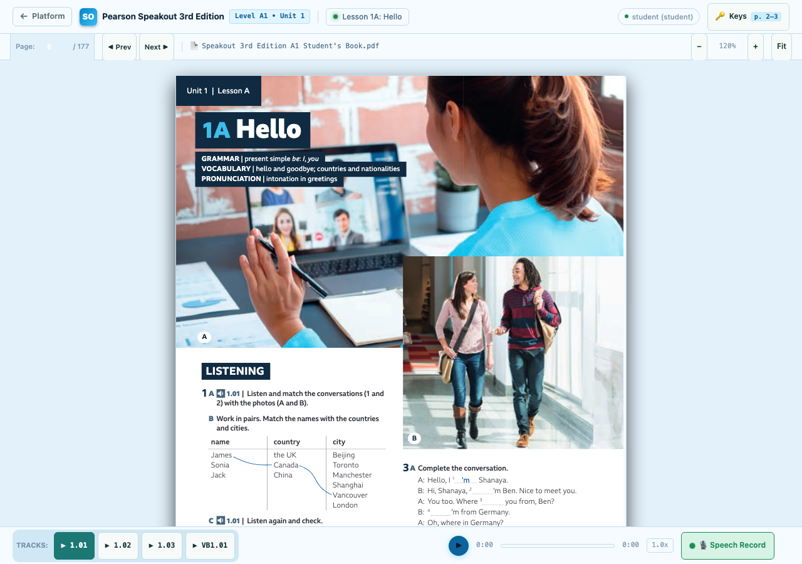
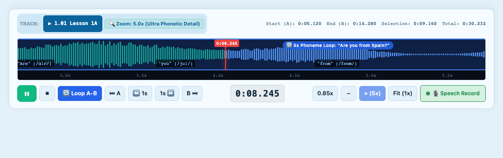

# План реализации студийного аудиоплеера с осциллограммой, A-B зацикливанием и зумом до 5х

> [!WARNING]
> Запрещено затрагивать, модифицировать или нарушать функционал, не относящийся к текущей задаче. Изменения вносятся строго изолированно в компоненты аудиоплеера студии Speakout (`speakout/web/`, `speakout/tests/`, `ops/preview-learning-workbench.mjs`). Все ранее реализованные функции (просмотрщик книги, уроки 1A–1D, ключи ответов, студия записи речи Speech Studio) сохраняют полную работоспособность.

---

### Утвержденные скриншоты реализации

#### Скриншот 1: Утвержденный экран студии на всю ширину без боковой панели

#### Скриншот 2: Утвержденный студийный плеер с формой волны, интервалом A-B и зумом 5.0x

---

### Чеклист реализации

| Статус | ID | Этап реализации |
| :---: | :---: | :--- |
| 🟩 | `WF-01` | **План и архитектура**: фиксация утвержденных макетов, спецификации A-B зацикливания и шагов зума до 5х |
| 🟩 | `WF-02` | **Разметка HTML**: интеграция контейнера формы волны, шкалы времени, маркеров A-B и пульта транспорта в [speakout/web/index.html](file:///Users/tsovakpalakian/PycharmProjects/english-quiz/speakout/web/index.html) |
| 🟩 | `WF-03` | **Стили CSS**: адаптивная верстка осциллограммы, скролл-вьюпорта, указателя воспроизведения и кнопок транспорта через переменные темы в [speakout/web/style.css](file:///Users/tsovakpalakian/PycharmProjects/english-quiz/speakout/web/style.css) |
| 🟩 | `WF-04` | **Логика плеера и аудиодвижок**: рендеринг формы волны на Canvas, скраббинг, циклическое A-B воспроизведение, зум до 5х с автоскроллом и миллисекундный тайминг в [speakout/web/app.js](file:///Users/tsovakpalakian/PycharmProjects/english-quiz/speakout/web/app.js) |
| 🟩 | `WF-05` | **MIME-тип .mjs в локальном стенде**: регистрация `text/javascript` для `.mjs` в [ops/preview-learning-workbench.mjs](file:///Users/tsovakpalakian/PycharmProjects/english-quiz/ops/preview-learning-workbench.mjs) |
| 🟩 | `WF-06` | **Тестирование и сборка**: юнит- и визуальные тесты на элементы плеера, зум 5х, A-B интервалы и пересборка продакшен-ассетов |

---

### Архитектурные спецификации

1. **Контейнер осциллограммы (`waveform-scroll-viewport` & `waveform-canvas`):**
   - Canvas отрисовывает амплитудные столбцы волны:
     - Сыгранная часть: `--acc` (`#10b981`).
     - Активная область интервала A-B: полупрозрачный синий (`#2563eb` / `rgba(37, 99, 235, 0.22)`).
     - Несыгранная часть: `rgba(255, 255, 255, 0.2)` в темной теме / `rgba(0, 0, 0, 0.15)` в светлой.
   - Линия указателя (`waveform-playhead`): красная вертикальная черта с бейджем времени `0:00.000` и `z-index: 10`.

2. **Интерактивные маркеры A-B:**
   - Левый маркер `< A`: регулирует точку старта интервала `loopStart`.
   - Правый маркер `B >`: регулирует точку завершения интервала `loopEnd`.
   - При воспроизведении в режиме `loopActive === true`: при достижении `currentTime >= loopEnd` аудио автоматически перематывается на `loopStart` без слышимой задержки.

3. **Масштабирование (Zoom) до 5.0x:**
   - Уровни зума: `1.0x` (вмещается в 100% ширины), `2.0x`, `3.0x`, `4.0x`, `5.0x` (максимум).
   - При зуме > 1.0x холст растягивается по ширине, появляется горизонтальный скролл.
   - Во время воспроизведения `requestAnimationFrame` автоматически центрирует скролл контейнера вокруг курсора `playhead`.
   - Кнопка `Fit (1x)` сбрасывает зум на 1.0x.

4. **Пульт управления воспроизведением (Transport Bar):**
   - Кнопки: `▶/⏸` Play/Pause, `⏹` Stop, `🔁 Loop A-B`, `⏮ A` Jump to Start, `⏪ 1s`/`5s`, `1s`/`5s ⏩`, `B ⏭` Jump to End, Speed (`0.75x`..`1.5x`), Zoom (`−`, `+ (5x)`, `Fit`), `🎙 Speech Record`.
   - Цифровой таймер `digital-clock`: отображает миллисекунды `0:00.000`.
   - Блок статистики: `Start (A)`, `End (B)`, `Selection`, `Total`.
