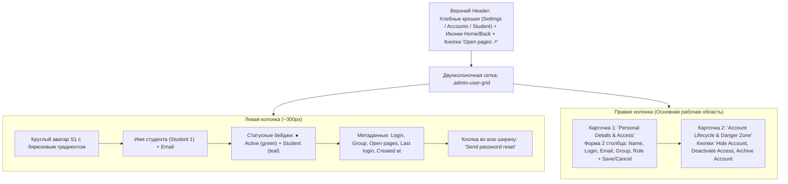

# Спецификация редизайна страницы управления аккаунтом студента (#adminuser)

## 1. Обзор и цели

Настоящий документ описывает редизайн интерфейса просмотра и редактирования учетной записи студента/пользователя (`#adminuser`) в платформе `english-quiz`. Интерфейс переводится из устаревшего одноколоночного плоского списка полей в современный двухколоночный SaaS/CRM-дашборд на основе эталонного макета `student_account_redesign_dashboard.html`.

---

## 2. Структура и компоненты (Desktop Grid Layout)

### 2.1. Верхняя панель (Header)
- **Навигация**:
  - Иконка «Home» (`🏠`, ведет на `#home` / `#admin`).
  - Иконка «Back» (`←`, `[data-nav-back]`, возвращает в список аккаунтов или группы).
  - Хлебные крошки: `Settings / Accounts / <Student_Login>`.
- **Быстрое действие**:
  - Яркая акцентная кнопка в правом верхнем углу `Open pages ↗` (`[data-account="open-pages"]`) со счетчиком доступных страниц (напр. `14`).

### 2.2. Левая колонка (Карточка-сводка, ~300px)
- **Аватар**: круглый (или скругленный суперэллипс 20px) с инициалами студента (напр. `S1`), бирюзовый градиент `#0d9488` $\to$ `#115e59`.
- **Имя и контакт**: крупный заголовок `user.name || user.login`, под ним `user.email`.
- **Бейджи**:
  - `● Active` (зеленый пульсирующий индикатор) / `Deactivated` (серый).
  - `Student` / `Teacher` / `Developer` (светло-бирюзовый фон, темный текст).
- **Список метаданных**:
  - `Login`: `user.login`
  - `Group`: текущая группа студента (`group.title` или `Unassigned`)
  - `Open pages`: количество доступных студенту уроков и экзаменов
  - `Last login`: метка времени активности (`Today, 14:20` / дата)
  - `Account created`: дата регистрации аккаунта
- **Действие**: кнопка во всю ширину `🔑 Send password reset` (`[data-account="reset-password"]`).

### 2.3. Правая колонка
- **Карточка 1: Личные данные и доступ (Account Information & Access)**:
  - Сетка формы (2 колонки на десктопе, 1 колонка на мобильных):
    - `Full Name` (`input[data-profile-name]`)
    - `Username (Login)` (`input[data-profile-login]`)
    - `Email Address` (`input[data-profile-email]`, на всю ширину)
    - `Assigned Group` (`select[data-student-group]`, выпадающий список групп с автоопределением изменений)
    - `System Role` (`select[data-role-pick]`, Student, Teacher, Developer)
  - Подсказка: *«Passwords are managed securely and not displayed here»*.
  - Подвал формы: кнопка `Save changes` (`[data-account="save-profile"]`) и `Cancel` (`[data-account="cancel-profile"]`).
- **Карточка 2: Зона опасных действий (Account Lifecycle & Danger Zone)**:
  - Мягкий предупреждающий фон (`#fff1f2` / `border: #fecdd3`).
  - Текст-описание: *«Hiding or deactivating limits student access instantly without deleting data»*.
  - Кнопки:
    - Контурная: `👁 Hide account` / `Show account` (`[data-account="hide-user"]`)
    - Контурная: `⏸ Deactivate access` / `Activate` (`[data-account="active-user"]`)
    - Деструктивная красная кнопка: `🗑 Archive account` (`[data-account="archive-user"]`).

---

## 3. Стилистика и CSS-токены

- **Основной акцентный цвет**: `#146c5c` / `#0d9488` (глубокий бирюзовый/изумрудный).
- **Фон карточек**: `#ffffff`, мягкая граница `1px solid var(--line, #e2e8f0)`, тень `0 1px 3px rgba(0,0,0,0.06)`.
- **Скругления**:
  - Карточки: `border-radius: 16px`.
  - Поля ввода и кнопки: `border-radius: 10px`.
  - Бейджи: `border-radius: 9999px`.
- **Типографика**: System UI / Inter font stack.
- **Адаптивность**: `@media (max-width: 900px)` переход в вертикальный стек (1 колонка).

---

## 4. Сохранение обратной совместимости с тестовым набором

Все селекторы, задействованные в существующих автоматических тестах платформы, строго сохраняются:
- `[data-student-group]`
- `[data-account="assign-group"]`
- `[data-account="open-pages"]`
- `[data-account="save-profile"]`
- `[data-account="set-role"]`
- `[data-account="hide-user"]`
- `[data-account="active-user"]`
- `[data-account="archive-user"]`
- `[data-nav-back]`

---

## 5. Чеклист реализации

- 🟩 1. Разработка Markdown-спецификации редизайна (`docs/student-account-redesign-spec.md`)
- 🟩 2. Верстка компонентов карточки и формы в `client/10-admin.js` (`paintAdminUser`)
- 🟩 3. Добавление адаптивных SaaS/CRM-стилей в `site/preview.css`
- 🟩 4. Сборка продакшен-бандлов (`npm run build:preview && node ops/build-learning-production-assets.mjs`)
- 🟩 5. Прогон тестов навигации и управления аккаунтом (`test-role-navigation-ui.mjs`, `test-chat-ui.mjs`, `test-ui-boot.mjs`, `test-deleted-account-ui.mjs`, `test-learning-main.mjs`)
- 🟩 6. Полный прогон `npm run check` (171 скрипт)
