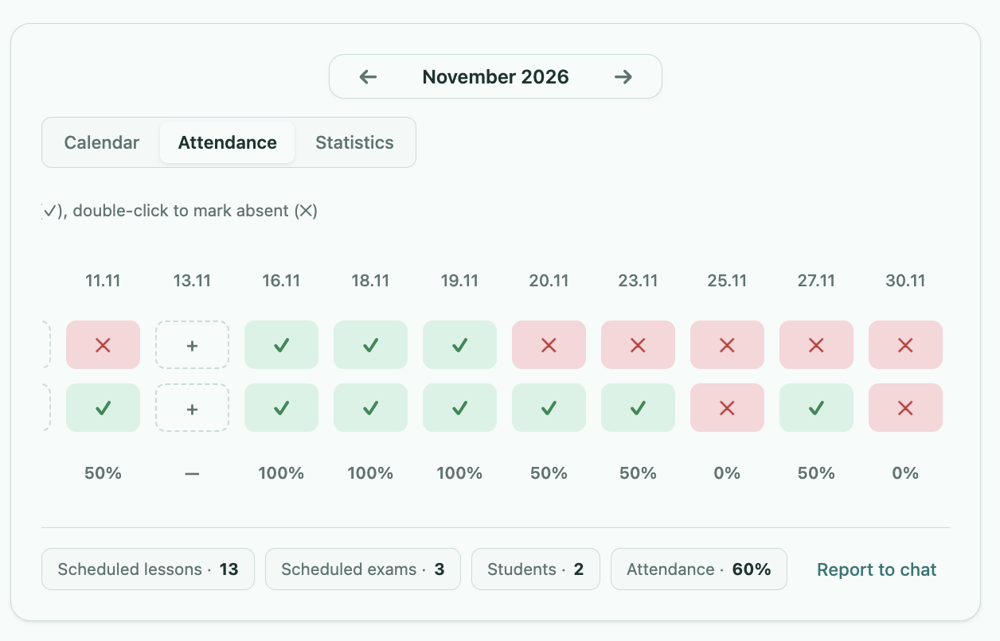
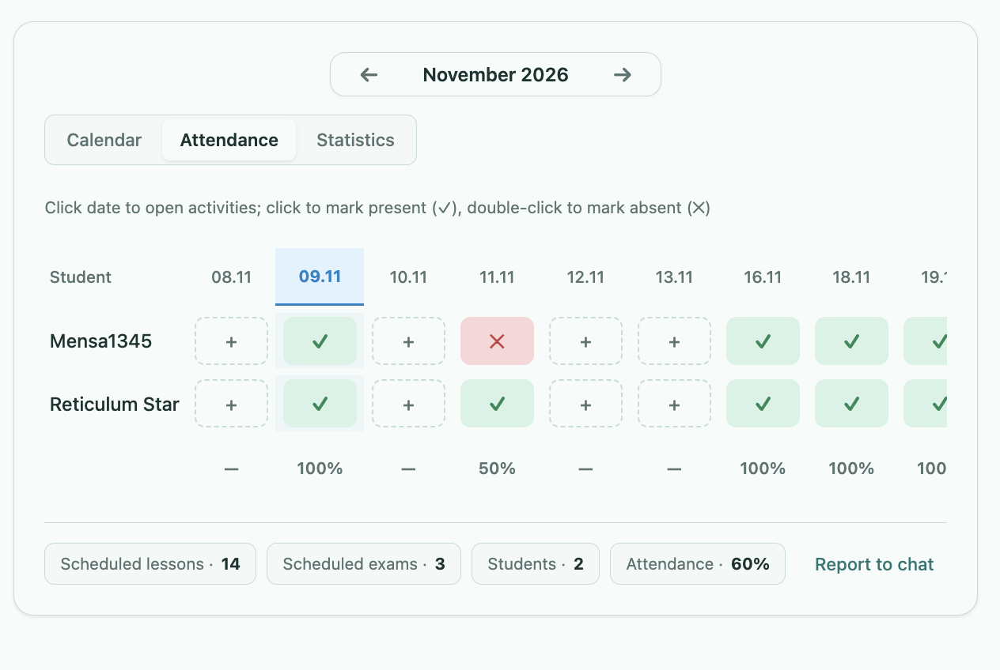
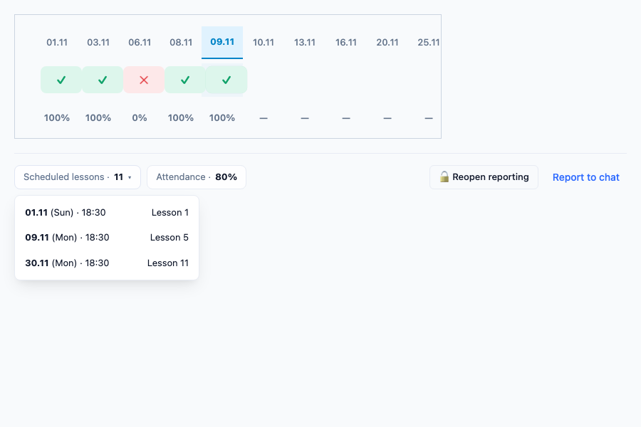
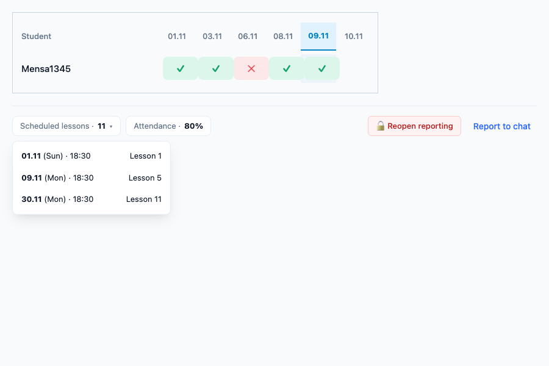

# План стабилизации сетки и устранения дефектов посещаемости ([TASK-40](https://lumiscia.atlassian.net/browse/TASK-40))

> [!WARNING]
> **ПРЕДУПРЕЖДЕНИЕ О НЕПРИКОСНОВЕННОСТИ СТОРОННЕГО ФУНКЦИОНАЛА:**
> Запрещается модифицировать, перемещать или нарушать функционал, не относящийся к таблице посещаемости и виджету календаря в задаче [TASK-40](https://lumiscia.atlassian.net/browse/TASK-40). Запрещено затрагивать серверные роуты, календарную сетку вкладки Calendar, вкладку Statistics, модальные окна создания уроков, диалоги платежей и чат. Все изменения строго изолированы внутри [`client/53a-group-calendar.js`](file:///Users/tsovakpalakian/PycharmProjects/english-quiz/client/53a-group-calendar.js) и [`site/preview.css`](file:///Users/tsovakpalakian/PycharmProjects/english-quiz/site/preview.css).

---

## 1. Точная формулировка задач и анализ обновленных требований

В описании задачи [TASK-40](https://lumiscia.atlassian.net/browse/TASK-40) зафиксированы 4 дефекта/требования:

### 1.1. Смещение сетки и мисклики в таблице Attendance
- **Проблема**: При попытке отметить посещаемость в последних колонках (у правого края контейнера или частично скрытых при прокрутке), таблица самопроизвольно сдвигается влево. Элементы смещаются из-под курсора в момент нажатия, из-за чего проставляется не тот статус или не тот студент.
- **Требования**:
  - Ширина всех ячеек-кнопок (`+`, `✓`, `✕`) должна быть строго фиксированной (fixed width: `width: 58px; min-width: 58px; max-width: 58px; box-sizing: border-box;`), чтобы смена состояния не вызывала пересчет размеров таблицы.
  - Таблица не должна использовать агрессивный авто-скролл при клике на элементы. Горизонтальная прокрутка должна контролироваться только пользователем, а сетка должна оставаться абсолютно статичной в момент клика.
- **Первопричина**:
  - В [`client/53a-group-calendar.js#L907-L917`](file:///Users/tsovakpalakian/PycharmProjects/english-quiz/client/53a-group-calendar.js#L907-L917) вызов `focusedBtn.scrollIntoView({ inline: 'center', block: 'nearest', behavior: 'smooth' })` срабатывал при каждом обновлении виджета.
  - При клике на ячейку ([`client/53a-group-calendar.js#L3222`](file:///Users/tsovakpalakian/PycharmProjects/english-quiz/client/53a-group-calendar.js#L3222)) вызывалась полная перерисовка `paintGroupCalendarWidget`, которая уничтожала DOM `.gcw-journal-wrap` (сбрасывая `scrollLeft` в 0), а затем плавно скроллила влево к целевой дате.
- **Решение**:
  - Точечное (in-place) обновление ячеек без деструктивной перерисовки всего виджета.
  - Сохранение и восстановление `scrollLeft` контейнера `.gcw-journal-wrap` при любых глобальных перерисовках.
  - Полное исключение `scrollIntoView` при кликах пользователя.

### 1.2. Запрет проставления посещаемости на будущие даты
- **Проблема**: Сейчас учитель может кликнуть на ячейку будущей даты (`d > todayStr`) и отметить посещаемость авансом.
- **Решение**:
  - Для дат `d > todayStr` блокировать изменение статуса посещаемости (кнопки ячеек переводятся в неактивное состояние `is-future` / `disabled`, клики блокируются).
  - Наведение и клики на будущие даты не должны менять состояние ячеек посещаемости.

### 1.3. Кликабельный бейдж «Scheduled lessons» с выпадающим списком дат
- **Проблема**: В футере виджета бейдж `Scheduled lessons · N` статичен.
- **Требование**: Сделать бейдж кликабельным с выпадающим списком (dropdown), содержащим список запланированных дат уроков текущего месяца.
- **Решение**:
  - Превратить бейдж в интерактивный триггер с выпадающим меню (`.gcw-scheduled-dropdown`).
  - При клике раскрывать компактный список дат (например, `08.11 · Sun 18:30`, `09.11 · Mon 18:30`, ...).
  - При клике на дату списка выполнять переход/скролл к этой дате или закрытие меню по внешнему клику.

### 1.4. Кнопка «Закрыть отчетность» (Lock reporting)
- **Требование**: Сделать кнопку «Закрыть отчетность» (`Close reporting` / `Lock reporting`), позволяющую захолдить (заблокировать) изменения Attendance за прошедший месяц.
- **Решение**:
  - В панели действий футера добавить кнопку `🔒 Close reporting` (или `🔒 Unlock reporting`, если отчетность уже заблокирована).
  - При блокировке отчетности флаг `reportingClosed: true` сохраняется в данных месяца (`monthData.reportingClosed`).
  - В заблокированном месяце все ячейки посещаемости переводятся в режим «только чтение» (`is-readonly`), предотвращая случайные или несогласованные правки задним числом.

---

## 2. Прилагаемые визуальные материалы

### Скриншот 1

*Скриншот 1: Таблица посещаемости Attendance с горизонтальной прокруткой к правым колонкам (11.11 — 30.11), демонстрирующий необходимость фиксации позиционирования и размеров ячеек.*

### Скриншот 2

*Скриншот 2: Таблица Attendance, иллюстрирующая фокус на дате 09.11, наличие будущих дат (10.11+), требующих блокировки, а также бейдж Scheduled lessons и футер действий.*

### Скриншот 3

*Скриншот 3: Верификация результатов тестирования Playwright — фиксированная ширина ячеек (58px), статичный скролл, приглушенные будущие даты, выпадающее меню уроков Scheduled lessons и кнопка блокировки отчетности.*

### Скриншот 4

*Скриншот 4: Скриншот от пользователя, показывающий, что открытие выпадающего меню вверх перекрывает таблицу посещаемости.*

### Скриншот 5

*Скриншот 5: Макет интерфейса с открытием выпадающего меню уроков вниз под кнопку (`top: calc(100% + 8px); bottom: auto;`), полностью освобождающий обзор таблицы посещаемости.*

---

## 3. Архитектурное решение и границы изменений

1. **CSS стили (`site/preview.css`)**:
   - Строгая фиксация ширины колонок и кнопок:
     ```css
     .gcw-table {
       width: max-content;
       min-width: 100%;
       border-collapse: separate;
       border-spacing: 0 6px;
     }
     .gcw-th-date,
     .gcw-table td:not(.gcw-td-student) {
       width: 58px;
       min-width: 58px;
       max-width: 58px;
       box-sizing: border-box;
     }
     .gcw-cell-btn {
       width: 58px;
       min-width: 58px;
       max-width: 58px;
       flex: 0 0 58px;
       box-sizing: border-box;
     }
     .gcw-cell-btn.is-future {
       cursor: not-allowed;
       opacity: 0.45;
       pointer-events: none;
     }
     ```
   - Стили для выпадающего списка дат уроков `.gcw-scheduled-dropdown` и кнопки блокировки отчетности `.gcw-lock-reporting-btn`.

2. **Логика виджета (`client/53a-group-calendar.js`)**:
   - Исключить вызов `scrollIntoView` при кликах на ячейки.
   - Сохранять `scrollLeft` перед перерисовкой и восстанавливать его синхронно.
   - Внедрить точечное обновление DOM ячейки при клике без перерисовки всей таблицы.
   - Запретить отметку посещаемости для дат `d > todayStr`.
   - Если месяц заблокирован (`monthData.reportingClosed`), запретить редактирование всех ячеек.
   - Реализовать выпадающее меню со списком дат уроков при клике на бейдж `Scheduled lessons`.
   - Реализовать кнопку `🔒 Close reporting` / `🔓 Reopen reporting` для прошедших месяцев.

---

## 4. Чек-лист реализации

- 🟩 **Этап 1: Фиксация геометрии таблицы и стилей в CSS**
  - Зафиксировать ширину колонок дат, кнопок и ячеек подвала в [`site/preview.css`](file:///Users/tsovakpalakian/PycharmProjects/english-quiz/site/preview.css).
  - Добавить стили для `.gcw-cell-btn.is-future`, выпадающего меню `.gcw-scheduled-dropdown` и кнопки `.gcw-lock-reporting-btn`.
- 🟩 **Этап 2: Устранение автоскролла и внедрение in-place обновления ячеек**
  - Ликвидировать агрессивный `scrollIntoView` на кликах в [`client/53a-group-calendar.js`](file:///Users/tsovakpalakian/PycharmProjects/english-quiz/client/53a-group-calendar.js).
  - Добавить сохранение и восстановление `scrollLeft` контейнера `.gcw-journal-wrap`.
  - Реализовать точечное обновление DOM кнопки, подвала и сводного бейджа посещаемости при клике.
- 🟩 **Этап 3: Блокировка отметки посещаемости для будущих дат**
  - Проверять условие `d > todayStr`: ячейки будущих дат рендерить с классом `is-future` и блокировать обработку кликов.
- 🟩 **Этап 4: Интерактивный список уроков и кнопка «Закрыть отчетность»**
  - Сделать бейдж `Scheduled lessons` кликабельным с выпадающим списком дат месяца.
  - Добавить кнопку `🔒 Close reporting` (с возможностью переключения `Reopen reporting`), блокирующую редактирование Attendance в прошедшем месяце.
- 🟩 **Этап 5: Сборка и верификация тестами**
  - Запустить сборку `npm run build:preview`.
  - Написать и выполнить модульные и визуальные Playwright-тесты для всех 4 требований.
- 🟩 **Этап 6: Изменение направления выпадающего списка Scheduled lessons вниз**
  - Изменить позиционирование `.gcw-scheduled-dropdown` в [`site/preview.css`](file:///Users/tsovakpalakian/PycharmProjects/english-quiz/site/preview.css) с открытия вверх на открытие вниз (`top: calc(100% + 8px); bottom: auto;`).
  - Обновить тесты в [`test/test-task-40-attendance-grid-and-scroll.mjs`](file:///Users/tsovakpalakian/PycharmProjects/english-quiz/test/test-task-40-attendance-grid-and-scroll.mjs) и перегенерировать проверочные снимки.
- 🟩 **Этап 7: Сохранение обратной совместимости статического контракта TASK-18**
  - Восстановить в [`client/53a-group-calendar.js`](file:///Users/tsovakpalakian/PycharmProjects/english-quiz/client/53a-group-calendar.js) точное исходное присваивание плейсхолдера `let sym = st === 'present' ? '✓' : st === 'absent' ? '✕' : (canEdit ? '+' : '');` для соответствия проверке [`test/test-task-18-dashboard-calendar.mjs`](file:///Users/tsovakpalakian/PycharmProjects/english-quiz/test/test-task-18-dashboard-calendar.mjs).
  - Сбросить символ в пустую строку при `!canEditCell && sym === '+'`, сохранив логику скрытия плюсика на будущих датах и заблокированных месяцах.
  - Проверить успешное прохождение всех проверок `check-all`.
