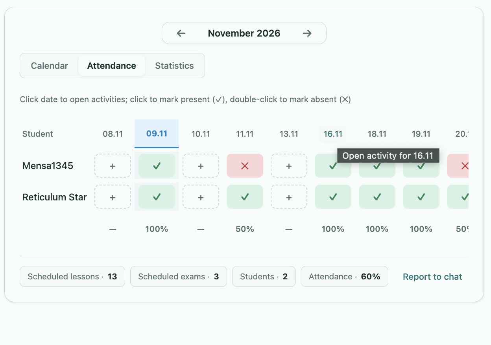
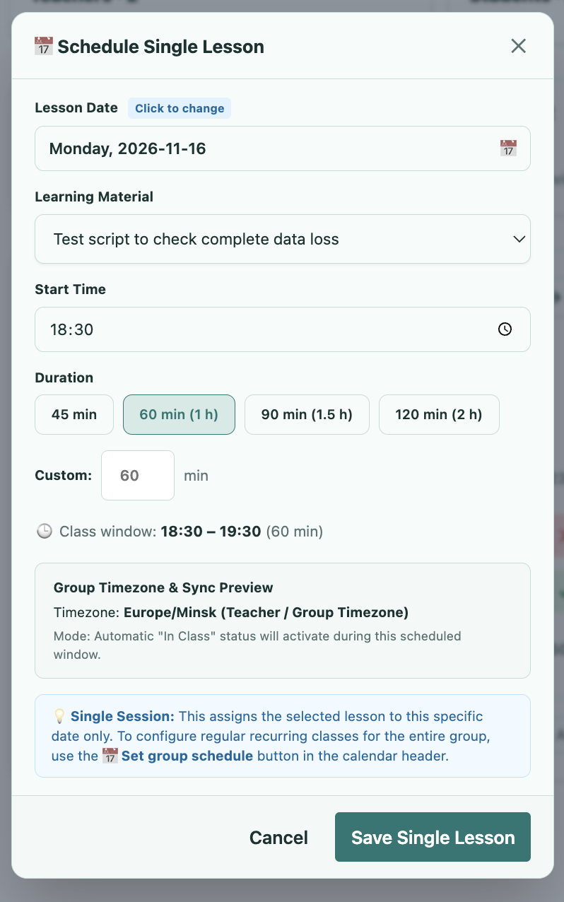
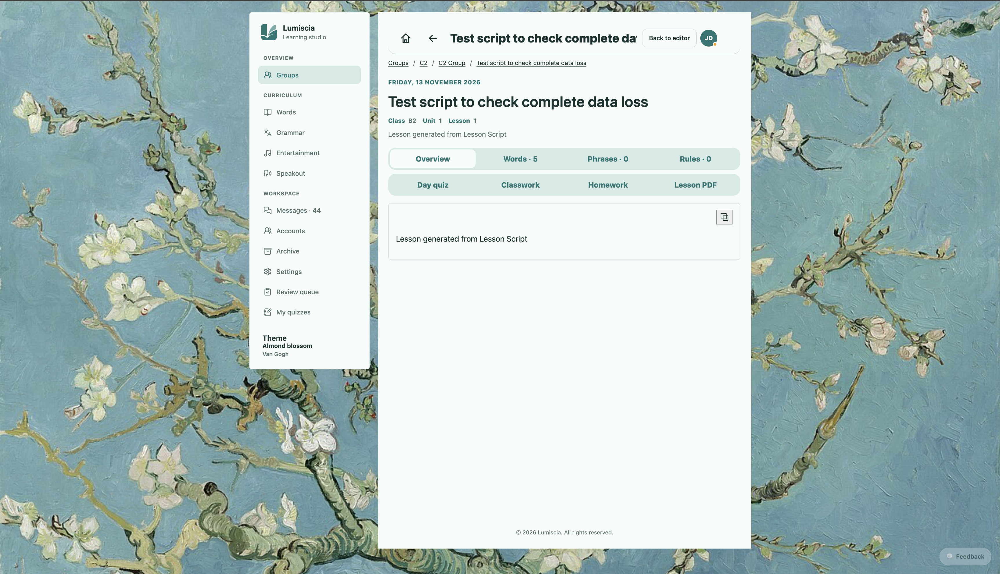
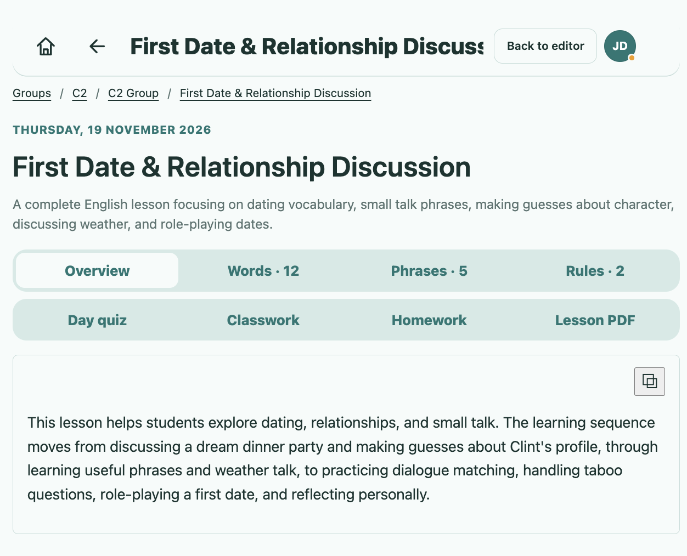
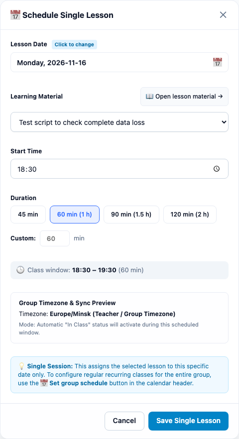

# План исправления логики формы в таблице Attendance: перенос слотов и единый паттерн клика ([TASK-41](https://lumiscia.atlassian.net/browse/TASK-41))

> [!WARNING]
> **ПРЕДУПРЕЖДЕНИЕ О НЕПРИКОСНОВЕННОСТИ СТОРОННЕГО ФУНКЦИОНАЛА:**
> Запрещается модифицировать, перемещать или нарушать функционал, не относящийся к обработке кликов по заголовкам дат и сохранению/переносу занятий в журнале Attendance в рамках задачи [TASK-41](https://lumiscia.atlassian.net/browse/TASK-41). Запрещено затрагивать серверные роуты `/api/groups/attendance` (сохранять полную обратную совместимость API), функционал выставления оценок, контекстное меню дня, диалоги оплат и отчетов в чат. Все изменения строго изолированы внутри [`client/53a-group-calendar.js`](file:///Users/tsovakpalakian/PycharmProjects/english-quiz/client/53a-group-calendar.js) и сопутствующих тестов.

---

## 1. Точная формулировка проблемы и анализ первопричин

### Выявленные дефекты:
1. **Дублирование слотов при смене даты в модальном окне `Schedule Single Lesson`**:
   - При клике на дату слота (например, `16.11`) и изменении дня на другой (например, `13.11`), система создает новый слот на `13.11`, но оставляет старый слот `16.11` с историей посещаемости в таблице.
   - Первопричина: в [`client/53a-group-calendar.js#L3138-L3155`](file:///Users/tsovakpalakian/PycharmProjects/english-quiz/client/53a-group-calendar.js#L3138-L3155) условие удаления старой даты опиралось на `hadPreviousSchedule = Boolean(existing.startTime)`. Если у черновика слота не было явно заданного `startTime`, старая дата не удалялась из `oldMonthData.lessonDates`. Кроме того, отметки посещаемости (`attendance`) студентов для старой даты (`initialDateStr`) вообще не переносились на новую дату (`dateStr`), оставаясь висеть на старой дате, из-за чего колонка продолжала отображаться с устаревшими данными. Также в [`client/53a-group-calendar.js#L3158-L3169`](file:///Users/tsovakpalakian/PycharmProjects/english-quiz/client/53a-group-calendar.js#L3158-L3169) дата `initialDateStr` не отфильтровывалась из массива `mat.dates` привязанного материала, сохраняя привязку материала к старому дню.
2. **Сломанный паттерн клика по заголовку даты в таблице Attendance**:
   - Клик по дате в заголовке таблицы ведет себя несогласованно:
     - Если это черновик даты без урока (`total === 0 && isScheduled`), открывается форма `Schedule Single Lesson`;
     - Если урок уже активен (`total === 1`), тот же самый клик срабатывает как немедленный переход (`window.lmOpenLesson(lessons[0].id)`) и уводит пользователя со страницы журнала посещаемости в просмотр урока ([`client/53a-group-calendar.js#L324-L333`](file:///Users/tsovakpalakian/PycharmProjects/english-quiz/client/53a-group-calendar.js#L324-L333)). В результате отредактировать или перенести дату активного урока из таблицы Attendance становится невозможно.
   - Первопричина: функция `handleDateItemClick` в [`client/53a-group-calendar.js#L324-L333`](file:///Users/tsovakpalakian/PycharmProjects/english-quiz/client/53a-group-calendar.js#L324-L333) при `total === 1` безусловно выполняет редирект вместо открытия формы редактирования/сведений о занятии.

---

## 2. Прилагаемые визуальные материалы

### Скриншот 1

*Скриншот 1: Таблица посещаемости (Attendance tab) с датами уроков в заголовке колонок и всплывающей подсказкой при наведении.*

### Скриншот 2

*Скриншот 2: Форма «Schedule Single Lesson», открываемая при клике на дату слота, где изменение даты приводило к созданию дубликата вместо переноса.*

### Скриншот 3

*Скриншот 3: Страница просмотра урока, куда система уводила пользователя, оставляя мусорный слот в таблице посещаемости.*

### Скриншот 4

*Скриншот 4: Страница активного урока, куда происходил немедленный редирект по клику на дату в шапке Attendance вместо открытия редактора/инфо-панели.*

### Скриншот 5

*Скриншот 5: Предлагаемый макет единого окна «Schedule Single Lesson», открывающегося для любых уроков, с возможностью переноса даты (Reschedule) с сохранением посещаемости и отдельной явной кнопкой «📖 Open lesson material →» для перехода к материалу урока.*

### Скриншот 6

*Скриншот 6: Финальный скриншот Playwright-верификации реализованного модального окна Schedule Single Lesson с активной кнопкой «📖 Open lesson material →».*

---

## 3. Архитектурное решение и план устранения

1. **Единый согласованный паттерн клика по заголовку колонки даты**:
   - При клике на дату в таблице `Attendance` (а также в сетке календаря для преподавателя) открывать форму редактирования занятия `showLessonSchedulerModal(groupId, dateStr, state, container)`.
   - В форме отображать выбранный учебный материал, время, длительность и дату.
   - Для перехода к содержимому урока разместить отдельную явную кнопку/ссылку «`📖 Open lesson material →`». Переход на страницу урока осуществляется строго по клику на эту кнопку, а не по клику на заголовок таблицы.
2. **Корректный перенос (Reschedule) слота и отметок посещаемости**:
   - При смене даты в модальном окне (`initialDateStr !== dateStr`):
     - Удалять `initialDateStr` из `oldMonthData.lessonDates` и `oldMonthData.scheduleData`;
     - Переносить все отметки присутствия/отсутствия студентов из `oldMonthData.attendance[stId][initialDateStr]` в `targetMonthData.attendance[stId][dateStr]`;
     - Удалять `oldMonthData.attendance[stId][initialDateStr]`, предотвращая появление мусорных колонок-дубликатов;
     - Обновлять дату привязанного материала урока в `lmLibrary.materials` (`mat.date = dateStr; mat.time = currentStartTime;`), удаляя `initialDateStr` из массива `mat.dates`;
     - Если слот переносится между месяцами, сохранять состояние для обоих затронутых месяцев (`saveGroupAttendanceData`);
     - Обновлять отображение виджета на месте без нежелательных редиректов.

---

## 4. Чек-лист реализации

- 🟩 **Этап 1: Доработка модального окна `showLessonSchedulerModal` и кнопки перехода в урок**
  - Добавить отображение кнопки «`📖 Open lesson material →`» в модальном окне при наличии выбранного/активного материала.
  - По клику на кнопку закрывать диалог и переходить в урок через `window.lmOpenLesson(materialId)`.
- 🟩 **Этап 2: Реализация логики полного переноса (Reschedule) с сохранением истории посещаемости**
  - В обработчике сохранения `saveBtn.onclick` гарантировать удаление `initialDateStr` независимо от наличия `existing.startTime`.
  - Реализовать автоматическую миграцию отметок посещаемости из `oldMonthData.attendance` в `targetMonthData.attendance` для всех студентов группы.
  - Корректно обновлять `mat.date`, удалять `initialDateStr` из `mat.dates` и очищать старую привязку, исключая появление фантомных дубликатов в `monthLessonDates`.
- 🟩 **Этап 3: Унификация клика по заголовку дат в таблице Attendance**
  - В `handleDateItemClick` для преподавателя (`canEdit === true`) открывать `showLessonSchedulerModal` при клике на дату с активным уроком (`total === 1`), исключая принудительный редирект в редактор.
- 🟩 **Этап 4: Сборка и верификация тестами**
  - Выполнить сборку `npm run build:preview`.
  - Разработать автоматические тесты (модульные и Playwright) для проверки:
    - Открытия формы редактирования по клику на заголовок активного урока;
    - Наличия кнопки перехода к материалу урока;
    - Переноса слота и сохранения отметок посещаемости при изменении даты без дублирования.
