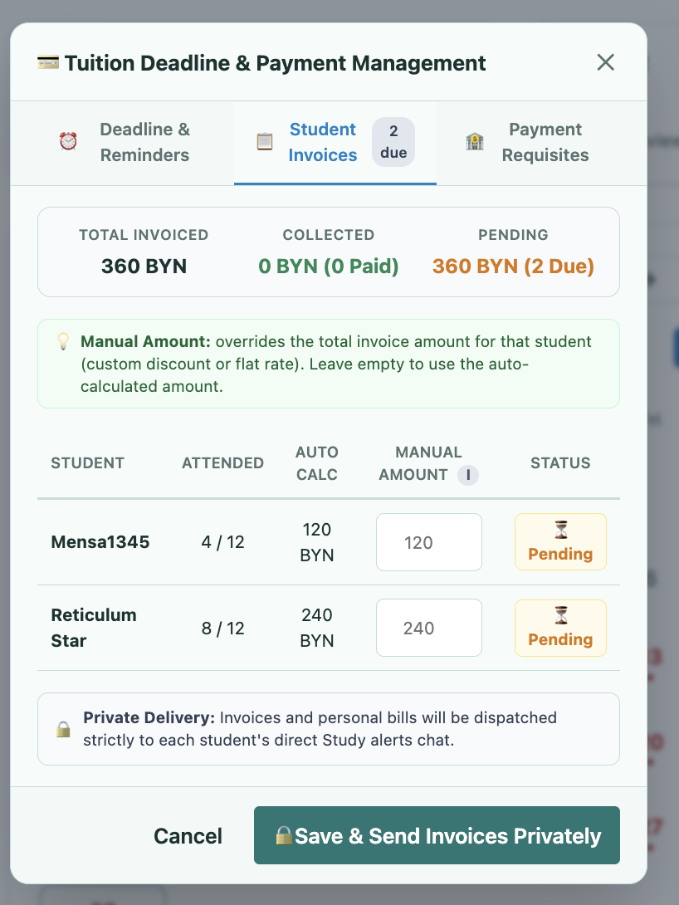
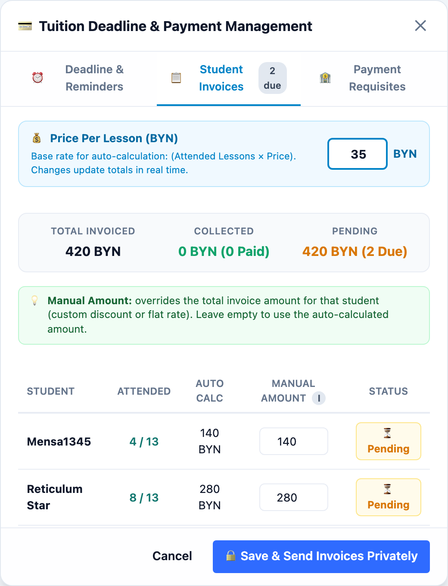
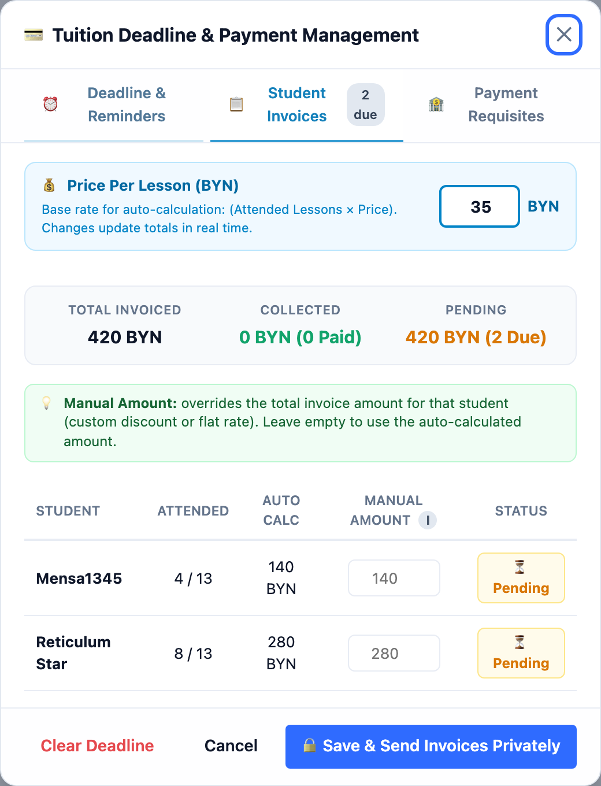

# План устранения рассинхрона количества уроков в Payment Management ([TASK-42](https://lumiscia.atlassian.net/browse/TASK-42))

> [!WARNING]
> **ПРЕДУПРЕЖДЕНИЕ О НЕПРИКОСНОВЕННОСТИ СТОРОННЕГО ФУНКЦИОНАЛА:**
> Запрещается модифицировать, перемещать или нарушать функционал, не относящийся к расчету и отображению общего количества занятий и счетов в окне `Tuition Deadline & Payment Management` в рамках задачи [TASK-42](https://lumiscia.atlassian.net/browse/TASK-42). Запрещено менять другие вкладки («Deadline & Reminders», «Payment Requisites»), логику расписания и переноса занятий, роуты API и систему авторизации. Все изменения строго изолированы внутри [`client/53a-group-calendar.js`](file:///Users/tsovakpalakian/PycharmProjects/english-quiz/client/53a-group-calendar.js), пересборки бандла и сопутствующих тестов.

---

## 1. Точная формулировка проблемы и анализ первопричины

### Исходные дефекты по тикету TASK-42:
1. **Отсутствие конфигурации цены за урок**:
   - В модалке счетов базовая ставка была захардкожена.
   - **Статус**: Уже исправлено в рамках недавней задачи TASK-35 (коммит `415976b`), где в панель `Student Invoices` возвращено настраиваемое поле `Price Per Lesson (BYN)` с мгновенным пересчетом итогов. Автор тикета оставил комментарий в Jira: *«1 поправлен»*.
2. **Рассинхрон количества уроков в колонке `ATTENDED` (дефект № 2)**:
   - В колонке `ATTENDED` модального окна `Student Invoices` отображается `4 / 12` и `8 / 12` (знаменатель 12 уроков), тогда как в статистике группы запланировано 13 занятий (`Scheduled lessons · 13`), а в журнале посещаемости заполнено только 10 занятий.
   - **Первопричина**:
     - В функции отрисовки виджета [`paintGroupCalendarWidget`](file:///Users/tsovakpalakian/PycharmProjects/english-quiz/client/53a-group-calendar.js#L603-L625) и генераторе отчета в чат число уроков (`lessonCount = 13`) рассчитывалось путем объединения дат из `monthData.lessonDates` и дат уроков из `lmLibrary.materials` (привязанных к группе через `grp.lessonIds` или `m.groupId`).
     - Однако в функции расчета счетов [`calculateStudentTuition`](file:///Users/tsovakpalakian/PycharmProjects/english-quiz/client/53a-group-calendar.js#L981), в модальном окне счетов [`showPaymentDeadlineModal`](file:///Users/tsovakpalakian/PycharmProjects/english-quiz/client/53a-group-calendar.js#L1143) и в персональных инвойсах для чата [`postPaymentInvoiceToChat`](file:///Users/tsovakpalakian/PycharmProjects/english-quiz/client/53a-group-calendar.js#L1037) использовался исключительно массив `Array.from(monthData.lessonDates)` без объединения с датами занятий из `lmLibrary.materials`.
     - Из-за этого при наличии занятий из библиотеки материалов общее число уроков рассчитывалось как 12 вместо 13, вызывая рассинхрон между бейджем статистики (`13`) и таблицей счетов (`4 / 12`, `8 / 12`).

---

## 2. Прилагаемые визуальные материалы

### Скриншот 1

*Скриншот 1: Исходное состояние модального окна из тикета TASK-42, где колонка ATTENDED показывает 4 / 12 и 8 / 12 вместо 13 запланированных уроков группы.*

### Скриншот 2

*Скриншот 2: Предлагаемый макет с синхронизацией базы расчета: в колонке ATTENDED отображается 4 / 13 и 8 / 13 в точном соответствии с 13 запланированными уроками группы и полем Price Per Lesson.*

### Скриншот 3

*Скриншот 3: Верификация в Playwright UI — синхронизированное отображение 4 / 13 и 8 / 13 в колонке ATTENDED с настраиваемой ставкой 35 BYN и итоговой суммой 420 BYN.*

---

## 3. Архитектурное решение и границы изменений

1. **Единый источник истины для списка уроков месяца (`Single Source of Truth`)**:
   - Внедрить функцию `getGroupMonthLessonDates(groupId, state, monthKey)` в [`client/53a-group-calendar.js`](file:///Users/tsovakpalakian/PycharmProjects/english-quiz/client/53a-group-calendar.js), объединяющую даты из `monthData.lessonDates` и даты назначенных группе уроков из `lmLibrary.materials`.
2. **Использование единого расчета во всех зависимых модулях**:
   - В [`calculateStudentTuition`](file:///Users/tsovakpalakian/PycharmProjects/english-quiz/client/53a-group-calendar.js#L1108) рассчитывать `totalLessons` и `attendedCount` на основе полного единого списка дат.
   - В [`showPaymentDeadlineModal`](file:///Users/tsovakpalakian/PycharmProjects/english-quiz/client/53a-group-calendar.js#L1272) определять `lastLessonDate` и `lastLessonBadgeText` по единому списку дат.
   - В [`postPaymentInvoiceToChat`](file:///Users/tsovakpalakian/PycharmProjects/english-quiz/client/53a-group-calendar.js#L1167) и [`showStudentPaymentDialog`](file:///Users/tsovakpalakian/PycharmProjects/english-quiz/client/53a-group-calendar.js#L1874) формировать уведомления с единым корректным значением `totalLessons` (13).
   - В [`paintGroupCalendarWidget`](file:///Users/tsovakpalakian/PycharmProjects/english-quiz/client/53a-group-calendar.js#L665) и `reportBtn.onclick` устранить дублирование кода и переиспользовать единую функцию.
3. **Сохранение целостности данных на сервере**:
   - В [`saveGroupAttendanceData`](file:///Users/tsovakpalakian/PycharmProjects/english-quiz/client/53a-group-calendar.js#L441) дополнять `monthData.lessonDates` датами из материалов группы, предотвращая отсечение посещаемости бэкенд-валидатором.

---

## 4. Контрольный чек-лист реализации

- 🟩 **Этап 1: Создание единой функции `getGroupMonthLessonDates(groupId, state, monthKey)`**
  - Реализация единого метода получения упорядоченного списка дат занятий группы за выбранный месяц.
- 🟩 **Этап 2: Интеграция единого списка дат в расчет счетов и диалоги**
  - Обновление `calculateStudentTuition`, `showPaymentDeadlineModal`, `postPaymentInvoiceToChat`, `showStudentPaymentDialog`.
- 🟩 **Этап 3: Устранение дублирования логики в `paintGroupCalendarWidget` и отчете в чат**
  - Замена локальных объединений множеств на вызов `getGroupMonthLessonDates`.
- 🟩 **Этап 4: Пересборка клиентского бандла**
  - Выполнение `npm run build:preview` и синхронизация [`preview.js`](file:///Users/tsovakpalakian/PycharmProjects/english-quiz/preview.js).
- 🟩 **Этап 5: Автоматизированное тестирование**
  - Создание тестов в `test/test-task-42-attendance-sync.mjs` (проверка контрактов, расчет `totalLessons` при наличии уроков из `lmLibrary`, Playwright UI верификация отображения `4 / 13` и `8 / 13`).
- 🟩 **Этап 6: Валидация и прогон целевых тестов**
  - Прогон `node --test test/test-task-42-attendance-sync.mjs` и `node --test test/test-task-35-calendar-management.mjs`.
