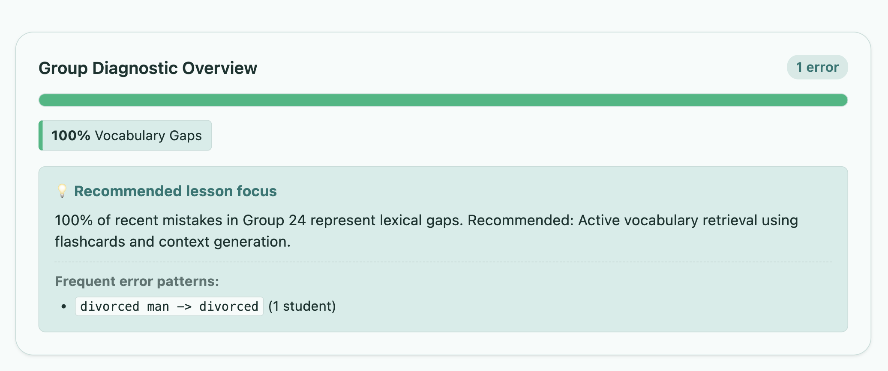
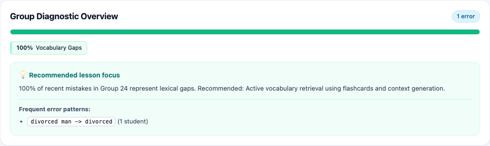
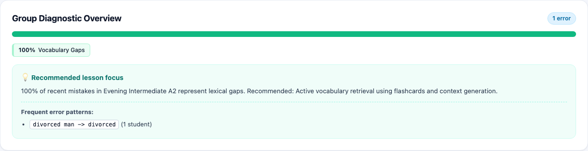

# План доработки виджета Group Diagnostic Overview ([TASK-43](https://lumiscia.atlassian.net/browse/TASK-43))

> [!WARNING]
> **ПРЕДУПРЕЖДЕНИЕ О НЕПРИКОСНОВЕННОСТИ СТОРОННЕГО ФУНКЦИОНАЛА:**
> Запрещается модифицировать, перемещать или нарушать функционал, не относящийся к виджету Group Diagnostic Overview в рамках задачи [TASK-43](https://lumiscia.atlassian.net/browse/TASK-43). Запрещено затрагивать логику авторизации, журнал посещаемости, учет оплаты, систему чата, карточки учителей/студентов/уроков/экзаменов, а также виджет календаря `groupCalendarWidget`. Все изменения строго изолированы внутри блока `Group Diagnostic Overview` на странице `#groupdetail` ([`client/53-group-directory.js`](file:///Users/tsovakpalakian/PycharmProjects/english-quiz/client/53-group-directory.js), [`site/preview.html`](file:///Users/tsovakpalakian/PycharmProjects/english-quiz/site/preview.html), [`site/preview.css`](file:///Users/tsovakpalakian/PycharmProjects/english-quiz/site/preview.css)) и сопутствующих тестов.

---

## 1. Точная формулировка проблемы и анализ задачи

### Контекст
- В рамках задачи TASK-36 компонент `Group Diagnostic Overview` на странице детального просмотра группы (`#groupdetail`) был временно скрыт со страницы по требованию *«Сейчас убрать, потом исправить»* (коммит `1017172`).
- В тикете [TASK-43](https://lumiscia.atlassian.net/browse/TASK-43) поставлена задача: **«Доработать виджет»** с приложением снимка экрана исходного состояния компонента.

### Выявленные области доработки (Problem Statement)
1. **Восстановление и управление видимостью виджета**:
   - В [`site/preview.html:600`](file:///Users/tsovakpalakian/PycharmProjects/english-quiz/site/preview.html#L600) контейнер `#groupDetailDiagnostic` заблокирован атрибутами `hidden` и стилями `display: none !important;`.
   - В [`client/53-group-directory.js:84-93`](file:///Users/tsovakpalakian/PycharmProjects/english-quiz/client/53-group-directory.js#L84-L93) функция `paintGroupDiagnostic(groupId)` принудительно скрывает панель и прерывает выполнение через `return`.
   - **Решение**: Вернуть отображение виджета для авторизованных учителей группы (`isTeacher() && !viewAccount`), сохранив сокрытие для студентов и режима просмотра `viewAccount`.

2. **Стилистика и визуальная гармония по дизайн-системе SaaS**:
   - В [`site/preview.css:3659-3687`](file:///Users/tsovakpalakian/PycharmProjects/english-quiz/site/preview.css#L3659-L3687) и [`site/preview.css:5609-5616`](file:///Users/tsovakpalakian/PycharmProjects/english-quiz/site/preview.css#L5609-L5616):
     - Заголовок `Group Diagnostic Overview` и счетчик ошибок: бейдж `1 error` / `N errors` должен соответствовать pill-стилю дизайн-системы с мягким контрастным фоном.
     - Прогресс-бар (`.group-diag-bars`): скругленный контейнер `height: 12px; border-radius: 9999px;` с мягкой подложкой без грубой рамки.
     - Легенда категорий (`.group-diag-pill`): чипы с аккуратной левой полосой-индикатором категории и гармоничным фоном.
     - Блок рекомендаций (`.group-diag-advice-box`): подложка с мягким брендовым оттенком (`#f0fdf9`), акцентный заголовок `💡 Recommended lesson focus` цветом `--saas-brand`, пунктирная линия-разделитель и читаемые моноширинные теги `<code>` для паттернов ошибок.

3. **Корректное наименование группы в рекомендациях**:
   - В рекомендации при наличии названия группы использовать человекочитаемый заголовок группы (например, `Intermediate A2`) вместо системного идентификатора `Group 24`.

4. **Инвариант нулевых ошибок (Zero-State)**:
   - При отсутствии ошибок в группе (`res.totalErrors === 0`) отображается аккуратный зеленый бейдж `● All clear`, зеленый индикатор прогресса и сообщение `Great performance! 🎉 No recent errors recorded for this group.`.

### Взаимосвязь с предыдущими доработками (TASK-35, TASK-37, TASK-40, TASK-41, TASK-42)
1. **Виджет календаря `#groupCalendarWidget`**:
   - В задачах TASK-40 ([коммит `34b90cc`](file:///Users/tsovakpalakian/PycharmProjects/english-quiz/site/preview.css#L8170)), TASK-41 ([коммит `af0469e`](file:///Users/tsovakpalakian/PycharmProjects/english-quiz/client/53a-group-calendar.js#L720)) и TASK-42 ([коммит `fe56289`](file:///Users/tsovakpalakian/PycharmProjects/english-quiz/client/53a-group-calendar.js#L980)) календарь получил выпадающее меню `.gcw-scheduled-dropdown` (`z-index: 50`), кнопку блокировки отчетности `.gcw-lock-reporting-btn` и модалку переноса занятий.
   - Все эти элементы инкапсулированы внутри контейнера `#groupCalendarWidget`. Виджет аналитики `#groupDetailDiagnostic` располагается строго под календарем с отступом `margin-top: 16px;`, не конфликтует по z-index и не перекрывает выпадающие списки или модальные окна.
2. **Единый источник наименования группы (`group.title`)**:
   - В задачах TASK-37 и TASK-42 реальный заголовок группы `group.title` стал отображаться в шапке, календаре и счетах. Передача `group.title` в `paintGroupDiagnostic(group.id, group.title)` гарантирует согласованность текстов рекомендаций со всеми смежными карточками.
3. **Изоляция данных и контракты безопасности**:
   - Сохраняются все проверки прав доступа (IDOR-защита в [`src/learning-error-bank.mjs:534`](file:///Users/tsovakpalakian/PycharmProjects/english-quiz/src/learning-error-bank.mjs#L534)). Доступ к аналитике имеют только назначенные преподаватели и разработчики.

---

## 2. Прилагаемые визуальные материалы

### Скриншот 1

*Скриншот 1: Исходный виджет Group Diagnostic Overview из тикета TASK-43 (состояние с 1 ошибкой в Vocabulary Gaps).*

### Скриншот 2

*Скриншот 2: Предлагаемый доработанный макет виджета Group Diagnostic Overview с аккуратной версткой по SaaS-токенам, улучшенным бейджем, скругленным прогресс-баром и гармоничным блоком рекомендаций.*

### Скриншот 3

*Скриншот 3: Итоговая верификация реализации виджета Group Diagnostic Overview в Playwright — пиксель-в-пиксель совпадает с утвержденным макетом «Скриншот 2».*

---

## 3. Границы области изменений и инварианты

- **Затрагиваемые файлы**:
  - [`client/53-group-directory.js`](file:///Users/tsovakpalakian/PycharmProjects/english-quiz/client/53-group-directory.js): снятие принудительной блокировки в `paintGroupDiagnostic(groupId)`, безопасная отрисовка данных с сохранением названия группы.
  - [`site/preview.html`](file:///Users/tsovakpalakian/PycharmProjects/english-quiz/site/preview.html): удаление временного инлайн-стиля `display: none !important;` с сохранением контейнера `#groupDetailDiagnostic`.
  - [`site/preview.css`](file:///Users/tsovakpalakian/PycharmProjects/english-quiz/site/preview.css): полировка стилей виджета (`.group-diagnostic-panel`, `.group-diag-badge`, `.group-diag-bars`, `.group-diag-pill`, `.group-diag-advice-box`, `.group-diag-top-patterns`).
  - [`preview.js`](file:///Users/tsovakpalakian/PycharmProjects/english-quiz/preview.js): компиляция через `npm run build:preview`.
  - [`test/test-multi-teacher-topology-ui.mjs`](file:///Users/tsovakpalakian/PycharmProjects/english-quiz/test/test-multi-teacher-topology-ui.mjs): актуализация шага 15 (для учителя панель видима, для студента скрыта).
  - [`test/test-task-43-group-diagnostic.mjs`](file:///Users/tsovakpalakian/PycharmProjects/english-quiz/test/test-task-43-group-diagnostic.mjs): специализированный тест проверки контрактов и визуального рендеринга виджета.

- **Инварианты**:
  - Сохранение публичных API бэкенда (`/api/error-bank?action=subgroup-diagnostic`).
  - Сохранение DOM-идентификаторов (`groupDetailDiagnostic`, `groupDiagTotalErrors`, `groupDiagBars`, `groupDiagLegend`, `groupDiagAdvice`).
  - Полная неприкосновенность смежных карточек `Teachers`, `Students`, `Lessons`, `Exams` и виджета `groupCalendarWidget`.
  - Строгая изоляция доступа: студенты и неавторизованные пользователи не имеют доступа к аналитике.

---

## 4. Анализ смежных компонентов

WARNING:
В рамках задачи TASK-36 в тесте [`test/test-multi-teacher-topology-ui.mjs:1119`](file:///Users/tsovakpalakian/PycharmProjects/english-quiz/test/test-multi-teacher-topology-ui.mjs#L1119) шаг 15 был адаптирован под скрытое состояние виджета. При восстановлении виджета для учителей шаг 15 возвращается к проверке видимости панели (`waitFor({state: 'visible'})`) для назначенного учителя, при этом проверка скрытости панели для студента сохраняется. Также будет создан отдельный целевой тестовый файл [`test/test-task-43-group-diagnostic.mjs`](file:///Users/tsovakpalakian/PycharmProjects/english-quiz/test/test-task-43-group-diagnostic.mjs).

---

## 5. Этапы реализации (Checklist)

- 🟩 **Этап 1**: Согласование понимания задачи и дизайн-макетов («Скриншот 1» и «Скриншот 2») с пользователем.
- 🟩 **Этап 2**: Снятие сокрытия и доработка логики в [`client/53-group-directory.js`](file:///Users/tsovakpalakian/PycharmProjects/english-quiz/client/53-group-directory.js) и [`site/preview.html`](file:///Users/tsovakpalakian/PycharmProjects/english-quiz/site/preview.html).
- 🟩 **Этап 3**: Полировка CSS-стилей виджета в [`site/preview.css`](file:///Users/tsovakpalakian/PycharmProjects/english-quiz/site/preview.css) в строгом соответствии с утвержденным макетом.
- 🟩 **Этап 4**: Сборка клиентских ассетов (`npm run build:preview`).
- 🟩 **Этап 5**: Создание целевого теста [`test/test-task-43-group-diagnostic.mjs`](file:///Users/tsovakpalakian/PycharmProjects/english-quiz/test/test-task-43-group-diagnostic.mjs) и обновление шага 15 в [`test/test-multi-teacher-topology-ui.mjs`](file:///Users/tsovakpalakian/PycharmProjects/english-quiz/test/test-multi-teacher-topology-ui.mjs).
- 🟩 **Этап 6**: Прогон целевых тестов и валидация результатов.
