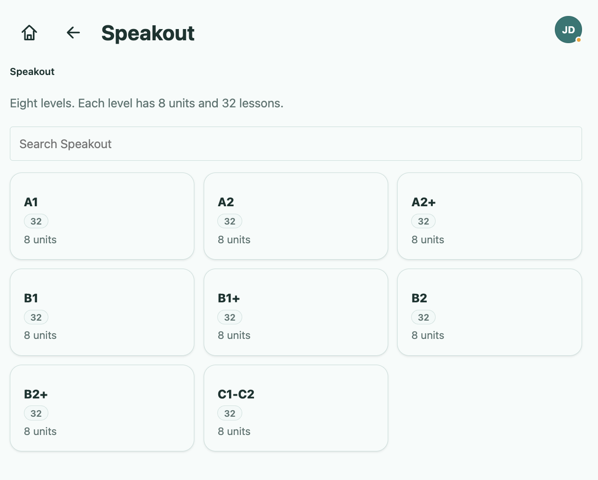
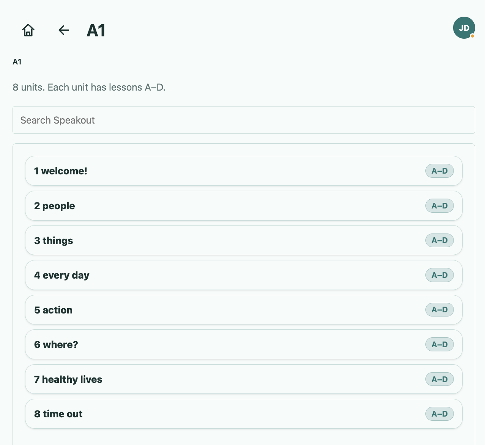
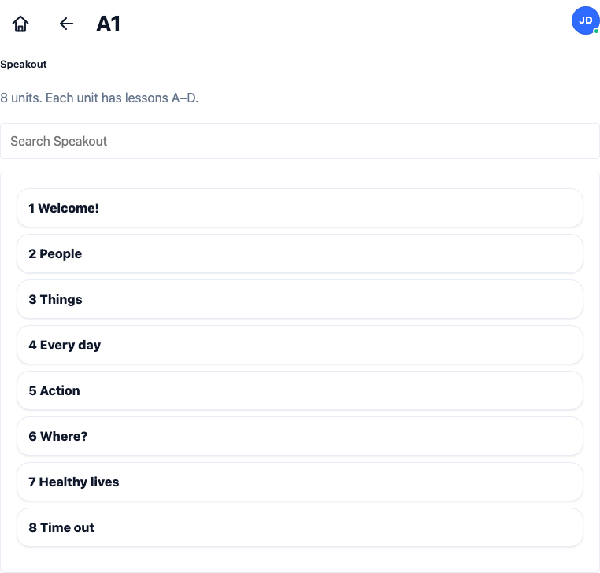
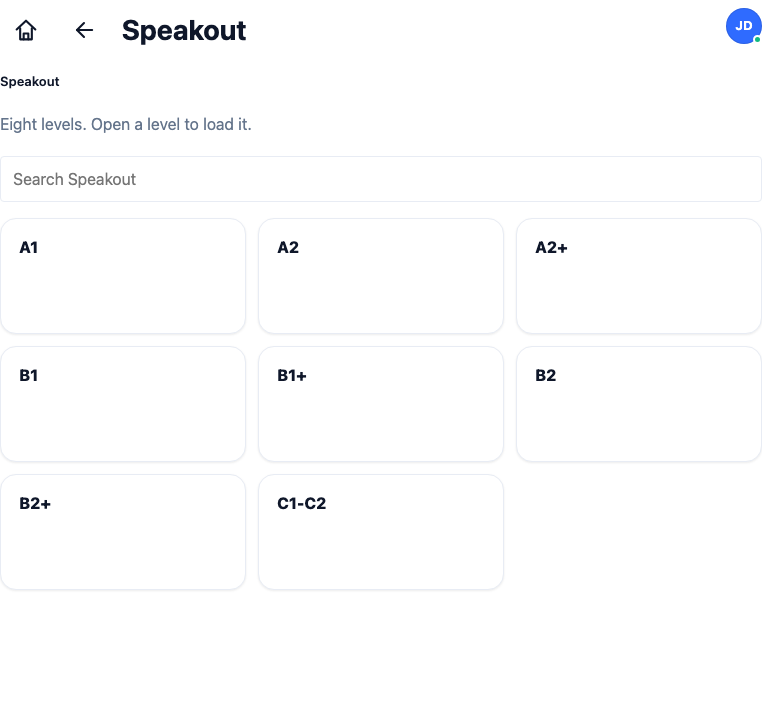

# План удаления спанов и форматирования заголовков в Speakout ([TASK-44](https://lumiscia.atlassian.net/browse/TASK-44))

> [!WARNING]
> **ПРЕДУПРЕЖДЕНИЕ О НЕПРИКОСНОВЕННОСТИ СТОРОННЕГО ФУНКЦИОНАЛА:**
> Запрещается модифицировать, перемещать или нарушать функционал, не относящийся к отображению карточек уровней и списка юнитов в разделе Speakout в рамках задачи [TASK-44](https://lumiscia.atlassian.net/browse/TASK-44). Запрещено изменять логику других разделов (Grammar, Library, Word Collections, Exams, Groups, Settings), редактора Speakout ([`client/main/main-hooks.js`](file:///Users/tsovakpalakian/PycharmProjects/english-quiz/client/main/main-hooks.js#L1716), [`site/speakout-editor.js`](file:///Users/tsovakpalakian/PycharmProjects/english-quiz/site/speakout-editor.js)), логику навигации и историю переходов. Все изменения строго изолированы внутри рендеринга карточек уровней и юнитов Speakout, пересборки бандла и сопутствующих тестов.

---

## 1. Точная формулировка задачи и анализ первопричины

### Исходные требования по тикету TASK-44:
1. **Удалить везде**:
   - `32` (и динамический счетчик уроков уровня).
   - `8 units` (и текстовую плашку количества юнитов).
2. **Удалить**:
   - `A–D` в списке юнитов уровня.
3. **Сохранить порядковый номер юнита и сделать надписи с большой буквы**:
   - Порядковые номера (`1`, `2`, `3`...) сохраняются перед названием юнита.
   - Названия юнитов отображаются с заглавной буквы (например: «1 Welcome!», «2 People», «3 Things», «4 Every day», «5 Action», «6 Where?», «7 Healthy lives», «8 Time out»).

### Первопричина и анализ кода:
- Карточки уровней формируются в двух местах:
  1. [`client/00-core.js`](file:///Users/tsovakpalakian/PycharmProjects/english-quiz/client/00-core.js#L477-L479) в функции `paintSpeak()` для режима `speakView === "levels"`: захардкожены спаны `328 units<i class="mini"><i style="width:100%"></i></i>`.
  2. [`client/main/main-hooks.js`](file:///Users/tsovakpalakian/PycharmProjects/english-quiz/client/main/main-hooks.js#L1681-L1686) в функции `stagePaintSpeakLevels()`: рендерятся `'+num+''+label+'`.
- Карточки юнитов формируются в [`client/00-core.js`](file:///Users/tsovakpalakian/PycharmProjects/english-quiz/client/00-core.js#L488-L490) для режима `speakView === "level"`:
  - Формируется строка: `'<b>' + (i + 1) + " " + esc(item.title) + '</b>A–D'`.
  - В файле [`speakout.js`](file:///Users/tsovakpalakian/PycharmProjects/english-quiz/speakout.js) названия всех юнитов заданы со строчной буквы («welcome!», «people», «things», «every day» и т.д.).
- Стили карточек уровней:
  - Класс `.file-card` в [`site/preview.css`](file:///Users/tsovakpalakian/PycharmProjects/english-quiz/site/preview.css#L1493-L1503) имеет `min-height: 116px` и `justify-content: flex-end`. При удалении спанов бейджей заголовок `<b>A1</b>` без явного правила прижимается к нижнему краю карточки. Для сохранения исходного положения заголовка вверху карточки в правило `#speakout .file-card` добавляется `justify-content: flex-start`.

---

## 2. Прилагаемые визуальные материалы

### Скриншот 1

*Скриншот 1: Исходное состояние страницы уровней Speakout из тикета TASK-44 с отображением бейджей 32 и 8 units.*

### Скриншот 2

*Скриншот 2: Исходное состояние страницы юнитов уровня A1 из тикета TASK-44 с бейджем A–D и названиями со строчной буквы.*

### Скриншот 3

*Скриншот 3: Предлагаемый результат страницы уровней Speakout — бейджи 32 и 8 units удалены, заголовок уровня выровнен в верхней части карточки.*

### Скриншот 4

*Скриншот 4: Предлагаемый результат страницы юнитов уровня A1 — бейдж A–D удален, порядковые номера 1–8 сохранены, названия юнитов начинаются с заглавной буквы.*

---

## 3. Архитектурное решение и границы изменений

1. **Удаление спанов карточек уровней**:
   - В [`client/00-core.js`](file:///Users/tsovakpalakian/PycharmProjects/english-quiz/client/00-core.js#L477) удаляются спаны ``, `` и неиспользуемый `<i class="mini">`, оставляя только `<b>` с кодом уровня.
   - В [`client/main/main-hooks.js`](file:///Users/tsovakpalakian/PycharmProjects/english-quiz/client/main/main-hooks.js#L1685) удаляются спаны `` и ``, оставляя только `<b>` с кодом уровня.
2. **Стилизация выравнивания заголовка карточек уровней**:
   - В [`site/preview.css`](file:///Users/tsovakpalakian/PycharmProjects/english-quiz/site/preview.css#L2724) для `#speakout .file-card` задается `justify-content: flex-start;`, чтобы заголовок уровня сохранял стабильное верхнее положение (Скриншот 3).
3. **Удаление бейджа `A–D` и капитализация названий юнитов**:
   - В [`client/00-core.js`](file:///Users/tsovakpalakian/PycharmProjects/english-quiz/client/00-core.js#L488-L490) удаляется `A–D`, внедряется форматирование названия юнита с заглавной буквы при рендере `(i + 1) + " " + esc(speakUnitTitle(item.title))`.
   - В [`speakout.js`](file:///Users/tsovakpalakian/PycharmProjects/english-quiz/speakout.js) обновляются заголовки всех юнитов всех уровней с заглавной буквы (например, «Welcome!», «People», «Things», «Every day» и т.д.).
4. **Сборка и валидация**:
   - Запуск `npm run build:preview` для синхронизации [`preview.js`](file:///Users/tsovakpalakian/PycharmProjects/english-quiz/preview.js).
   - Актуализация существующего теста [`test/test-learning-main.mjs`](file:///Users/tsovakpalakian/PycharmProjects/english-quiz/test/test-learning-main.mjs#L2531) (проверка отсутствия спанов).
   - Создание нового целевого теста `test/test-task-44-speakout-spans.mjs` с Playwright UI верификацией DOM и скриншотов.

---

## 4. Контрольный чек-лист реализации

- 🟩 **Этап 1: Удаление спанов уровней в [`client/00-core.js`](file:///Users/tsovakpalakian/PycharmProjects/english-quiz/client/00-core.js) и [`client/main/main-hooks.js`](file:///Users/tsovakpalakian/PycharmProjects/english-quiz/client/main/main-hooks.js)**
  - Удаление `` и `` при отрисовке карточек уровней.
- 🟩 **Этап 2: Удаление бейджа `A–D` и капитализация юнитов в [`client/00-core.js`](file:///Users/tsovakpalakian/PycharmProjects/english-quiz/client/00-core.js) и [`speakout.js`](file:///Users/tsovakpalakian/PycharmProjects/english-quiz/speakout.js)**
  - Удаление `A–D`, капитализация заголовков юнитов с сохранением порядкового номера.
- 🟩 **Этап 3: Корректировка стилей `#speakout .file-card` в [`site/preview.css`](file:///Users/tsovakpalakian/PycharmProjects/english-quiz/site/preview.css)**
  - Добавление `justify-content: flex-start;` для фиксации заголовка уровня в верхней части карточки.
- 🟩 **Этап 4: Пересборка клиентского бандла**
  - Запуск `npm run build:preview` и генерация [`preview.js`](file:///Users/tsovakpalakian/PycharmProjects/english-quiz/preview.js).
- 🟩 **Этап 5: Автоматизированное тестирование**
  - Актуализация теста в [`test/test-learning-main.mjs`](file:///Users/tsovakpalakian/PycharmProjects/english-quiz/test/test-learning-main.mjs).
  - Написание нового комплексного теста [`test/test-task-44-speakout-spans.mjs`](file:///Users/tsovakpalakian/PycharmProjects/english-quiz/test/test-task-44-speakout-spans.mjs) (юнит-тесты + Playwright UI).
- 🟩 **Этап 6: Валидация и прогон целевых тестов**
  - Выполнение `node --test test/test-task-44-speakout-spans.mjs` и `node --test test/test-learning-main.mjs`.

---

## 5. Фактические скриншоты верификации реализации

### Скриншот верификации уровней (Скриншот 5)

*Скриншот 5: Фактическое отображение экрана уровней Speakout после применения изменений — спаны 32 и 8 units удалены, заголовок уровня зафиксирован вверху.*

### Скриншот верификации юнитов (Скриншот 6)

*Скриншот 6: Фактическое отображение списка юнитов Speakout после применения изменений — бейдж A–D удален, порядковые номера 1–8 сохранены, надписи начинаются с заглавной буквы.*
