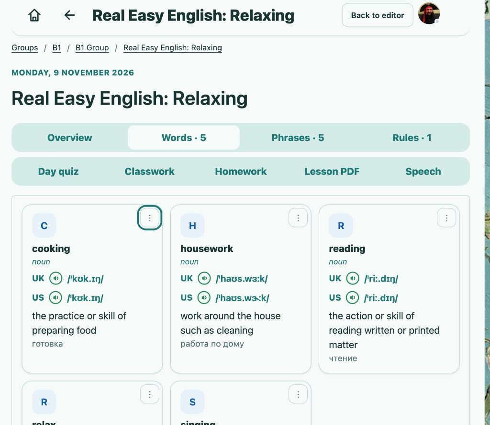
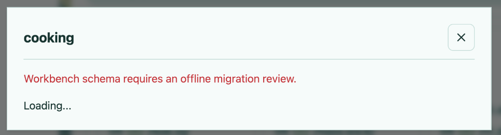
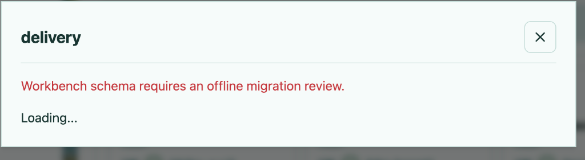

# План реализации TASK-45: Устранение ошибки схемы Learning Workbench при открытии действий карточки слова

## 1. Описание задачи и контекст

- **Ключ задачи**: `TASK-45`
- **Родительский эпик**: `TASK-16` (`[bugs] Groups`)
- **Заголовок**: `[bug] Сбой схемы Learning Workbench при открытии действий карточки слова`
- **Проблема**: При нажатии на вертикальное троеточие `⋮` в верхнем правом углу карточки любого слова (в частности, «cooking» или «delivery») открывается модальное окно `Learning kit`, в котором выводится сообщение об ошибке красного цвета: `Workbench schema requires an offline migration review.` и постоянный статус `Loading...`.
- **Причина**: В активной базе данных Cloudflare D1 (`STUDY_DB` / `DB`) отсутствуют 41 таблица и 15 триггеров из набора `migrations/quiz-review-draft/` (20 SQL-файлов от `001_quiz_review.sql` до `020_study_exam_bridge.sql`). Серверная проверка готовности схемы `learningWorkbenchReadiness` в [src/learning-workbench-schema.mjs#L9](file:///Users/tsovakpalakian/PycharmProjects/english-quiz/src/learning-workbench-schema.mjs#L9) возвращает `ready: false`, из-за чего [src/learning-integrated-worker.mjs#L253](file:///Users/tsovakpalakian/PycharmProjects/english-quiz/src/learning-integrated-worker.mjs#L253) выбрасывает исключение HTTP 503.

---

## 2. Изоляция функционала и запрет нецелевых изменений

> [!WARNING]
> WARNING: Запрещено задевать, модифицировать или ломать функционал, не относящийся к текущей задаче. Задача строго изолирована рамками схемы воркбенча и открытия карточки Learning kit. Запрещено вносить изменения в логику расписания уроков, систему оплаты, чат, экзамены или авторизацию.

---

## 3. Чек-лист реализации

- 🟩 **Этап 1: Фиксация задачи в Jira и документации**
  - 🟩 Зарегистрировать дефект `TASK-45` в проекте `TASK` с привязкой к родительскому эпику `TASK-16`.
  - 🟩 Загрузить скриншоты в Jira-тикет `TASK-45`.
  - 🟩 Сформировать план реализации в `docs/task-45-workbench-schema-and-quiz-creation-plan.md`.

- 🟩 **Этап 2: Подготовка и интеграция миграций схемы Workbench**
  - 🟩 Перенести 20 файлов миграций из `migrations/quiz-review-draft/` в официальный каталог миграций `migrations/learning/` с упорядоченной нумерацией от `010_quiz_review.sql` до `029_study_exam_bridge.sql`.
  - 🟩 Провести проверку применения миграций на изолированном клоне базы данных.
  - 🟩 Подтвердить успешное создание 41 таблицы и 15 триггеров с прохождением `learningWorkbenchReadiness`.

- 🟩 **Этап 3: Снятие серверной блокировки HTTP 503 и проверка API**
  - 🟩 Убедиться, что при наличии всех таблиц и триггеров проверка в `src/learning-integrated-worker.mjs#L253` возвращает `readiness.ready === true`.
  - 🟩 Проверить корректность ответов эндпоинтов `/api/workbench/status` и `/api/workbench/kit`.

- 🟩 **Этап 4: Верификация клиентского интерфейса Learning kit**
  - 🟩 Проверить клик по кнопке `⋮` на карточке слова в уроках ([client/52a-workbench.js#L368](file:///Users/tsovakpalakian/PycharmProjects/english-quiz/client/52a-workbench.js#L368)).
  - 🟩 Проверить отображение информации о слове, выбор значения (`senseId`), появление кнопки `New quiz` для создания 17 типов квизов и кнопки `Assign reviewed quiz to exam`.
  - 🟩 Убедиться в отсутствии зависания на статусе `Loading...`.

- 🟩 **Этап 5: Автотесты и сборка ассетов**
  - 🟩 Добавить целевые тесты в `test/test-workbench-schema-migration.mjs`.
  - 🟩 Запустить таргетированные тесты `node --test test/test-workbench-schema-migration.mjs test/test-workbench-infrastructure.mjs test/test-learning-workbench.mjs`.
  - 🟩 Выполнить сборку клиентских ассетов командой `npm run build:preview`.

- 🟩 **Этап 6: Универсальное разрешение разработчика подготовки (workbenchActor)**
  - 🟩 Обновить запрос в `src/learning-workbench-runtime.mjs#L22` для поиска по `id`, по `login`, а также по сопоставлению устаревших идентификаторов в таблице `legacy_account_ids`: `WHERE id=? OR login=? OR id=(SELECT new_id FROM legacy_account_ids WHERE old_id=?)`.
  - 🟩 Добавить целевые unit-тесты в `test/test-workbench-schema-migration.mjs` для проверки поиска по целочисленному `id`, строковому `id`, логину `login`, а также по устаревшему UUID через `legacy_account_ids`, включая обработку случая отсутствия таблицы `legacy_account_ids`.
  - 🟩 Запустить целевые тесты (26 тестов успешно пройдено) и выполнить `npm run build:preview`.

---

## 4. Прикрепленные скриншоты

### Скриншот 1: Кнопка вызова меню действий слова в карточке

*Скриншот 1: Расположение кнопки вертикального троеточия «⋮» в верхнем правом углу карточки слова «cooking».*

---

### Скриншот 2: Ошибка схемы воркбенча на слове «cooking»

*Скриншот 2: Ошибка «Workbench schema requires an offline migration review» при открытии модального окна слова «cooking».*

---

### Скриншот 3: Воспроизведение ошибки на слове «delivery»

*Скриншот 3: Системная ошибка готовности схемы базы данных при открытии модального окна слова «delivery».*

---

### Скриншот 4: Ошибка схемы воркбенча на удаленном стенде после деплоя

*Скриншот 4: Сохранение ошибки «Workbench schema requires an offline migration review» на удаленном стенде из-за отсутствия триггера qr_speech_attempts_immutable в базе данных Cloudflare D1 STUDY_DB.*

---

### Скриншот 5: Ошибка отсутствия активного разработчика подготовки после исправления схемы

*Скриншот 5: Ошибка «An active preparation worker is required.» в модальном окне «cooking» из-за отсутствия или неверного значения LEARNING_WORKBENCH_WORKER_ID.*
