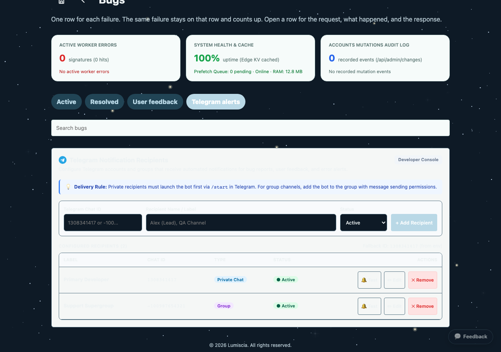

# План реализации поддержки нескольких каналов Telegram для уведомлений CI/CD

> [!WARNING]
> Запрещено задевать, модифицировать или ломать функционал, не относящийся к текущей задаче. Выполняемая задача строго и изолированно затрагивает утилиту отправки уведомлений CI/CD в [ops/telegram-notify.mjs](file:///Users/tsovakpalakian/PycharmProjects/english-quiz/ops/telegram-notify.mjs) и связанные с ней тесты в [test/test-ci-telegram-logs.mjs](file:///Users/tsovakpalakian/PycharmProjects/english-quiz/test/test-ci-telegram-logs.mjs) и [test/test-check-environment.mjs](file:///Users/tsovakpalakian/PycharmProjects/english-quiz/test/test-check-environment.mjs). Функционал веб-приложения, клиентские модули в `client/`, сборщик ассетов и логика обратной связи в `src/feedback.mjs` остаются неприкосновенными.

---

### Утвержденные материалы интерфейса

### Скриншот 1: Вкладка Telegram alerts в панели разработчика Bugs

---

### 1. Формулировка проблемы

1. Уведомления о результатах сборки и деплоя GitHub Actions CI/CD отправляются через утилиту [ops/telegram-notify.mjs](file:///Users/tsovakpalakian/PycharmProjects/english-quiz/ops/telegram-notify.mjs).
2. На данный момент функция `telegramConfig` валидирует `TELEGRAM_CHAT_ID` регулярным выражением `/^-?\d+$/`, что допускает ровно один числовой идентификатор чата.
3. При необходимости отправлять уведомления о деплое одновременно в личный чат и во второй рабочий канал в секретах репозитория GitHub Actions требуется указывать несколько идентификаторов чатов (через запятую или пробел).
4. Текущая реализация приводит к ошибке валидации конфигурации при наличии более одного идентификатора и не осуществляет доставку сообщений во второй канал.

---

### 2. Контрольный список реализации

- 🟩 **Этап 1: Документация и планирование**
  - Подготовка проектного документа в `docs/task-ci-telegram-multi-channel-plan.md` с предупреждающим блоком, скриншотом и чек-листом.
- 🟩 **Этап 2: Поддержка нескольких каналов в ops/telegram-notify.mjs**
  - Обновление парсинга `TELEGRAM_CHAT_ID` в `telegramConfig`: разбиение по запятым и пробелам, валидация каждого идентификатора регулярным выражением `/^-?\d+$/`.
  - Возврат структуры `{ token, chats, chat }` с сохранением обратной совместимости.
  - Реализация отправки текстового сообщения `notifyTelegram` по всем указанным чатам.
  - Реализация отправки документа с логами `notifyTelegramDocument` по всем указанным чатам.
- 🟩 **Этап 3: Тестирование и верификация**
  - Добавление тестов на множественные чаты (список через запятую, пробелы, переводы строк) в [test/test-ci-telegram-logs.mjs](file:///Users/tsovakpalakian/PycharmProjects/english-quiz/test/test-ci-telegram-logs.mjs).
  - Актуализация тестов конфигурации в [test/test-check-environment.mjs](file:///Users/tsovakpalakian/PycharmProjects/english-quiz/test/test-check-environment.mjs).
  - Запуск таргетированных тестов: `node --test test/test-ci-telegram-logs.mjs test/test-check-environment.mjs` (все 22 теста успешно пройдены).
- 🟩 **Этап 4: Финальная валидация и коммит**
  - Фиксация статуса в документации.
  - Предоставление коммит-сообщения и списка тестовых файлов без расширений.
