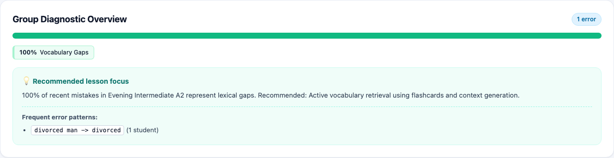
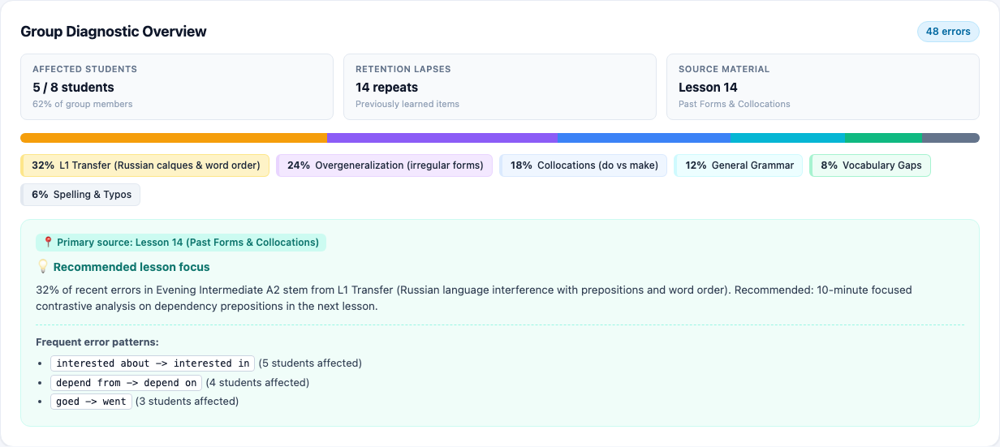
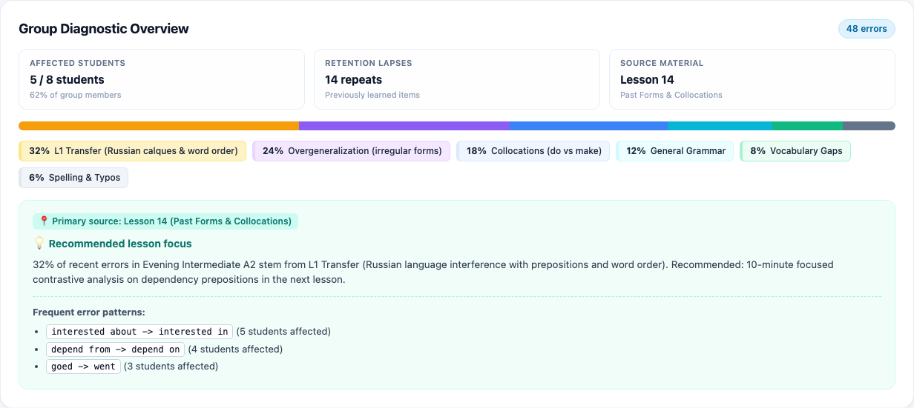

# План расширения аналитических метрик виджета Group Diagnostic Overview

> [!WARNING]
> **ПРЕДУПРЕЖДЕНИЕ О НЕПРИКОСНОВЕННОСТИ СТОРОННЕГО ФУНКЦИОНАЛА:**
> Запрещается модифицировать, перемещать или нарушать функционал, не относящийся к виджету Group Diagnostic Overview в рамках текущей задачи. Запрещено затрагивать логику авторизации, журнал посещаемости, учет оплаты, систему чата, карточки учителей/студентов/уроков/экзаменов, а также виджет календаря `groupCalendarWidget`. Все изменения строго изолированы внутри блока `Group Diagnostic Overview` на странице `#groupdetail` ([`client/53-group-directory.js`](file:///Users/tsovakpalakian/PycharmProjects/english-quiz/client/53-group-directory.js), [`site/preview.html`](file:///Users/tsovakpalakian/PycharmProjects/english-quiz/site/preview.html), [`site/preview.css`](file:///Users/tsovakpalakian/PycharmProjects/english-quiz/site/preview.css), [`src/learning-error-bank.mjs`](file:///Users/tsovakpalakian/PycharmProjects/english-quiz/src/learning-error-bank.mjs), [`src/learning-error-classifier.mjs`](file:///Users/tsovakpalakian/PycharmProjects/english-quiz/src/learning-error-classifier.mjs)) и сопутствующих тестов.

---

## 1. Точная формулировка проблемы и анализ задачи

### Контекст
- Виджет `Group Diagnostic Overview` на странице `#groupdetail` ([`site/preview.html:600`](file:///Users/tsovakpalakian/PycharmProjects/english-quiz/site/preview.html#L600)) отображает общую сводку ошибок группы: счетчик `totalErrors`, прогресс-бар по 6 категориям, чипы легенды и блок методической рекомендации с 3 паттернами ошибок.
- В таблице базы данных `account_error_items` ([`src/learning-error-bank.mjs:52-80`](file:///Users/tsovakpalakian/PycharmProjects/english-quiz/src/learning-error-bank.mjs#L52-L80)) фиксируются ровно 27 колонок, содержащие детальные параметры (идентификатор студента `account_id`, привязка к уроку `material_id`, повторные срывы памяти `lapses`, когнитивная задержка `latency_ms`).
- В текущей реализации синтезатор [`src/learning-error-classifier.mjs:345-441`](file:///Users/tsovakpalakian/PycharmProjects/english-quiz/src/learning-error-classifier.mjs#L345-L441) агрегирует только общие категории, упуская контекст охвата студентов группы, фактор забывания ранее изученного и привязку к уроку.

### Предлагаемые доработки (Problem Statement)
1. **Добавление трех микро-метрик в интерфейс виджета**:
   - `Affected students`: количество и доля студентов группы, совершивших зафиксированные ошибки (значение: `5 / 8 students (62%)`).
   - `Retention lapses`: количество повторных срывов в изученном материале на основе поля `lapses` (повторные ошибки vs первичное знакомство).
   - `Source material`: название и номер урока из `lmLibrary`, в котором сконцентрировано наибольшее число ошибок.
2. **Отображение тега урока в блоке рекомендаций**:
   - Добавление чипа `📍 Primary source: Lesson X (Title)` в начале блока рекомендаций для точной фокусировки повторения.
3. **Бэкенд-синтез дополнительных метрик**:
   - Расширение объекта ответа эндпоинта `/api/error-bank?action=subgroup-diagnostic` ([`src/learning-integrated-worker.mjs:1023`](file:///Users/tsovakpalakian/PycharmProjects/english-quiz/src/learning-integrated-worker.mjs#L1023)) полями `affectedStudentsCount`, `totalGroupStudents`, `retentionLapsesCount`, `topMaterialId`, `topMaterialTitle`.
4. **Сохранение чистоты нулевого состояния**:
   - При `totalErrors === 0` виджет сохраняет компактный зеленый статус `All clear` без отображения пустых карточек микро-метрик.

---

## 2. Прилагаемые визуальные материалы

### Скриншот 1

*Скриншот 1: Текущая реализация виджета Group Diagnostic Overview с отображением счетчика ошибок, сегментированной полосы, легенды и блока рекомендаций.*

### Скриншот 2

*Скриншот 2: Концепт расширенного виджета Group Diagnostic Overview с тремя дополнительными микро-метриками (Affected students, Retention lapses, Source material) и привязкой к уроку.*

### Скриншот 3

*Скриншот 3: Итоговая верификация реализации расширенного виджета Group Diagnostic Overview в Playwright — точное совпадение с утвержденным макетом «Скриншот 2».*

---

## 3. Границы области изменений и инварианты

- **Затрагиваемые файлы**:
  - [`src/learning-error-classifier.mjs`](file:///Users/tsovakpalakian/PycharmProjects/english-quiz/src/learning-error-classifier.mjs): вычисление `affectedStudentsCount`, `retentionLapsesCount`, `topMaterialId` в функции `synthesizeSubgroupDiagnostic`.
  - [`src/learning-error-bank.mjs`](file:///Users/tsovakpalakian/PycharmProjects/english-quiz/src/learning-error-bank.mjs): выборка поля `lapses` в запросе `subgroupDiagnostic` и подсчет общего числа студентов группы из `class_group_students`.
  - [`client/53-group-directory.js`](file:///Users/tsovakpalakian/PycharmProjects/english-quiz/client/53-group-directory.js): отрисовка контейнера микро-метрик и сопоставление `materialId` с названием урока из библиотеки `lmLibrary`.
  - [`site/preview.html`](file:///Users/tsovakpalakian/PycharmProjects/english-quiz/site/preview.html): добавление контейнера `#groupDiagSubmetrics` в разметку панели.
  - [`site/preview.css`](file:///Users/tsovakpalakian/PycharmProjects/english-quiz/site/preview.css): стилизация карточек микро-метрик и тега урока по SaaS-токенам.
  - [`preview.js`](file:///Users/tsovakpalakian/PycharmProjects/english-quiz/preview.js): сборка клиентских ассетов (`npm run build:preview`).
  - [`test/test-task-group-diagnostic-extended.mjs`](file:///Users/tsovakpalakian/PycharmProjects/english-quiz/test/test-task-group-diagnostic-extended.mjs): целевой тест верификации контрактов и визуального рендеринга.

- **Инварианты**:
  - Обратная совместимость API: сохранение всех существующих полей в ответе `/api/error-bank?action=subgroup-diagnostic`.
  - Сохранение нулевого состояния: при отсутствии ошибок блок микро-метрик скрывается, отображается чип `● All clear`.
  - Неприкосновенность смежных карточек: `Teachers`, `Students`, `Lessons`, `Exams` и виджета `groupCalendarWidget`.
  - Строгая изоляция доступа: студенты и неавторизованные пользователи не имеют доступа к аналитике.

---

## 4. Анализ смежных компонентов

WARNING:
Расширение виджета затрагивает разметку `#groupDetailDiagnostic` на странице `#groupdetail` и схему ответа метода `subgroupDiagnostic` в `src/learning-error-bank.mjs`. Существующие тесты (`test/test-task-43-group-diagnostic.mjs`, `test/test-learning-error-classifier.mjs`, `test/test-multi-teacher-topology-ui.mjs`) не должны быть нарушены; новые поля передаются в дополнение к существующим полям без изменения базовых сигнатур.

---

## 5. Этапы реализации (Checklist)

- 🟩 **Этап 1**: Утверждение плана и получение разрешения пользователя со словом `do`.
- 🟩 **Этап 2**: Расширение вычислений в [`src/learning-error-classifier.mjs`](file:///Users/tsovakpalakian/PycharmProjects/english-quiz/src/learning-error-classifier.mjs) и выборки в [`src/learning-error-bank.mjs`](file:///Users/tsovakpalakian/PycharmProjects/english-quiz/src/learning-error-bank.mjs).
- 🟩 **Этап 3**: Добавление контейнера в [`site/preview.html`](file:///Users/tsovakpalakian/PycharmProjects/english-quiz/site/preview.html) и стилизация в [`site/preview.css`](file:///Users/tsovakpalakian/PycharmProjects/english-quiz/site/preview.css).
- 🟩 **Этап 4**: Отрисовка микро-метрик и привязки к уроку в [`client/53-group-directory.js`](file:///Users/tsovakpalakian/PycharmProjects/english-quiz/client/53-group-directory.js).
- 🟩 **Этап 5**: Компиляция клиентских файлов (`npm run build:preview`).
- 🟩 **Этап 6**: Написание и запуск целевого теста [`test/test-task-group-diagnostic-extended.mjs`](file:///Users/tsovakpalakian/PycharmProjects/english-quiz/test/test-task-group-diagnostic-extended.mjs) с визуальной валидацией в Playwright.
