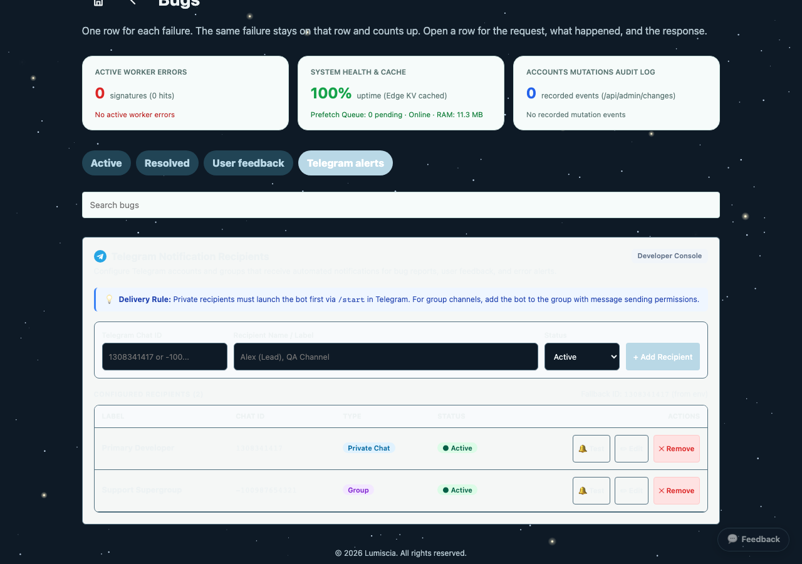

# План реализации управления получателями Telegram-уведомлений разработчика

> [!WARNING]
> Запрещено задевать, модифицировать или ломать функционал, не относящийся к текущей задаче. Выполняемая задача строго и изолированно затрагивает функционал вкладки управления получателями Telegram в разделе разработчика Bugs и доставку уведомлений обратной связи в [src/feedback.mjs](file:///Users/tsovakpalakian/PycharmProjects/english-quiz/src/feedback.mjs). Функционал пайплайнов CI/CD в [ops/telegram-notify.mjs](file:///Users/tsovakpalakian/PycharmProjects/english-quiz/ops/telegram-notify.mjs), авторизация через Telegram в [src/telegram-oauth.mjs](file:///Users/tsovakpalakian/PycharmProjects/english-quiz/src/telegram-oauth.mjs) и прочие компоненты системы остаются неизменными.

---

### Утвержденный макет интерфейса

### Скриншот 3: Новая отдельная вкладка Telegram alerts в разделе Bugs

### Скриншот 4: Реальная реализация вкладки Telegram alerts в живом браузере

---

### Контрольный список реализации

- 🟩 **Этап 1: Документация и планирование**
  - Подготовка проектного документа в `docs/` с утвержденным скриншотом и изолированным чек-листом.
- 🟩 **Этап 2: Серверная модель данных и API**
  - Реализация функций `getTelegramRecipients`, `setTelegramRecipients`, `testTelegramRecipient` в [src/feedback.mjs](file:///Users/tsovakpalakian/PycharmProjects/english-quiz/src/feedback.mjs).
  - Интеграция эндпоинтов `GET /api/feedback/telegram-recipients`, `POST /api/feedback/telegram-recipients` и `POST /api/feedback/telegram-test` в [src/learning-integrated-worker.mjs](file:///Users/tsovakpalakian/PycharmProjects/english-quiz/src/learning-integrated-worker.mjs).
  - Обновление рассылки `notifyFeedbackTelegram` в [src/feedback.mjs](file:///Users/tsovakpalakian/PycharmProjects/english-quiz/src/feedback.mjs) для отправки всем активным получателям из таблицы `catalog_documents`.
- 🟩 **Этап 3: Клиентский интерфейс раздела Bugs**
  - Добавление кнопки вкладки `Telegram alerts` в разметку [site/preview.html](file:///Users/tsovakpalakian/PycharmProjects/english-quiz/site/preview.html#L2042-L2045).
  - Регистрация вкладки `telegram` в клиентской маршрутизации [client/03-core.js](file:///Users/tsovakpalakian/PycharmProjects/english-quiz/client/03-core.js#L132-L139).
  - Отрисовка формы добавления, таблицы получателей, бейджей статуса, кнопок редактирования, удаления и тестового пинга в [client/24-bugs.js](file:///Users/tsovakpalakian/PycharmProjects/english-quiz/client/24-bugs.js).
- 🟩 **Этап 4: Сборка клиентских бандлов**
  - Запуск `npm run build:preview` для генерации `preview.js`.
- 🟩 **Этап 5: Автоматизированные тесты**
  - Написание модульных тестов API и рассылки в [test/test-telegram-recipients.mjs](file:///Users/tsovakpalakian/PycharmProjects/english-quiz/test/test-telegram-recipients.mjs).
  - Написание визуальных и функциональных UI-тестов в [test/test-telegram-recipients-ui.mjs](file:///Users/tsovakpalakian/PycharmProjects/english-quiz/test/test-telegram-recipients-ui.mjs).
  - Запуск полного набора тестов `npm test` и `ops/check-all.mjs` (240 из 240 тестов успешно пройдены).
- 🟩 **Этап 6: Финальная валидация и отчет**
  - Двойная проверка соответствия утвержденному макету Скриншот 3.
  - Предоставление коммит-сообщения и списка тестовых файлов без расширений.
