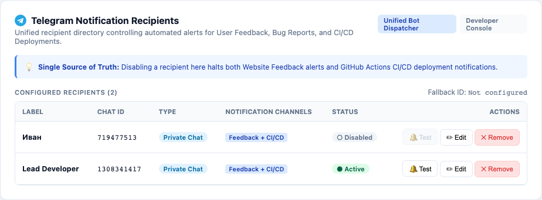

# План реализации единого управления Telegram-уведомлениями (обратная связь и CI/CD)

> [!WARNING]
> Запрещено задевать, модифицировать или ломать функционал, не относящийся к текущей задаче. Выполняемая задача строго и изолированно затрагивает интеграцию получения списка активных получателей в [ops/telegram-notify.mjs](file:///Users/tsovakpalakian/PycharmProjects/english-quiz/ops/telegram-notify.mjs), сервисный эндпоинт `/api/ci/telegram-recipients` в [src/learning-integrated-worker.mjs](file:///Users/tsovakpalakian/PycharmProjects/english-quiz/src/learning-integrated-worker.mjs), интерфейс вкладки Telegram в [client/24-bugs.js](file:///Users/tsovakpalakian/PycharmProjects/english-quiz/client/24-bugs.js), а также соответствующие тесты. Все остальные компоненты приложения остаются неизменными.

---

### Утвержденный макет интерфейса

### Скриншот 1: Единое управление получателями уведомлений бота в UI

---

### Контрольный список реализации

- 🟩 **Этап 1: Документация и планирование**
  - Создание проектного документа в `docs/` с изолированным планом, этапами и утвержденным макетом.
- 🟩 **Этап 2: Серверный эндпоинт для CI/CD диспетчера**
  - Добавление эндпоинта `GET /api/ci/telegram-recipients` в [src/learning-integrated-worker.mjs](file:///Users/tsovakpalakian/PycharmProjects/english-quiz/src/learning-integrated-worker.mjs).
  - Авторизация запросов по заголовку `Authorization: Bearer <TELEGRAM_BOT_TOKEN>`.
  - Возврат только активных получателей (`status === 'active'`) из таблицы `catalog_documents`.
- 🟩 **Этап 3: Интеграция диспетчера CI/CD с единым реестром получателей**
  - Обновление функции выборки получателей в [ops/telegram-notify.mjs](file:///Users/tsovakpalakian/PycharmProjects/english-quiz/ops/telegram-notify.mjs) с поддержкой динамического запроса к серверу приложения.
  - Исключение выключенных получателей (статус `disabled`) из отправки результатов сборки и тестов.
  - Сохранение переменной окружения `TELEGRAM_CHAT_ID` в качестве аварийного fallback.
- 🟩 **Этап 4: Обновление интерфейса вкладки Telegram alerts**
  - Обновление текстовых формулировок и бейджа `Unified Bot Dispatcher` в [client/24-bugs.js](file:///Users/tsovakpalakian/PycharmProjects/english-quiz/client/24-bugs.js).
  - Сборка клиентского бандла через `npm run build:preview`.
- 🟩 **Этап 5: Автоматические тесты (модульные, интеграционные и визуальные)**
  - Тестирование эндпоинта `GET /api/ci/telegram-recipients` и логики фильтрации в [test/test-telegram-recipients.mjs](file:///Users/tsovakpalakian/PycharmProjects/english-quiz/test/test-telegram-recipients.mjs).
  - Тестирование динамической доставки в [test/test-ci-telegram-logs.mjs](file:///Users/tsovakpalakian/PycharmProjects/english-quiz/test/test-ci-telegram-logs.mjs).
  - Визуальное UI-тестирование с захватом подтверждающего скриншота в [test/test-telegram-recipients-ui.mjs](file:///Users/tsovakpalakian/PycharmProjects/english-quiz/test/test-telegram-recipients-ui.mjs).
- 🟩 **Этап 6: Сборка продакшен-ассетов и валидация**
  - Запуск `node ops/build-learning-production-assets.mjs`.
  - Прогон целевых тестов.
  - Финальный отчет с обобщенным коммит-сообщением и списком тестов.
